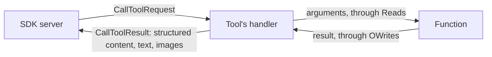

# `mcp` module architecture

## Responsibility

`mcp` bridges play-json and the [MCP Java SDK](https://github.com/modelcontextprotocol/java-sdk), so that an MCP
server declares its tools with play-json's `Reads` and `OWrites`, like the rest of the code reads and writes JSON. It's
a helper, not a wrapper: each server builds its `McpServer` with the SDK's sync API, and uses the SDK directly for what
the helper doesn't cover, such as resources. A tool's logic stays in a service of its domain; the tool only reads its
arguments, calls the service and writes the result.

It is the only module that depends on the SDK: `mcp-core` and `mcp-json-jackson2`, never the `mcp` bundle, which
brings Jackson 3 next to play-json's Jackson 2. The build pins every Jackson artifact to the SDK's version; see
[`build.md`](../../../docs/development/build.md#dependencies). Its tests call the handlers that the helper builds with
the SDK's own requests, so that an SDK release that breaks the tool API fails them.

## Key types

- **`PlayJsonMcp`** — the JSON mapper to give the SDK's transports, a Jackson `ObjectMapper` that also reads and
  writes play-json's `JsValue`s; and the helpers, `tool` and `imageTool`, which build an SDK tool from an input
  `Reads`, an output `OWrites`, an input schema written by hand as a `JsObject`, since play-json derives none, and a
  function.
- **`ImageResult`** — what an `imageTool`'s function returns: PNGs, which the tool's result holds as images beside its
  JSON result.

## Flows

A call to a tool that the helper built:

The SDK checks the arguments against the input schema before the handler runs. Arguments that the `Reads` rejects, and
an exception that the function throws, give a result with `isError` set, which the agent reads, rather than a protocol
error. The exception's stack trace goes to the log.
