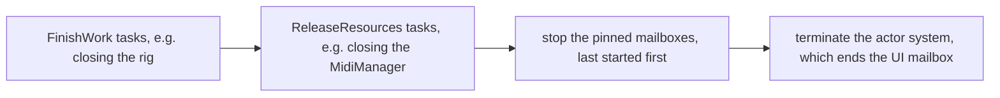

# `messaging-pekko` module architecture

## Responsibility

`messaging-pekko` is the production runtime of [`messaging`](../../messaging/docs/ARCHITECTURE.md): it implements
`MessagingRuntime` on Pekko Typed, and adds the startup and the shutdown of the actor system that runs the mailboxes.
Only `app` is to depend on it: the other modules use `messaging`'s API alone.

## Key types

**`PekkoMessagingRuntime`** starts each mailbox as a system actor of its `ActorSystem`, and shuts the system down.
`start(config)` initialises SLF4J and starts the system, named `microtonalist`; its public API takes no Pekko type.

**`PekkoMailbox`**, `private[pekko]`, is the `Mailbox` over a mailbox's actor.

**`ShutdownPhase`** names the two phases that take the app's shutdown tasks: `FinishWork` and `ReleaseResources`.

**`SingleThreadExecutorConfigurator`** gives a dispatcher a thread of its own: the UI mailbox's default executor.

**Configuration.** The module's `reference.conf` holds, under `microtonalist.messaging`, the pinned and the UI
dispatchers and the mailbox type, and routes Pekko's logging through SLF4J, hence logback.

## The mailbox's actor

Each mailbox runs in an actor of its own, named `mailbox-<n>` from a counter, since a mailbox's name may repeat, as
`Business` does for every bus of a suite, or be no valid actor name, as `Track-Piano 1/2`. The name goes to the thread
only.

- **Pinned.** A mailbox that `startMailbox` starts runs on a `PinnedDispatcher`, which keeps its thread while idle. The
  actor's setup runs on that thread and sets its name and priority there.
- **Control-aware.** Every mailbox uses Pekko's `UnboundedControlAwareMailbox`. A normal message is sent as it is, so
  the note path allocates nothing of ours; an `Urgent` one travels in an `UrgentEnvelope`, a `ControlMessage`, which
  overtakes the queued normal messages, and the actor unwraps it.
- **Stop.** `stop()` sets a flag, from which on `enqueue` drops its messages, and sends an internal `Stop` behind the
  queued messages. The actor stops once it reads it, and its `PostStop` completes the `Future` that every `stop()`
  call returns.

## The UI mailbox

The UI mailbox runs on dispatcher `microtonalist.messaging.ui-dispatcher`, one message at a time (`throughput = 1`),
on the thread of the executor that its configuration names. The default, `SingleThreadExecutorConfigurator`, serves an
app without a toolkit and the tests; without it, Pekko would fall back to its default dispatcher's pool, whose thread
changes between messages. `app` overrides the dispatcher's `executor` in its configuration with its toolkit's.

The toolkit's thread isn't the runtime's to name or to prioritise. `startUiMailbox` returns once the actor's setup has
recorded that thread, waiting up to `UiStartTimeout`.

## Shutdown

`shutdown()` runs Pekko's `CoordinatedShutdown`, or returns the run in progress, and its `Future` completes once the
actor system has terminated:

`addShutdownTask` adds a task to a phase: `FinishWork` is Pekko's `service-requests-done`, and `ReleaseResources` its
`service-stop`. In `before-actor-system-terminate`, the runtime stops each pinned mailbox still running once the one
started after it has stopped: the tracks', then the Business mailbox. Pekko's JVM shutdown hook runs the sequence on exit in production; the tests' configuration turns it off.

## Errors

| Case | Outcome |
| ---- | ------- |
| A non-fatal exception escapes a handler | Logged at ERROR as `A message of mailbox <name> failed.`, with the exception; the mailbox goes on, so Pekko's supervision never stops it |
| `startMailbox` gets a priority outside `Thread.MIN_PRIORITY..Thread.MAX_PRIORITY` | `IllegalArgumentException` on the caller's thread |
| `startUiMailbox`'s actor doesn't record its thread in time, e.g. because the call ran on that thread | `IllegalStateException` |
| A message is enqueued after `stop()` | Dropped; one that races `stop()` may still reach Pekko's dead letters, which log it |

## Testing

`PekkoTestRuntime` is the `MessagingTestRuntime` of `messaging-pekko`, over a `PekkoMessagingRuntime` built on the
system of a suite's `ActorTestKit`, so that a case costs only its mailboxes' threads. It counts the messages in flight,
which `awaitIdle` waits to reach zero, runs `onToolkit` on the UI dispatcher's thread, and captures the logs of the
mailboxes' threads. `PekkoTestSupport` starts the test kits, on `application-test.conf`, and holds the timeout of the
waits.

`PekkoMessageBusTest` and `PekkoFutureContinuationsTest` run `messaging`'s shared behaviors, `MessageBusBehaviors` and
`FutureContinuationsBehaviors`, on it; `PekkoMessagingRuntimeTest` tests the runtime itself.

## Subject to change

- `app` adopts the runtime, with Swing's executor for the UI mailbox, in #388.
- What becomes of MIDI sent to a track after its `Close`, including the messages that race `stop()`, is #391.
- The JavaFX executor of the UI mailbox is #393.
