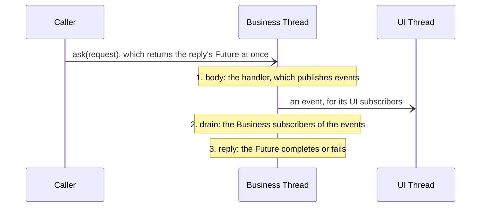

# `messaging` module architecture

## Responsibility

`messaging` is the messaging layer of the threading model: it runs commands one at a time on the Business Thread,
delivers events to subscribers on the Business or the UI Thread, and continues `Future`s on either thread. Domain state
touched only there needs no locks.

It holds the API, the dispatch logic and the runtime interface, and leaves the threads to a runtime. It knows nothing
of the domain and depends on no Pekko, JavaFX or Guava, only on `common`.

## Key types

**Messages.** A `Command` has exactly one handler, registered for its class or for a supertype, so that one handler
can serve a sealed family. A `Request[R]` is a command with a reply. An event is any `AnyRef`, so a library's events
need no wrapper; it reaches the subscribers of its class and of its supertypes. Both are immutable values.

**`MessageBus`** is the API: `dispatch`, `ask` and `publish` from any thread, `handle`, `handleRequest`, `subscribe`
and `subscribeOnUi` to register, and the thread checks `requireBusinessThread` and `requireUiThread`. Constructing it
starts the Business mailbox, named `Business`, then the UI mailbox. `subscribe` returns a `Subscription`, which
cancels it.

**Continuations.** The `Future` extension methods `mapOnBusiness`, `flatMapOnBusiness`, `onCompleteOnBusiness`,
`mapOnUi` and `onCompleteOnUi`, which take a `given MessageBus`, continue a `Future` on their thread, and may be called
on that thread only, so that they continue work started there.

**Runtime interface.** `MessagingRuntime` starts each `Mailbox`: one on a named thread of its own, at a given
priority, and the UI toolkit's. A mailbox runs its messages one at a time, in arrival order, save that an `Urgent` one
overtakes the others queued. `ManualRuntime`, in the test sources, implements it for tests.

Inside, `CommandHandlers` resolves a command's class to its handler, caching the resolution per class, and
`Subscribers` is the copy-on-write subscription registry.

## Flows

### A Business message

Every message on the Business Thread, whether it runs a command, delivers an event or runs a continuation, goes
through three steps:

1. **Body.** An event it publishes for Business subscribers joins a local queue; one for UI subscribers is enqueued
   to the UI mailbox at once.
2. **Drain.** The Business subscribers of the queued events run, and the events they publish join the queue. So no
   subscriber runs nested in the publisher's code, and everything a command causes on Business runs before the next
   message.
3. **Reply.** An `ask`'s reply completes with the outcome of the handler's `Future` if it has completed by then;
   otherwise in a Business message of its own, once it completes. Either way, the events published up to the reply
   reach their subscribers first, and a `mapOnUi` continuation of the reply runs after the UI ones.

An event published off the Business Thread is enqueued to the Business mailbox. Subscribers are matched when the event
is published: a thread with no matching subscriber gets no message, and a subscription cancelled before its delivery
is skipped.

### The causing command

Each `dispatch` and `ask` gives its command an id, from a counter per bus. The messages it causes carry the id: its
handler's, the deliveries of the events published there and by their subscribers, and the continuations started
there. The stamp is internal for now; tests read it with `ManualRuntime.causingCommandId`.

### Continuations

A continuation runs in a message of its own on its thread, stamped with the cause captured at the call. On Business,
it is a Business message like the others, so its events are drained after it. The continuations run on private
`ExecutionContext`s, so that no other thread can run a lambda on Business.

## Errors

A command or request that matches no handler, or several, throws `IllegalStateException` on the caller's thread, as
does an `ask` of a request handled with `handle`. Registering a handler for a class related to a handled one throws
`IllegalArgumentException`.

An exception thrown on either thread is logged at ERROR, with the exception, and the mailbox goes on:

| Thrown by | Logged as |
| --------- | --------- |
| A handler, or the `Future` of a request sent with `dispatch`, failing at once or later | `The handler of <command> failed.` |
| A subscriber; the other subscribers still run | `A subscriber of <event> failed.` |
| An `onComplete…` continuation | `A continuation failed.` |

On Business, the first of them also fails the reply of the `ask` that caused it, once the message's drain is over. On
the UI Thread it is only logged, since the reply has usually completed by then. The failed `Future` of an asked request
isn't logged, since the reply carries it, and a `map…` continuation that throws fails the `Future` it returns.

## Threading

The Business Thread runs at `Thread.NORM_PRIORITY`, and only its messages. The UI Thread is the toolkit's, which also
runs UI code outside the messages; so `startUiMailbox` returns only once the mailbox has recorded its thread, while
`startMailbox` returns at once. The thread checks compare `Thread.currentThread` with the mailbox's.

**The refused `Await`.** Each Business and UI message runs inside a `BlockContext` that refuses to block: there,
`Await` on a `Future` that hasn't completed, and `scala.concurrent.blocking`, throw `IllegalStateException`. On
Business, awaiting an `ask`'s reply would otherwise deadlock, since its handler runs only after the await. The check
misses code that the toolkit calls directly, and blocking without `Await`, e.g. on a latch.

## Testing

`ManualRuntime`'s mailboxes run their messages only when a test drains them, with `drainAll()` or a `ManualMailbox`'s
`drain()`, on the test's thread. That thread counts as the mailbox's while it runs one of its messages, so the thread
checks behave as in production, and the messages run in production order. A module whose tests use it depends on
`messaging` with `"compile->compile;test->test"`.

## Subject to change

- No module uses `messaging` yet: the modules move to it from `businessync` in #388.
- The production runtime, on Pekko, is #387.
