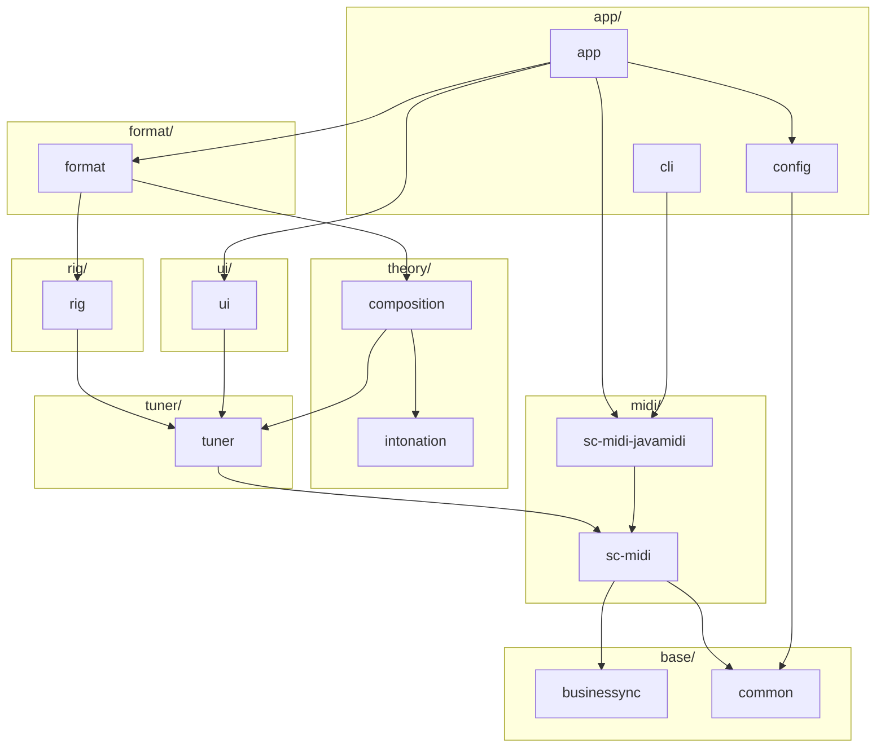

# Module overview

A *module* is an SBT project. Modules are organized in *module groups*: each group is a folder at the repository root
that holds the modules of one area, `<group>/<module>/`. A group's `README.md` lists every module in it, with its root
package; the group's `CLAUDE.md` imports that README, so an agent gets it when working in the group.

## Module groups

| Group | Area |
| ----- | ---- |
| [`base`](../../base/README.md) | Infrastructure: shared utilities, and the event bus with its threading model |
| [`theory`](../../theory/README.md) | Music theory: interval math and the composition model |
| [`midi`](../../midi/README.md) | A Scala-idiomatic MIDI API over Java Sound |
| [`tuner`](../../tuner/README.md) | Real-time tuning of the instruments over MIDI |
| [`rig`](../../rig/README.md) | The tracks a performer plays, one per instrument |
| [`format`](../../format/README.md) | Persistence of compositions, scales and rigs, in local files or over HTTP(S) |
| [`ui`](../../ui/README.md) | The desktop GUI |
| [`app`](../../app/README.md) | The application layer: the executables, and their configuration and wiring |

## Main modules

| Module | Group | Description |
| ------ | ----- | ----------- |
| `app` | `app` | The desktop application, which wires the modules together |
| `config` | `app` | HOCON configuration of the application |
| `cli` | `app` | Command-line utility tool, e.g. for listing the MIDI devices |
| `ui` | `ui` | Swing GUI |
| `format` | `format` | JSON (de)serialization of compositions, scales and rigs |
| `rig` | `rig` | The tracks, each routing MIDI from an input to an output through a tuning changer and a tuner |
| `tuner` | `tuner` | MIDI tuning engine: tuners, tuning changers and the tuning session |
| `composition` | `theory` | The composition model, which turns scales into tunings |
| `intonation` | `theory` | Interval math |
| `sc-midi-javamidi` | `midi` | Java Sound implementation of `sc-midi`, with CoreMIDI4J |
| `sc-midi` | `midi` | Scala-idiomatic MIDI API |
| `businessync` | `base` | Event bus and threading |
| `common` | `base` | Shared utilities |

## Dependencies

The main modules and their direct dependencies, leaving out those that others imply; `build.sbt` has them all.

