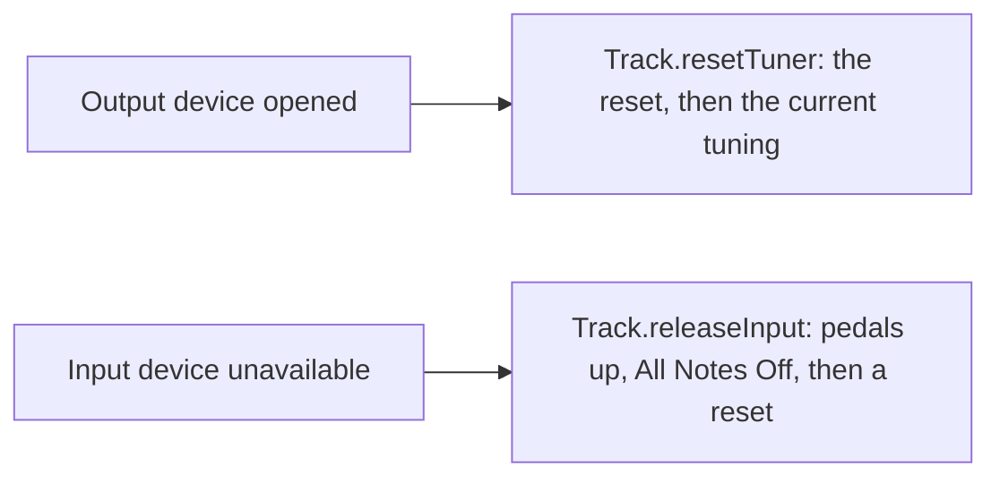

# #363 Extract a `rig` module from `tuner` Implementation Plan

> **For agentic workers:** REQUIRED SUB-SKILL: Use superpowers:subagent-driven-development (recommended) or
> superpowers:executing-plans to implement this plan task-by-task. Steps use checkbox (`- [ ]`) syntax for tracking.

- Date: 2026-10-15
- Base: `refactoring/track-module` at `4e51284f` (`main` at `d1e49bdf`), draft PR #364. The branch and the
  `issues/00363-track-module/` directory keep their names, so that the PR and its links stay valid.
- Issue: [#363](https://github.com/calinburloiu/microtonalist/issues/363)

**Goal:** Move the rig (the setup of tracks, each a per-instrument MIDI pipeline) out of `tuner` into a new `rig`
module that depends on `tuner`, and name the types that hold the whole setup after the rig, without changing behaviour.

**Architecture:** First rename the rig types in place (`TrackSpecs` → `RigSpec`, `TrackSession` → `RigSession`, …).
Then `git mv` ten production files and eight test files from `tuner` to `rig`, change their package to
`org.calinburloiu.music.microtonalist.rig` and import the engine types they use. `TunerModule` shrinks to the tuning
session and service; a new `RigModule` wires the rig manager, session and service, and `MicrotonalistApp` builds both.
`format` and `app` import the moved types from their new package.

**Tech Stack:** Scala 3.9, sbt 1 (through `sbtn` on the dev stack's BSP server), Metals MCP, ScalaTest `AnyWordSpec`,
ScalaMock 7.6 `Stubs`.

**Spec:** [`2026-10-15-design.md`](2026-10-15-design.md). It is the source of truth; this plan only adds the mechanics.

## Global Constraints

- **No behaviour change.** Every commit compiles and keeps the whole suite green. No string literal of production code
  changes.
- Renames: exactly those of the design's "Naming" section. The tracks file (`TrackFormat`, `JsonTrackFormat`,
  `JsonTrackIOPluginFormat`, `InvalidTrackFormatException`, `FormatModule.trackFormat`, the JSON schemas, the
  `.mtlist.tracks` extension) keeps its names, for a follow-up issue.
- Module: directory `rig`, `lazy val rigModule`, `.withId("rig")`, `name := "microtonalist-rig"`.
- Root package: `org.calinburloiu.music.microtonalist.rig`. No split package: nothing in `rig` keeps the `tuner`
  package.
- `rig` depends on `tuner`, `businessync`, `common`, `sc-midi`, plus `commonTestUtilsModule % Test`; it declares
  `jsr305`. Nothing in `tuner` depends on `rig`. `format` and `app` add `rigModule`; `ui` and `composition` don't
  change; `root` aggregates `rigModule`.
- Coverage: `tuner` and `rig` both get `coverageSettings(stmt = 80, branch = 80)`. If `rig` measures under 80%, it gets
  a floor 3% below the measured value and a `// TODO #<n>` naming a follow-up issue. `RigModule` is held to 80% either
  way.
- Tests: `rig` gets **trimmed copies** of `FakeTuner` (only `resetMessages`, `tuningMessages`, `processMessages`,
  `processedMessages`) and `TestTunings` (only `justCMaj`, `justCRast`). No `tuner-test-utils` module, no `test->test`
  dependency, no shared source directory.
- Move and rename files with `git mv` and keep the edits small, so that git detects the renames.
- Commit messages start with `[#363] ` and end with the line
  `Co-Authored-By: Claude Opus 5.5 <noreply@anthropic.com>`.
- Compile with the Metals MCP (`mcp__metals__compile-full`, `mcp__metals__compile-module`); run tests with
  `sbtn "<module>/testOnly <class or *> -- -oNCXEHLOPQRMWS"`. After a `build.sbt` change, run
  `bin/mtlist-dev-stack restart` (10-minute timeout) so that Metals re-imports the build.
- Don't use git worktrees; work on `refactoring/track-module`.
- New `.scala` files are written **without** a license header: the pre-commit hook adds it. `Read` hides the header of
  existing files, so they appear to start at about line 17.
- TDD: Tasks 1 and 3 are pure renames and moves, guarded by the existing suite (green before, green after). Following
  the design's order, `RigModuleTest` (Task 4) comes after `RigModule` exists, so Task 4 gets its red evidence by
  breaking `RigModule` on purpose and watching each test fail.

## Review Focus

1. **Tuning changes stop reaching the tracks** if `RigModule` no longer registers its `RigManager` on the bus when it
   is built. Pinned by Task 4, "retune its tracks when the tunings of the tuning session change".
2. **Shutdown leaves outputs detuned or devices held** if `RigModule.close()` doesn't close the tracks. Pinned by Task
   4, "close its tracks, switching their outputs back to 12-EDO and releasing their devices, when closed".
3. **Opening tracks reaches the wrong collaborators** if `RigModule` wires `rigService` to anything but the `RigRepo`
   and `MidiManager` it is given. Pinned by Task 4, "open the tracks read from its repo through its rig service".
4. **A composition without a tracks file** builds `RigModule` but never touches `rigService`; shutdown must still close
   it cleanly. Pinned by Task 4, "close without releasing any device when no tracks were opened".
5. **ScalaDoc links that silently stop resolving.** Scala 3's Scaladoc ignores imports (today `tuner/doc` already can't
   resolve the imported `MidiManager`), so every link from a moved file to a `tuner` type breaks with the package
   change. Pinned by the `sbtn rig/doc` check of Task 3 and the `sbtn tuner/doc` check of Task 5.
6. **A rename that reaches the tracks file.** The repo methods `readTracks*` / `writeTracks*` become `readRig*` /
   `writeRig*`, but `TrackFormat`'s methods of the same names stay. Pinned by the `grep` of Task 1, step 4, and by the
   compiler.

`MicrotonalistApp.run` has no test harness (`app`'s coverage floor is 0), so its shutdown order, `rigModule` before
`midiManager`, is checked by reading the diff in Task 3.

---

## File map

Paths below use these prefixes:

- `TUNER_MAIN` = `tuner/src/main/scala/org/calinburloiu/music/microtonalist/tuner`
- `TUNER_TEST` = `tuner/src/test/scala/org/calinburloiu/music/microtonalist/tuner`
- `RIG_MAIN` = `rig/src/main/scala/org/calinburloiu/music/microtonalist/rig`
- `RIG_TEST` = `rig/src/test/scala/org/calinburloiu/music/microtonalist/rig`
- `FORMAT_MAIN` = `format/src/main/scala/org/calinburloiu/music/microtonalist/format`
- `FORMAT_TEST` = `format/src/test/scala/org/calinburloiu/music/microtonalist/format`

| Change | Files |
| ------ | ----- |
| Rename in place (Task 1) | `TUNER_MAIN`: `TrackEvent` → `RigEvent`, `TrackManager` → `RigManager`, `TrackRepo` → `RigRepo`, `TrackService` → `RigService`, `TrackSession` → `RigSession`, `TrackSpecs` → `RigSpec`; `TUNER_TEST`: `TrackManagerTest` → `RigManagerTest`, `TrackServiceTest` → `RigServiceTest`, `TrackSessionTest` → `RigSessionTest`; `FORMAT_MAIN`: `DefaultTrackRepo`, `FileTrackRepo`, `HttpTrackRepo`, `LibraryTrackRepo` → `*RigRepo` (`.scala`) |
| Move to `RIG_MAIN` (Task 3) | `Track`, `RigEvent`, `TrackIO`, `RigManager`, `RigRepo`, `RigService`, `RigSession`, `RigSpec`, `TunerProcessor`, `TuningChangeProcessor` (`.scala`) |
| Move to `RIG_TEST` (Task 3) | `TrackTest`, `RigManagerTest`, `RigSessionTest`, `RigServiceTest`, `TunerProcessorTest`, `TuningChangeProcessorTest`, `RecordingMidiReceiver`, `FakeMidiDeviceHandle` (`.scala`) |
| Create | `rig/CLAUDE.md`, `RIG_MAIN/RigModule.scala`, `RIG_TEST/FakeTuner.scala`, `RIG_TEST/TestTunings.scala`, `RIG_TEST/RigModuleTest.scala`, `docs/architecture/rig/README.md` |
| Modify | `build.sbt`, `TUNER_MAIN/TunerModule.scala`, `TUNER_MAIN/Tuner.scala`, `TUNER_MAIN/Track.scala`, `TUNER_MAIN/TunerProcessor.scala`, `app/src/main/scala/org/calinburloiu/music/microtonalist/MicrotonalistApp.scala`, `format` files (Task 1, Task 3 step 10), `docs/agents/linting.md`, `docs/development/linting.md`, ten docs under `docs/architecture/` (Task 6) |

---

### Task 1: Rename the rig types in place

**Files:**

- Rename: the 13 files of the file map's first row
- Modify: every `.scala` file of `tuner`, `format` and `app` that names a renamed type, value or method;
  `docs/agents/linting.md`, `docs/development/linting.md`

**Interfaces:**

- Produces, still in package `org.calinburloiu.music.microtonalist.tuner`: `RigSpec`, `RigSession`, `RigService`,
  `RigManager`, `RigRepo` (`readRig(uri: URI): RigSpec`, `readRigAsync(uri: URI): Future[RigSpec]`,
  `writeRig(rigSpec: RigSpec, uri: URI): Unit`, `writeRigAsync(rigSpec: RigSpec, uri: URI): Future[Unit]`),
  `RigRepoException`, `RigNotFoundException`, `BadRigRequestException`, `RigEvent`, `RigOpenedEvent`, `RigClosedEvent`,
  `RigReplacedEvent`; `TunerModule.rigService`. In `format`: `DefaultRigRepo`, `FileRigRepo`, `HttpRigRepo`,
  `LibraryRigRepo`, `FormatModule.{fileRigRepo, httpRigRepo, libraryRigRepo, defaultRigRepo}`.

- [ ] **Step 1: Open the follow-up issue for the tracks file**

Invoke the `contributing` skill and open an issue (type `Task`/refactoring per the skill, milestone `Architecture`
if the skill's rules fit) titled "Rename the tracks file after the rig". Its body: after #363, the types that hold the
setup of tracks are named after the rig, but the tracks file keeps its old names; rename `TrackFormat`,
`JsonTrackFormat`, `JsonTrackIOPluginFormat`, `InvalidTrackFormatException`, `FormatModule.trackFormat` and their
`readTracks*` / `writeTracks*` methods, the JSON schemas under `json-schemas/v1/track/`, and the `.mtlist.tracks`
extension (with a migration story for existing files). Write its number down as `<n>` for steps 6 and Task 6.

- [ ] **Step 2: Rename the files with `git mv`**

```bash
TUNER_MAIN=tuner/src/main/scala/org/calinburloiu/music/microtonalist/tuner
TUNER_TEST=tuner/src/test/scala/org/calinburloiu/music/microtonalist/tuner
FORMAT_MAIN=format/src/main/scala/org/calinburloiu/music/microtonalist/format
git mv "$TUNER_MAIN/TrackEvent.scala" "$TUNER_MAIN/RigEvent.scala"
git mv "$TUNER_MAIN/TrackManager.scala" "$TUNER_MAIN/RigManager.scala"
git mv "$TUNER_MAIN/TrackRepo.scala" "$TUNER_MAIN/RigRepo.scala"
git mv "$TUNER_MAIN/TrackService.scala" "$TUNER_MAIN/RigService.scala"
git mv "$TUNER_MAIN/TrackSession.scala" "$TUNER_MAIN/RigSession.scala"
git mv "$TUNER_MAIN/TrackSpecs.scala" "$TUNER_MAIN/RigSpec.scala"
git mv "$TUNER_TEST/TrackManagerTest.scala" "$TUNER_TEST/RigManagerTest.scala"
git mv "$TUNER_TEST/TrackServiceTest.scala" "$TUNER_TEST/RigServiceTest.scala"
git mv "$TUNER_TEST/TrackSessionTest.scala" "$TUNER_TEST/RigSessionTest.scala"
for p in Default File Http Library; do
  git mv "$FORMAT_MAIN/${p}TrackRepo.scala" "$FORMAT_MAIN/${p}RigRepo.scala"
done
git status --short | grep -c '^R'
```

Expected: `13`.

- [ ] **Step 3: Rename the types, values and parameters**

```bash
perl -pi -e '
  s/\bTrackSpecs\b/RigSpec/g;
  s/\bTrack(Session|Service|Manager)(?=(Test)?\b)/Rig$1/g;
  s/\bTrackRepoException\b/RigRepoException/g;
  s/\b(Default|File|Http|Library)TrackRepo\b/$1RigRepo/g;
  s/\bTrackRepo\b/RigRepo/g;
  s/\bTracksNotFoundException\b/RigNotFoundException/g;
  s/\bBadTracksRequestException\b/BadRigRequestException/g;
  s/\bTrackEvent\b/RigEvent/g;
  s/\bTracks(Opened|Closed|Replaced)Event\b/Rig$1Event/g;
  s/\btrackSpecs(?=(Format)?\b)/rigSpec/g;
  s/\btrack(Session|Service)\b/rig$1/g;
  s/\btrackManager(?=(Mock)?\b)/rigManager/g;
  s/\b(default|file|http|library)TrackRepo\b/$1RigRepo/g;
  s/\btrackRepo(?=(Selector)?\b)/rigRepo/g;
  s/\btrack (session|service)\b/rig $1/g;
' $(git ls-files 'tuner/src/*.scala' 'format/src/*.scala' 'app/src/*.scala')
rg -n -i '\b[a-z]*(trackspecs|tracksession|trackservice|trackmanager|trackrepo|trackevent|tracks(opened|closed|replaced)|tracksnotfound|badtracks)' tuner/src format/src app/src
```

Expected: the `rg` prints nothing. No production string literal names a renamed type (checked while writing this plan),
so only the two test names of `RigServiceTest` that named `TrackSession` and `TrackSpecs` change among the strings.

- [ ] **Step 4: Rename the methods of `RigRepo` and its implementations**

`TrackFormat` has methods of the same names, which stay; its calls are the only lines that mention `trackFormat.`.

```bash
TUNER_MAIN=tuner/src/main/scala/org/calinburloiu/music/microtonalist/tuner
TUNER_TEST=tuner/src/test/scala/org/calinburloiu/music/microtonalist/tuner
FORMAT_MAIN=format/src/main/scala/org/calinburloiu/music/microtonalist/format
FORMAT_TEST=format/src/test/scala/org/calinburloiu/music/microtonalist/format
perl -pi -e 's/\b(read|write)Tracks(Async)?\b/$1Rig$2/g unless /trackFormat\./' \
  "$TUNER_MAIN/RigRepo.scala" "$TUNER_MAIN/RigSession.scala" "$TUNER_TEST/RigSessionTest.scala" \
  "$FORMAT_MAIN/DefaultRigRepo.scala" "$FORMAT_MAIN/FileRigRepo.scala" "$FORMAT_MAIN/HttpRigRepo.scala" \
  "$FORMAT_MAIN/LibraryRigRepo.scala" "$FORMAT_TEST/FormatTestUtils.scala" "$FORMAT_TEST/JsonTrackFormatTest.scala"
rg -n -w '(read|write)Tracks(Async)?' tuner/src format/src app/src | rg -v '/(Json)?TrackFormat\.scala:'
```

Expected: the last command prints only the two `trackFormat.readTracksAsync(` calls, in `FileRigRepo.scala` and
`HttpRigRepo.scala`.

- [ ] **Step 5: Reword the class ScalaDocs after the rig**

Each sentence below replaces the first sentence of the class's ScalaDoc; the rest stays.

| File | New first sentence |
| ---- | ------------------ |
| `TUNER_MAIN/RigSpec.scala` (`case class RigSpec`) | `Specification of a rig, the setup of tracks: a list of [[TrackSpec]] instances that allows querying a basic list update operations.` (keep the next sentence, about uniqueness and `O(1)` access) |
| `TUNER_MAIN/RigSession.scala` | `Manages the rig, a sequence of tracks, by providing loading/unloading (I/O) and editing operations.` |
| `TUNER_MAIN/RigService.scala` | `Service that exposes the management of the rig to the application layer.` |
| `TUNER_MAIN/RigManager.scala` | `Manages the MIDI tracks of the rig and updates them based on external events: …` (only "a collection of MIDI tracks" becomes "the MIDI tracks of the rig") |
| `TUNER_MAIN/RigRepo.scala` (`trait RigRepo`) | `Repository pattern trait used for retrieving or persisting rigs, stored in tracks files identified by URI.` |

- [ ] **Step 6: Mark `TrackFormat` for the follow-up**

In `FORMAT_MAIN/TrackFormat.scala`, add above the ScalaDoc of `trait TrackFormat`, followed by a blank line, as
`TrackManager`'s `// TODO #121` was:

```scala
// TODO #<n> Rename after the rig, with the extension and the JSON schemas of the tracks file.
```

- [ ] **Step 7: Rename the example of the linting guides**

```bash
perl -pi -e 's/`TrackManager`/`RigManager`/g' docs/agents/linting.md docs/development/linting.md
git diff --stat -- docs
```

Expected: one line changes in each guide.

- [ ] **Step 8: Compile**

Call `mcp__metals__compile-full`.
Expected: success, with only the two existing deprecation warnings (`TuningServiceTest.scala`, `TuningListFrame.scala`).

- [ ] **Step 9: Run the tests of the three modules**

```bash
sbtn "tuner/testOnly * -- -oNCXEHLOPQRMWS"
sbtn "format/testOnly * -- -oNCXEHLOPQRMWS"
sbtn "app/testOnly * -- -oNCXEHLOPQRMWS"
```

Expected: all pass.

- [ ] **Step 10: Format and commit**

Run: `sbtn fix`
Expected: success; it re-sorts the import selectors whose names changed (e.g. `{RigSpec, TrackSpec}`).

```bash
git add -A tuner format app docs/agents/linting.md docs/development/linting.md
git commit -m "$(cat <<'EOF'
[#363] Name the types of the setup of tracks after the rig

A rig is the setup of tracks: TrackSpecs, TrackSession, TrackService,
TrackManager, TrackRepo, its implementations, exceptions and events are
renamed after it. The tracks file keeps its names until #<n>.

Co-Authored-By: Claude Opus 5.5 <noreply@anthropic.com>
EOF
)"
git show --stat -M HEAD | grep -c '=>'
```

Expected: the last command prints `13` (every renamed file detected as a rename).

---

### Task 2: Add the empty `rig` module

**Files:**

- Modify: `build.sbt` (the `root` aggregate; a new `rigModule` after `tunerModule`)
- Create: `rig/CLAUDE.md`

**Interfaces:**

- Produces: the sbt project `rig` (`lazy val rigModule`), and the Metals build targets `rig` and `rig-test`.

- [ ] **Step 1: Add `rigModule` to `build.sbt`**

In `root`'s `.aggregate(...)`, add `rigModule,` on the line after `tunerModule,`:

```scala
    compositionModule,
    tunerModule,
    rigModule,
    formatModule,
```

Right after the whole `lazy val tunerModule = ...` definition (before `lazy val formatModule`), add:

```scala
lazy val rigModule = (project in file("rig"))
  .withId("rig")
  .dependsOn(
    businessyncModule,
    commonModule,
    commonTestUtilsModule % Test,
    scMidiModule,
    tunerModule,
  )
  .disablePlugins(AssemblyPlugin)
  .settings(
    name := "microtonalist-rig",
    commonSettings,
    libraryDependencies ++= Seq(
      jsr305,
    ),
    coverageSettings(stmt = 80, branch = 80),
  )
```

- [ ] **Step 2: Create `rig/CLAUDE.md`**

```markdown
# `rig` module

@../docs/architecture/rig/README.md
```

The imported README is written in Task 6; until then the import has no target, which Claude Code ignores.

- [ ] **Step 3: Restart the dev stack so that Metals imports the new module**

Run: `bin/mtlist-dev-stack restart` (timeout 600000 ms)
Expected: exit 0. Then call `mcp__metals__list-modules`.
Expected: the list contains `rig` and `rig-test`.

- [ ] **Step 4: Compile**

Call `mcp__metals__compile-full`.
Expected: success, with only the two existing deprecation warnings.

Run: `sbtn 'show rig/target'`
Expected: a path ending in `rig/target-bsp`.

- [ ] **Step 5: Commit**

```bash
git add build.sbt rig/CLAUDE.md
git commit -m "$(cat <<'EOF'
[#363] Add an empty rig module

Co-Authored-By: Claude Opus 5.5 <noreply@anthropic.com>
EOF
)"
```

---

### Task 3: Move the rig to `rig`

Everything in this task lands in **one commit**: moving the rig breaks `format` and `app` until their imports change.

**Files:**

- Modify: `build.sbt` (`appModule`, `formatModule`)
- Move: the 10 production and 8 test files of the file map
- Create: `RIG_TEST/FakeTuner.scala`, `RIG_TEST/TestTunings.scala`, `RIG_MAIN/RigModule.scala`
- Modify: `TUNER_MAIN/TunerModule.scala`, `MicrotonalistApp.scala`, the `format` files of step 10

**Interfaces:**

- Consumes: the `rig` sbt project (Task 2) and the renamed types (Task 1).
- Produces:
  - `org.calinburloiu.music.microtonalist.rig.RigModule(businessync: Businessync, rigRepo: RigRepo, midiManager:
    MidiManager, tuningService: TuningService) extends AutoCloseable`, with `lazy val rigService: RigService` and
    `close(): Unit`.
  - `org.calinburloiu.music.microtonalist.tuner.TunerModule(businessync: Businessync)` (no longer `AutoCloseable`),
    with `lazy val tuningService: TuningService` and `lazy val tuningSession: TuningSession`.
  - Test helpers in package `rig`: `FakeTuner(resetMessages: Seq[MidiMsg] = Seq.empty, tuningMessages: Map[Tuning,
    Seq[MidiMsg]] = Map.empty, processMessages: Map[MidiMsg, Seq[MidiMsg]] = Map.empty)` with `processedMessages:
    Seq[MidiMsg]`; `TestTunings.justCMaj`, `TestTunings.justCRast`; and the moved `RecordingMidiReceiver` and
    `FakeMidiDeviceHandle`.
  - Every moved type keeps its (Task 1) name, in package `org.calinburloiu.music.microtonalist.rig`.

- [ ] **Step 1: Add `rigModule` to the dependencies of `format` and `app`**

In `build.sbt`, in `appModule`'s `.dependsOn(...)`, add `rigModule,` after `formatModule,`:

```scala
    formatModule,
    rigModule,
    scMidiModule,
    tunerModule,
```

In `formatModule`'s `.dependsOn(...)`, add `rigModule,` after `compositionModule,`:

```scala
    compositionModule,
    rigModule,
    tunerModule,
```

Run: `bin/mtlist-dev-stack restart` (timeout 600000 ms)
Expected: exit 0.

- [ ] **Step 2: Move the files with `git mv`**

```bash
TUNER_MAIN=tuner/src/main/scala/org/calinburloiu/music/microtonalist/tuner
TUNER_TEST=tuner/src/test/scala/org/calinburloiu/music/microtonalist/tuner
RIG_MAIN=rig/src/main/scala/org/calinburloiu/music/microtonalist/rig
RIG_TEST=rig/src/test/scala/org/calinburloiu/music/microtonalist/rig
mkdir -p "$RIG_MAIN" "$RIG_TEST"
for f in Track RigEvent TrackIO RigManager RigRepo RigService RigSession RigSpec TunerProcessor \
    TuningChangeProcessor; do
  git mv "$TUNER_MAIN/$f.scala" "$RIG_MAIN/$f.scala"
done
for f in TrackTest RigManagerTest RigSessionTest RigServiceTest TunerProcessorTest TuningChangeProcessorTest \
    RecordingMidiReceiver FakeMidiDeviceHandle; do
  git mv "$TUNER_TEST/$f.scala" "$RIG_TEST/$f.scala"
done
git status --short | grep -c '^R'
```

Expected: `18`.

- [ ] **Step 3: Change the package of the moved files**

```bash
perl -pi -e 's/^package org\.calinburloiu\.music\.microtonalist\.tuner$/package org.calinburloiu.music.microtonalist.rig/' \
  rig/src/main/scala/org/calinburloiu/music/microtonalist/rig/*.scala \
  rig/src/test/scala/org/calinburloiu/music/microtonalist/rig/*.scala
grep -L '^package org.calinburloiu.music.microtonalist.rig$' rig/src/*/scala/org/calinburloiu/music/microtonalist/rig/*.scala
```

Expected: the `grep -L` prints nothing.

- [ ] **Step 4: Import the engine types the moved files use**

Add exactly these imports; the other moved files (`RigEvent`, `TrackIO`, `RigRepo`, `RigService`, `RigSession`,
`RigSessionTest`, `RigServiceTest`, `RecordingMidiReceiver`, `FakeMidiDeviceHandle`) use no `tuner` type. The position
keeps the ASCII order that scalafix's `OrganizeImports` checks; `sbtn fix` (step 15) wraps the lines longer than 120
characters.

| File | Import to add | Where |
| ---- | ------------- | ----- |
| `RIG_MAIN/Track.scala` | `import org.calinburloiu.music.microtonalist.tuner.{Tuning, TuningService}` | after `import com.typesafe.scalalogging.StrictLogging` |
| `RIG_MAIN/RigManager.scala` | `import org.calinburloiu.music.microtonalist.tuner.{Tuning, TuningEvent, TuningService}` | after `import com.typesafe.scalalogging.{LazyLogging, StrictLogging}` |
| `RIG_MAIN/RigSpec.scala` | `import org.calinburloiu.music.microtonalist.tuner.{Tuner, TuningChanger}` | after the `package` line, with a blank line before and after |
| `RIG_MAIN/TunerProcessor.scala` | `import org.calinburloiu.music.microtonalist.tuner.{Tuner, Tuning}` | after `import com.typesafe.scalalogging.StrictLogging` |
| `RIG_MAIN/TuningChangeProcessor.scala` | `import org.calinburloiu.music.microtonalist.tuner.{EffectiveTuningChange, NoTuningChange, TuningChange, TuningChanger, TuningService}` | before `import org.calinburloiu.music.scmidi.MidiProcessor` |
| `RIG_TEST/TrackTest.scala` | `import org.calinburloiu.music.microtonalist.tuner.{NoTuningChange, Tuning, TuningChanger, TuningService}` | before `import org.calinburloiu.music.scmidi.message.{` |
| `RIG_TEST/RigManagerTest.scala` | `import org.calinburloiu.music.microtonalist.tuner.{MtsMessageGenerator, MtsOctave1ByteNonRealTimeTuner, Tuner, Tuning, TuningService, TuningSession}` | after `import org.calinburloiu.businessync.Businessync` |
| `RIG_TEST/TunerProcessorTest.scala` | `import org.calinburloiu.music.microtonalist.tuner.Tuning` | before `import org.calinburloiu.music.scmidi.message.{CcMidiMsg, MidiMsg, NoteOnMidiMsg, PitchBendMidiMsg}` |
| `RIG_TEST/TuningChangeProcessorTest.scala` | `import org.calinburloiu.music.microtonalist.tuner.{IndexTuningChange, MayTriggerTuningChange, NextTuningChange, NoTuningChange, TuningChanger, TuningService}` | before `import org.calinburloiu.music.scmidi.message.{CcMidiMsg, MidiCc, MidiMsg, NoteOnMidiMsg}` |

- [ ] **Step 5: Scope `RigManager`'s thread members to `rig`**

```bash
perl -pi -e 's/private\[tuner\]/private[rig]/g' \
  rig/src/main/scala/org/calinburloiu/music/microtonalist/rig/RigManager.scala
grep -rn 'private\[tuner\]' rig/
```

Expected: the `grep` prints nothing. (`TrackThreadsNamePrefix` and `TrackThreadsGroup` are used only inside
`RigManager`.)

- [ ] **Step 6: Qualify the ScalaDoc links from the moved files to `tuner` types**

Scala 3's Scaladoc resolves a link by the enclosing package, not by the imports, so a `[[Tuner]]` in package `rig` no
longer resolves. A fully qualified link does, across modules.

```bash
RIG_MAIN=rig/src/main/scala/org/calinburloiu/music/microtonalist/rig
perl -pi -e 's/\[\[(Tuner|TuningChanger|TuningChange|NoTuningChange)([.#][A-Za-z]+)?\]\]/[[org.calinburloiu.music.microtonalist.tuner.$1$2]]/g' \
  "$RIG_MAIN/Track.scala" "$RIG_MAIN/RigSpec.scala" "$RIG_MAIN/TunerProcessor.scala" \
  "$RIG_MAIN/TuningChangeProcessor.scala"
grep -oE '\[\[org\.calinburloiu\.music\.microtonalist\.tuner\.[A-Za-z.#]+\]\]' "$RIG_MAIN"/*.scala | wc -l
grep -nE '\[\[(Tuner|TuningChanger|TuningChange|NoTuningChange)([.#][A-Za-z]+)?\]\]' "$RIG_MAIN"/*.scala
```

Expected: the count is `17`: `Track.scala` (`TuningChanger`), `RigSpec.scala` (`TuningChanger`, `TuningChange`,
`Tuner`), `TunerProcessor.scala` (`Tuner` three times, `Tuner.canTune`) and `TuningChangeProcessor.scala`
(`TuningChanger` four times, `TuningChange` three times, `TuningChange#isChanging`, `NoTuningChange`); the second
`grep` prints nothing. `[[Track]]`, `[[TunerProcessor]]` and `[[TuningChangeProcessor]]` stay as they are: they now
live in `rig` too.

- [ ] **Step 7: Add the trimmed test helpers**

Create `RIG_TEST/FakeTuner.scala`:

```scala
package org.calinburloiu.music.microtonalist.rig

import org.calinburloiu.music.microtonalist.tuner.{Tuner, Tuning}
import org.calinburloiu.music.scmidi.message.MidiMsg

import scala.collection.mutable

/**
 * A [[org.calinburloiu.music.microtonalist.tuner.Tuner]] test double that returns canned messages and records the
 * messages it is asked to process. It can apply any tuning. It is not thread-safe.
 *
 * It is a trimmed copy of the `tuner` tests' `FakeTuner`, which `rig`'s tests can't reach: a test-utils module would
 * form a dependency cycle with `tuner`.
 *
 * @param resetMessages What its [[onReset]] returns, which a reset follows with the messages of the current tuning.
 * @param tuningMessages What its [[onTune]] returns for each of these tunings; it returns nothing for any other.
 * @param processMessages What [[process]] returns for each of these messages; it returns nothing for any other.
 */
class FakeTuner(resetMessages: Seq[MidiMsg] = Seq.empty,
                tuningMessages: Map[Tuning, Seq[MidiMsg]] = Map.empty,
                processMessages: Map[MidiMsg, Seq[MidiMsg]] = Map.empty) extends Tuner {
  override val typeName: String = "fake"

  private val _processedMessages: mutable.Buffer[MidiMsg] = mutable.ArrayBuffer()

  /** The messages passed to [[process]] so far, in order. */
  def processedMessages: Seq[MidiMsg] = _processedMessages.toSeq

  override def canTune(tuning: Tuning): Boolean = true

  override protected def onReset(): Seq[MidiMsg] = resetMessages

  override protected def onTune(tuning: Tuning, previousTuning: Option[Tuning]): Seq[MidiMsg] =
    tuningMessages.getOrElse(tuning, Seq.empty)

  override def process(message: MidiMsg): Seq[MidiMsg] = {
    _processedMessages += message
    processMessages.getOrElse(message, Seq.empty)
  }
}
```

Create `RIG_TEST/TestTunings.scala`:

```scala
package org.calinburloiu.music.microtonalist.rig

import org.calinburloiu.music.microtonalist.tuner.Tuning

/** Tunings shared by the tests of `rig`: a trimmed copy of the `tuner` tests' `TestTunings`. */
object TestTunings {
  val justCMaj: Tuning = Tuning("Just C Major",
    c = Some(0.0),
    d = Some(3.91),
    e = Some(-13.69),
    f = Some(-1.96),
    g = Some(1.96),
    a = Some(-15.64),
    b = Some(-11.73)
  )

  val justCRast: Tuning = Tuning("Just C Rast",
    c = Some(0.0),
    d = Some(3.91),
    e = Some(-13.69),
    f = Some(-1.96),
    g = Some(1.96),
    a = Some(5.87),
    aSharpOrBFlat = Some(-3.91),
    b = Some(-11.73)
  )
}
```

`TUNER_TEST/FakeTuner.scala` and `TUNER_TEST/TestTunings.scala` stay unchanged: `TunerTest`, `MtsTunerTest`,
`TuningServiceTest` and `TuningSessionTest` still use them.

- [ ] **Step 8: Split `TunerModule` and add `RigModule`**

Replace everything after the license header of `TUNER_MAIN/TunerModule.scala` with:

```scala
package org.calinburloiu.music.microtonalist.tuner

import org.calinburloiu.businessync.Businessync

/**
 * Composition root of the `tuner` module: lazily wires the tuning session and its service.
 *
 * @param businessync The event bus and business thread the session and the service run on.
 */
class TunerModule(businessync: Businessync) {

  /** Thread-safe facade over [[tuningSession]] for the application and UI layers. */
  lazy val tuningService: TuningService = new TuningService(tuningSession, businessync)

  /** Holds the sequence of tunings and the current tuning index; may only be touched on the business thread. */
  lazy val tuningSession: TuningSession = new TuningSession(businessync)
}
```

Create `RIG_MAIN/RigModule.scala`:

```scala
package org.calinburloiu.music.microtonalist.rig

import org.calinburloiu.businessync.Businessync
import org.calinburloiu.music.microtonalist.tuner.TuningService
import org.calinburloiu.music.scmidi.MidiManager

/**
 * Composition root of the `rig` module: lazily wires the rig session, its service and the [[RigManager]] around the
 * [[org.calinburloiu.music.scmidi.MidiManager]] it is given.
 *
 * Building it registers the [[RigManager]] on the bus, so that the tracks follow the tuning events of the session
 * behind `tuningService`.
 *
 * @param businessync The event bus and business thread the session and the service run on.
 * @param rigRepo Where [[RigSession]] loads the rig from.
 * @param midiManager Opens the MIDI devices of the tracks. The caller owns it and closes it after this module; it is
 *   not closed by [[close]].
 * @param tuningService Where the tracks send the tuning changes that their triggers decide.
 */
class RigModule(businessync: Businessync,
                rigRepo: RigRepo,
                midiManager: MidiManager,
                tuningService: TuningService) extends AutoCloseable {

  /** Thread-safe facade over this module's [[RigSession]] for the application and UI layers. */
  lazy val rigService: RigService = new RigService(rigSession, businessync)

  private lazy val rigManager = new RigManager(midiManager, tuningService)
  businessync.register(rigManager)

  private lazy val rigSession = new RigSession(rigManager, rigRepo, businessync)

  override def close(): Unit = {
    rigManager.close()
  }
}
```

- [ ] **Step 9: Rewire `MicrotonalistApp`**

In `app/src/main/scala/org/calinburloiu/music/microtonalist/MicrotonalistApp.scala`:

Add the import after `import org.calinburloiu.music.microtonalist.format.FormatModule`:

```scala
import org.calinburloiu.music.microtonalist.rig.RigModule
```

Keep `import org.calinburloiu.music.microtonalist.tuner.*` (it brings `TunerModule`). Replace:

```scala
    val tunerModule = TunerModule(businessync, formatModule.defaultRigRepo, midiManager)
    val rigService = tunerModule.rigService
```

with:

```scala
    val tunerModule = TunerModule(businessync)
    val rigModule = RigModule(businessync, formatModule.defaultRigRepo, midiManager, tunerModule.tuningService)
    val rigService = rigModule.rigService
```

In the shutdown hook, replace `tunerModule.close()` with `rigModule.close()`; it stays before `midiManager.close()`.
`tunerModule.tuningSession` and `tunerModule.tuningService` stay as they are.

- [ ] **Step 10: Import the moved types in `format`**

Each of these files has exactly one `tuner` import, which holds only moved types: point it at `rig`.

```bash
FORMAT_MAIN=format/src/main/scala/org/calinburloiu/music/microtonalist/format
FORMAT_TEST=format/src/test/scala/org/calinburloiu/music/microtonalist/format
perl -pi -e 's/^import org\.calinburloiu\.music\.microtonalist\.tuner\./import org.calinburloiu.music.microtonalist.rig./' \
  "$FORMAT_MAIN/DefaultRigRepo.scala" "$FORMAT_MAIN/FileRigRepo.scala" "$FORMAT_MAIN/FormatModule.scala" \
  "$FORMAT_MAIN/HttpRigRepo.scala" "$FORMAT_MAIN/JsonTrackFormat.scala" "$FORMAT_MAIN/JsonTrackIOPluginFormat.scala" \
  "$FORMAT_MAIN/LibraryRigRepo.scala" "$FORMAT_MAIN/TrackFormat.scala" \
  "$FORMAT_TEST/FormatTestUtils.scala" "$FORMAT_TEST/JsonTrackIOPluginFormatTest.scala"
```

Two files also use engine types:

- `FORMAT_MAIN/JsonTrackFormat.scala` (now `import org.calinburloiu.music.microtonalist.rig.*`): its private
  `JsonTrackFormat` object names `Tuner` and `TuningChanger`. Add, right after the `rig.*` import:

  ```scala
  import org.calinburloiu.music.microtonalist.tuner.{Tuner, TuningChanger}
  ```

- `FORMAT_TEST/JsonTrackFormatTest.scala`: keep `import org.calinburloiu.music.microtonalist.tuner.*` (it brings
  `PedalTuningChanger`, `MtsOctave1ByteNonRealTimeTuner` and `MonophonicPitchBendTuner`) and add, right before it:

  ```scala
  import org.calinburloiu.music.microtonalist.rig.*
  ```

- [ ] **Step 11: Compile**

Call `mcp__metals__compile-full`.
Expected: success, with only the two existing deprecation warnings. Fix any other warning or error: a missing import
names its type; an unused import means a row of step 4 is wrong for that file.

- [ ] **Step 12: Check the module boundary**

```bash
git ls-files tuner | grep -E '/(Track[A-Za-z]*|Rig[A-Za-z]*|TunerProcessor|TuningChangeProcessor)(Test)?\.scala$'
grep -rln 'microtonalist\.rig' tuner/src
```

Expected: both print nothing. (`Tuner.scala` still links `[[Track]]` and `[[TunerProcessor]]`; Task 5 handles them.)

Read the `MicrotonalistApp` diff (`git diff -- app`) and check that the shutdown hook closes `rigModule`, then
`midiManager`.

- [ ] **Step 13: Check the ScalaDoc links of `rig`**

Run: `sbtn "rig/doc" 2>&1 | grep "Couldn't resolve"`
Expected: only the queries that the moved files already failed to resolve in `tuner`, all of types outside `tuner`
(fixing them is out of scope): `MidiManager` (`Track.scala`), `MidiDeviceId` and `Plugin` (`TrackIO.scala`),
`TrackFormat` (`RigRepo.scala`), `MidiProcessor` (`TunerProcessor.scala`). If a query names a `tuner` type, qualify
it as in step 6.

- [ ] **Step 14: Run the tests of the four modules**

```bash
sbtn "tuner/testOnly * -- -oNCXEHLOPQRMWS"
sbtn "rig/testOnly * -- -oNCXEHLOPQRMWS"
sbtn "format/testOnly * -- -oNCXEHLOPQRMWS"
sbtn "app/testOnly * -- -oNCXEHLOPQRMWS"
```

Expected: all pass. `rig` runs `TrackTest`, `RigManagerTest`, `RigSessionTest`, `RigServiceTest`,
`TunerProcessorTest` and `TuningChangeProcessorTest`.

- [ ] **Step 15: Format and commit**

Run: `sbtn fix`
Expected: success; it sorts and wraps the new imports. Then run `git status --short` and check that it lists only the
18 renames and the files of this task.

```bash
git add -A build.sbt tuner rig format app
git commit -m "$(cat <<'EOF'
[#363] Move the rig from tuner to a new rig module

The tracks, their processors, the rig's session and repository move to
package org.calinburloiu.music.microtonalist.rig. TunerModule keeps the
tuning session and service, and RigModule wires the rig around them.

Co-Authored-By: Claude Opus 5.5 <noreply@anthropic.com>
EOF
)"
git show --stat -M HEAD | grep -c '=>'
```

Expected: the last command prints `18` (every moved file detected as a rename).

---

### Task 4: Add `RigModuleTest`

**Files:**

- Create: `RIG_TEST/RigModuleTest.scala`

**Interfaces:**

- Consumes: `RigModule`, `TunerModule`, `FakeTuner`, `TestTunings`, `RecordingMidiReceiver`, `FakeMidiDeviceHandle`
  (Task 3); `org.scalamock.stubs.Stubs`, whose `StubbedMethod` has `returns(f: A => R)`, `calls: List[A]` and
  `times: Int` (`A` is the argument, or the tuple of arguments).

- [ ] **Step 1: Write the test**

Create `RIG_TEST/RigModuleTest.scala`:

```scala
package org.calinburloiu.music.microtonalist.rig

import com.google.common.eventbus.EventBus
import org.calinburloiu.businessync.Businessync
import org.calinburloiu.music.microtonalist.tuner.{TunerModule, Tuning}
import org.calinburloiu.music.scmidi.message.{CcMidiMsg, MidiCc, MidiMsg, PitchBendMidiMsg}
import org.calinburloiu.music.scmidi.{MidiDeviceId, MidiDirection, MidiManager}
import org.scalamock.stubs.{Stub, Stubs}
import org.scalatest.matchers.should.Matchers
import org.scalatest.wordspec.AnyWordSpec

import java.net.URI
import scala.concurrent.duration.{DurationInt, FiniteDuration}
import scala.concurrent.{Await, Future}

class RigModuleTest extends AnyWordSpec with Matchers with Stubs {

  /** How long a test waits for the tracks to open; the repo reads them at once. */
  private val OpenTimeout: FiniteDuration = 1.second

  private val tracksUri: URI = URI("file:///compositions/test.mtlist.tracks")

  private val keyboardId: MidiDeviceId = MidiDeviceId("CoreMIDI4J - Seaboard", "ROLI")
  private val pianoId: MidiDeviceId = MidiDeviceId("CoreMIDI4J - FP-90", "Roland")

  private val initMessage: MidiMsg = CcMidiMsg(0, MidiCc.DataEntryMsb, 2)

  /** What the fake tuner sends when it is tuned to 12-EDO. */
  private val standardTuningMessage: MidiMsg = PitchBendMidiMsg(1, -100)

  /** What the fake tuner sends when it is tuned to Just C Major. */
  private val justCMajTuningMessage: MidiMsg = PitchBendMidiMsg(1, 100)

  /**
   * A [[RigModule]] on a real bus, given the tuning service of a [[TunerModule]] on the same bus. Its stubbed
   * [[MidiManager]] opens every device as a [[FakeMidiDeviceHandle]] whose receiver records what the device gets, and
   * its stubbed [[RigRepo]] reads a rig of one track, "piano", which plays the keyboard on the piano.
   */
  private trait Fixture {
    val businessync: Businessync = Businessync(EventBus())
    val tunerModule: TunerModule = TunerModule(businessync)

    val deviceReceivers: Map[MidiDeviceId, RecordingMidiReceiver] =
      Seq(keyboardId, pianoId).map(_ -> RecordingMidiReceiver()).toMap

    val midiManager: Stub[MidiManager] = stub[MidiManager]
    midiManager.openDevice.returns { (deviceId, _) => FakeMidiDeviceHandle(deviceId, deviceReceivers(deviceId)) }
    midiManager.closeDevice.returns(_ => ())

    val rigSpec: RigSpec = RigSpec(Seq(
      TrackSpec("piano", "Piano", input = Some(DeviceTrackInputSpec(keyboardId, None)),
        tuner = Some(FakeTuner(resetMessages = Seq(initMessage), tuningMessages = Map(
          Tuning.Standard -> Seq(standardTuningMessage), TestTunings.justCMaj -> Seq(justCMajTuningMessage)))),
        output = Some(DeviceTrackOutputSpec(pianoId, None)))
    ))
    val rigRepo: Stub[RigRepo] = stub[RigRepo]
    rigRepo.readRigAsync.returns(_ => Future.successful(rigSpec))

    val rigModule: RigModule = RigModule(businessync, rigRepo, midiManager, tunerModule.tuningService)

    def pianoMessages: Seq[MidiMsg] = deviceReceivers(pianoId).messages

    def openTracks(): Unit = Await.result(rigModule.rigService.open(tracksUri), OpenTimeout)
  }

  "a RigModule" should {
    "open the tracks read from its repo through its rig service" in new Fixture {
      // When
      openTracks()

      // Then
      rigRepo.readRigAsync.calls shouldEqual List(tracksUri)
      midiManager.openDevice.calls should contain theSameElementsAs Seq(
        (keyboardId, MidiDirection.Input), (pianoId, MidiDirection.Output))
      pianoMessages shouldEqual Seq(initMessage, standardTuningMessage)
    }

    "retune its tracks when the tunings of the tuning session change" in new Fixture {
      // Given
      openTracks()
      deviceReceivers(pianoId).clear()

      // When
      tunerModule.tuningSession.tunings = Seq(TestTunings.justCMaj, TestTunings.justCRast)

      // Then
      pianoMessages shouldEqual Seq(justCMajTuningMessage)
    }

    "close its tracks, switching their outputs back to 12-EDO and releasing their devices, when closed" in
      new Fixture {
        // Given
        openTracks()
        deviceReceivers(pianoId).clear()

        // When
        rigModule.close()

        // Then
        pianoMessages shouldEqual Seq(standardTuningMessage)
        midiManager.closeDevice.calls should contain theSameElementsAs Seq(
          (keyboardId, MidiDirection.Input), (pianoId, MidiDirection.Output))
      }

    "close without releasing any device when no tracks were opened" in new Fixture {
      // When
      rigModule.close()

      // Then
      midiManager.openDevice.times shouldBe 0
      midiManager.closeDevice.times shouldBe 0
    }
  }
}
```

Why these messages: building the track attaches the piano's receiver, so the tuner's reset reaches it (`initMessage`)
followed by its current tuning, 12-EDO at first. Setting the session's tunings publishes a `TuningsUpdatedEvent` whose
current tuning is Just C Major. Closing the track detaches the piano, which the `TunerProcessor` switches back to
12-EDO.

- [ ] **Step 2: Run the test**

Run: `sbtn "rig/testOnly org.calinburloiu.music.microtonalist.rig.RigModuleTest -- -oNCXEHLOPQRMWS"`
Expected: 4 tests pass. If one fails, the test is wrong, not `RigModule` (Task 3 moved its wiring unchanged): fix the
expectation by reading `Track`, `TunerProcessor` and `RigSession`.

- [ ] **Step 3: Watch the bus test fail without the registration**

Delete the line `businessync.register(rigManager)` from `RIG_MAIN/RigModule.scala` and run the command of step 2.
Expected: "retune its tracks when the tunings of the tuning session change" FAILS, because the piano receives nothing;
the other three pass.

Restore it: `git checkout -- rig/src/main/scala/org/calinburloiu/music/microtonalist/rig/RigModule.scala`

- [ ] **Step 4: Watch the close test fail without closing**

Replace the body of `RigModule.close()` with `()` (`override def close(): Unit = ()`) and run the command of step 2.
Expected: "close its tracks, switching their outputs back to 12-EDO and releasing their devices, when closed" FAILS;
the other three pass.

Restore it: `git checkout -- rig/src/main/scala/org/calinburloiu/music/microtonalist/rig/RigModule.scala`

- [ ] **Step 5: Run the module's tests**

Run: `git diff --stat` (expected: no change to `RigModule.scala`), then
`sbtn "rig/testOnly * -- -oNCXEHLOPQRMWS"`.
Expected: all pass.

- [ ] **Step 6: Commit**

```bash
git add rig/src/test/scala/org/calinburloiu/music/microtonalist/rig/RigModuleTest.scala
git commit -m "$(cat <<'EOF'
[#363] Test the wiring of RigModule

Co-Authored-By: Claude Opus 5.5 <noreply@anthropic.com>
EOF
)"
```

---

### Task 5: Unlink the track types from the ScalaDoc of `Tuner`

`tuner` can't link to `rig`, which depends on it: the four `[[Track]]` and two `[[TunerProcessor]]` links of
`Tuner.scala` become plain backticked names.

**Files:**

- Modify: `TUNER_MAIN/Tuner.scala` (ScalaDoc only)

- [ ] **Step 1: See the broken links**

Run: `sbtn "tuner/doc" 2>&1 | grep "Couldn't resolve"`
Expected: queries for `Track` and `TunerProcessor` in `Tuner.scala`, and nothing else.

- [ ] **Step 2: Rewrite them**

```bash
perl -pi -e 's/\[\[(Track|TunerProcessor)\]\]/`$1`/g' \
  tuner/src/main/scala/org/calinburloiu/music/microtonalist/tuner/Tuner.scala
grep -cE '\[\[(Track|TunerProcessor)\]\]' tuner/src/main/scala/org/calinburloiu/music/microtonalist/tuner/Tuner.scala
git diff --stat
```

Expected: the `grep -c` prints `0`; the diff touches only `Tuner.scala`, on the six lines that held a link (28, 34, 39,
50, 190 and 203).

- [ ] **Step 3: Check the ScalaDoc and compile**

Run: `sbtn "tuner/doc" 2>&1 | grep -c "Couldn't resolve"`
Expected: `0`.

Call `mcp__metals__compile-module` with `module = "tuner"`.
Expected: success.

- [ ] **Step 4: Commit**

```bash
git add tuner/src/main/scala/org/calinburloiu/music/microtonalist/tuner/Tuner.scala
git commit -m "$(cat <<'EOF'
[#363] Unlink the track types from the ScalaDoc of Tuner

Co-Authored-By: Claude Opus 5.5 <noreply@anthropic.com>
EOF
)"
```

---

### Task 6: Document the `rig` module

**Files:**

- Create: `docs/architecture/rig/README.md`
- Modify: `docs/architecture/tuner/README.md`, `docs/architecture/module-overview.md`,
  `docs/architecture/domain-concepts.md`, `docs/architecture/data-flow.md`, `docs/architecture/README.md`,
  `docs/architecture/app/README.md`, `docs/architecture/format/README.md`, `docs/architecture/common/README.md`,
  `docs/architecture/businessync/README.md`

- [ ] **Step 1: Invoke the `architecture-docs` skill**

Follow its rules for every doc below (shape, Mermaid, 1000-word budget, maintenance checklist).

- [ ] **Step 2: Rename the identifiers in the architecture docs**

Run the identifier substitutions of Task 1, step 3 (without its last line, the prose one) on
`docs/architecture/**/*.md`, then check with
`rg -n '\b(Track(Specs|Session|Service|Manager|Repo|Event)|Tracks(Opened|Closed|Replaced)Event|defaultTrackRepo)\b' docs/architecture`
(expected: nothing). The steps below quote the docs after this rename.

- [ ] **Step 3: Write `docs/architecture/rig/README.md`**

It takes, from `docs/architecture/tuner/README.md`, the "Tracks" and "Processors" paragraphs, the "Track pipeline",
"Tuning-change flow" and "Device changes" sections, the track part of "Threading", and the track items of "Subject to
change". Two things move that the design doesn't list by name:

- the "Tuning-change flow": a trigger enters it in a track and its event returns to `RigManager`, so it is a rig flow
  that passes through `tuner`;
- the #90 item of "Subject to change": `RigManager` is the only `@Subscribe` handler in the two modules.

````markdown
# `rig` module architecture

## Responsibility

`rig` runs the *rig*: the setup of tracks a performer plays. A *track* is a per-instrument pipeline that routes MIDI
from an input to an output while detecting tuning-change triggers and applying the current tuning, with the tuning
engine of [`tuner`](../tuner/README.md). The module holds the runtime state of the rig, behind a thread-safe service.

It doesn't read or write the tracks files that store rigs: the `RigRepo` trait lives here, its implementations in
`format`.

## Key types

`TrackInputSpec` and `TrackOutputSpec` are plugins, which `format` (de)serializes by their `familyName` and `typeName`.

**Tracks.** A `Track` is one instrument pipeline built from a `TrackSpec`, whose `TrackInputSpec` and
`TrackOutputSpec` each name a device or another track. A `RigSpec` is the ordered list of a rig's `TrackSpec`s.
`RigManager` builds and replaces the tracks, wires the links between them, and reacts to tuning and device events.

**Processors.** They are the stages of a track. `TuningChangeProcessor` asks the track's tuning changers in order, the
first effective decision winning, and calls `TuningService.changeTuning`. `TunerProcessor` wraps a `Tuner`: it sends
the tuner's reset to every receiver attached to its transmitter and, as a courtesy, restores 12-EDO on every receiver
detached from it.

**Session and service.** `RigSession` loads the `RigSpec` through a `RigRepo` and edits it. It runs on the business
thread and publishes `RigEvent`s, behind the thread-safe `RigService`. `RigModule` wires them around the
`MidiManager` that `app` gives it and the `TuningService` of `tuner`.

## Track pipeline


Either processor is optional. The output device's receiver is attached when the track is built, so the tuner's reset
reaches it at once; `RigManager` attaches the downstream tracks afterwards. The channel of an input or output spec is
meant to filter the input or remap the output, but no track applies it yet (#97).

## Tuning-change flow


`TuningService`, `TuningSession` and `Tuner` are in `tuner`. Loading a composition sets the session's tunings, and
their `TuningsUpdatedEvent` makes `RigManager` retune every track the same way.

## Device changes



- Only the tracks wired straight to the device react.
- A device available when its track is built needs no event: attaching it already sends the reset.
- `RigManager` forgets the old tracks before building new ones, so that an event never reaches a closed track.

## Threading

`RigSession` and `RigManager` are `@NotThreadSafe` and run on the business thread (see
[`businessync`](../businessync/README.md)); other threads go through `RigService`. The processors, and the tuners and
tuning changers they hold, are `@NotThreadSafe` too: MIDI messages run through them on the input device's callback
thread, and `tune` and `reset` come from the business thread; #121 will give each track a thread of its own.

Today, wrongly, `RigManager` handles a `MidiEvent`, and so resets the tracks a device change concerns, on the thread
publishing the event; #90 will move it to the business thread.

## Subject to change

- `Track` doesn't run on a thread of its own yet (#121).
- Events are subscribed to with Guava's `@Subscribe`, and device events are handled on the publishing thread (#90).
- A link declared from both of its ends is wired twice (#296).
- A track fed by another track loses the messages that arrive before the link is wired (#298).
- The courtesy 12-EDO messages make 12-EDO the tuner's current tuning, and attaching and detaching will drive the
  device requests (#305; see [`midi-device-lifecycle.md`](../midi-device-lifecycle.md#subject-to-change-305)).
- A track fed by another track isn't released or reset when the feeding track's input device goes away (#316).
````

- [ ] **Step 4: Trim `docs/architecture/tuner/README.md` to the engine**

Replace the "Responsibility" section's two paragraphs with:

```markdown
`tuner` is the low-level MIDI tuning engine. It turns a `Tuning` into the MIDI messages an output instrument needs to
play microtonally, detects tuning-change triggers in the MIDI messages, and holds the runtime tuning state behind a
thread-safe service. The rig, the setup of per-instrument tracks that run MIDI through this engine, lives in
[`rig`](../rig/README.md).

It doesn't decide which tunings exist: `composition` builds them and hands over a `Seq[Tuning]`.
```

In "Key types":

- Replace the first line with: `` `Tuner` and `TuningChanger` are plugins, which `format` (de)serializes by their
  `familyName` and `typeName`. ``
- Delete the "**Processors.**" and "**Tracks.**" paragraphs.
- Replace the "**Sessions and services.**" paragraph with:

  ```markdown
  **Session and service.** `TuningSession` holds the tunings and the current index, and publishes a `TuningEvent` on
  every change, which the rig and the UI follow. It runs on the business thread, behind the thread-safe
  `TuningService`. `TunerModule` wires the two.
  ```

Delete the "Track pipeline", "Tuning-change flow" and "Device changes" sections. Replace the "Threading" section's body
with:

```markdown
`TuningSession` is `@NotThreadSafe` and runs on the business thread (see [`businessync`](../businessync/README.md));
other threads go through `TuningService`. The tuners and the tuning changers are `@NotThreadSafe` too: a track runs MIDI
messages through them on the input device's callback thread, and tunes and resets them on the business thread (see
[`rig`](../rig/README.md#threading)).
```

Replace the "Subject to change" list with:

```markdown
- `TuningService.tunings` is deprecated until the UI moves to JavaFX (#99).
- A tuning beyond a tuner's limits is only warned about when applied (#326).
```

The `Tuner` paragraph, the protocol table, the `MpeTuner` sentence and "Tuning-change detection" stay unchanged.

- [ ] **Step 5: Update the overviews**

`docs/architecture/module-overview.md`, in the tree, change the `format` line and add a `rig` line before `tuner`:

```
├── format        (JSON/file I/O, depends on composition + rig + tuner)
├── rig           (setup of per-instrument MIDI tracks, depends on tuner)
├── tuner         (MIDI tuning, depends on sc-midi + businessync)
```

In its "Packages" table, add after the `tuner` row:

```markdown
| `rig` | `org.calinburloiu.music.microtonalist.rig` |
```

`docs/architecture/domain-concepts.md`: remove the `Track` and `RigManager` items from the **Tuner** group, and add
after that group:

```markdown
**Rig (`rig` module, `org.calinburloiu.music.microtonalist.rig`):**

- *Rig* — the setup of tracks a performer plays, specified by a `RigSpec`, an ordered list of `TrackSpec`s
- `Track` — one instrument pipeline: input device → `TuningChangeProcessor` → `TunerProcessor` → output device
- `RigManager` — lifecycle manager for the tracks of the rig; reacts to tuning and MIDI device events
- `RigSession` / `RigService` — loads the rig through a `RigRepo` and exposes a thread-safe API for editing it
```

`docs/architecture/data-flow.md`: mark which module each half of the pipeline runs in, and link the rig doc:

```
  → TuningSession.tunings          (tuner module)
  → TuningIndexUpdatedEvent (via Businessync)
  → RigManager → Track.tune()      (rig module)
  → TunerProcessor → Tuner
```

and in the "More detail" note, add "the rig in [`rig/`](rig/README.md);" before "serialization in".

`docs/architecture/README.md`, in the "Module index" table, add a `rig` row after the `tuner` row, in the table's
format (module, directory, doc link to `rig/README.md`).

- [ ] **Step 6: Update the module docs that name the old home or wiring**

`docs/architecture/app/README.md`:

- "start the tuner runtime and open its tracks" → "start the tuner and rig runtimes and open the rig's tracks".
- "injects it into `TunerModule` as a `MidiManager`, so `tuner` uses a manager it neither builds nor closes. A JVM
  shutdown hook closes the tuner runtime and then the MIDI manager" → "injects it into `RigModule` as a `MidiManager`,
  so `rig` uses a manager it neither builds nor closes. A JVM shutdown hook closes the rig runtime and then the MIDI
  manager".
- "(e.g. `FormatModule`, `TunerModule`)" → "(e.g. `FormatModule`, `TunerModule`, `RigModule`)".
- In the "Dependencies" block, add `app → rig → tuner` after the `ui` line, and change the `format` line to
  `app → format → { common, composition, rig, tuner }`.

`docs/architecture/format/README.md`:

- "`RigRepo` is the one repository trait that **lives in the `tuner` module** (because `Track`/`RigSpec` are tuner
  domain types)" → "`RigRepo` is the one repository trait that **lives in the `rig` module** (because `RigSpec` is a
  rig domain type)".
- In "Dependencies", "`tuner` (`RigSpec`, the `RigRepo` trait, and the tuner/tuning-changer plugin families)" → "`rig`
  (`RigSpec`, the `RigRepo` trait and the track I/O plugin families), `tuner` (the tuner and tuning-changer plugin
  families)".
- In "Future / planned changes", add: "The tracks file, its `TrackFormat` / `JsonTrackFormat` / `JsonTrackIOPluginFormat`
  types and its `.mtlist.tracks` extension will be renamed after the rig they store (#<n>)."

`docs/architecture/common/README.md`:

- "(`tuner`, `format`, `sc-midi`, `config`, `app`)" → "(`tuner`, `rig`, `format`, `sc-midi`, `config`, `app`)".
- "`SoftChromaticGenusMapping`) and `tuner` (`Tuner`, `TuningChanger`, and the track I/O specs `TrackInputSpec` /
  `TrackOutputSpec`)" → "`SoftChromaticGenusMapping`), `tuner` (`Tuner`, `TuningChanger`) and `rig` (the track I/O
  specs `TrackInputSpec` / `TrackOutputSpec`)".
- "Implemented by `RigSession` in `tuner`." → "Implemented by `RigSession` in `rig`."
- "depended on directly by `config`, `tuner`, `format`, `sc-midi`, and `app`" → "depended on directly by `config`,
  `tuner`, `rig`, `format`, `sc-midi`, and `app`".

`docs/architecture/businessync/README.md`, in "Dependencies": "`tuner` (publishes/subscribes to `TuningEvent`/
`RigEvent`)" → "`tuner` (publishes `TuningEvent`), `rig` (publishes `RigEvent`, subscribes to `TuningEvent` and
`MidiEvent`)".

`docs/architecture/midi-device-lifecycle.md` names no renamed type and not the module of a track type, so it needs no
change. Check it: `grep -nE 'tuner|TrackManager' docs/architecture/midi-device-lifecycle.md` prints nothing.

- [ ] **Step 7: Run the `architecture-docs` maintenance checklist**

Run: `python3 .claude/skills/architecture-docs/scripts/check_arch_doc_size.py`
Expected: no error, and no warning for `rig/README.md` or `tuner/README.md`.

Check that every type the two READMEs name exists, with `mcp__metals__glob-search` on each of: `Track`, `TrackSpec`,
`RigSpec`, `TrackInputSpec`, `TrackOutputSpec`, `RigManager`, `TuningChangeProcessor`, `TunerProcessor`, `RigSession`,
`RigService`, `RigModule`, `RigRepo`, `RigEvent`, `TunerModule`, `TuningSession`, `TuningService`, `TuningEvent`.
Expected: each one is found in its new package.

Run: `grep -rn 'tuner/README.md#' --include='*.md' . | grep -v '^./issues/'`
Expected: nothing (no link points into a heading that moved).

- [ ] **Step 8: Commit**

```bash
git add docs/architecture
git commit -m "$(cat <<'EOF'
[#363] Document the rig module

Co-Authored-By: Claude Opus 5.5 <noreply@anthropic.com>
EOF
)"
```

---

### Task 7: Final checks

Create a task for each check below, as `AGENTS.md` asks.

- [ ] **Step 1: Module tests**

```bash
sbtn "tuner/testOnly * -- -oNCXEHLOPQRMWS"
sbtn "rig/testOnly * -- -oNCXEHLOPQRMWS"
sbtn "format/testOnly * -- -oNCXEHLOPQRMWS"
sbtn "app/testOnly * -- -oNCXEHLOPQRMWS"
```

Expected: all pass.

- [ ] **Step 2: Coverage**

Invoke the `scoverage-inspector` skill and measure `tuner`, `rig`, `format` and `app` with their own tests.
Expected, from the design: `tuner` about 95% statements / 94% branches, `rig` about 88% / 91%; `format` and `app` no
lower than their floors (66/59, 0/0). `RigModule.scala` at 80% or more (expected 100%).

If `rig` is under 80%, open a follow-up issue with the `contributing` skill and set `rig`'s floor to 3% below the
measured values, with the comment line `// TODO #<n> Raise toward 80% statement and branch coverage.` above
`coverageSettings(...)`, then `sbtn reload`, re-run the coverage, and commit `build.sbt`:

```bash
git add build.sbt
git commit -m "$(cat <<'EOF'
[#363] Set the coverage floor of rig

Co-Authored-By: Claude Opus 5.5 <noreply@anthropic.com>
EOF
)"
```

- [ ] **Step 3: Full test suite**

Run: `sbtn "root/testOnly * -- -oNCXEHLOPQRMWS"`
Expected: all pass.

- [ ] **Step 4: Documentation**

Check that every new public identifier has a ScalaDoc (`RigModule`, its `rigService`; the shrunk `TunerModule`) and
that Task 6 is committed. Nothing else in `docs/`, `README.md` or the agent docs names a renamed type or the module of
a moved type, apart from the linting guides of Task 1 and the dated logs of `docs/development/scoverage-issue.md` and
`docs/release-notes.md`, which record history (checked while writing this plan).

- [ ] **Step 5: Lint**

Run: `sbtn fixLint`
Expected: success. Fix what it reports by hand and repeat until it passes; commit any change:

```bash
git add -A build.sbt tuner rig format app
git commit -m "$(cat <<'EOF'
[#363] Apply the lint fixes

Co-Authored-By: Claude Opus 5.5 <noreply@anthropic.com>
EOF
)"
```

- [ ] **Step 6: Hand over**

Run `git log --oneline main..HEAD` and `git status --short` (expected: clean). Once the user agrees, push the branch
to draft PR #364 and update its title and description.

---

## Self-review

- **Spec coverage.** Goal and success criteria: Tasks 1 (naming), 3 (boundary, step 12), 6 (docs), 7 (tests,
  coverage). Naming: Task 1, and Task 6 step 2 for the docs. Module boundary table: Task 3 steps 2–8. Package section:
  steps 3–6 of Task 3 and Task 5. Composition roots: Task 3 steps 8–9, Task 4. Build graph: Task 2 and Task 3 step 1.
  Tests section: Task 1 step 2, Task 3 steps 2 and 7, Task 4. Coverage: Task 7 step 2. Documentation: Task 1 step 7
  and Task 6. Implementation order: Tasks 1–7 map one to one to the design's steps 1–7.
- **Placeholders.** The follow-up issue number of Task 1 step 1, used in Task 1 steps 6 and 10 and Task 6 step 6; and
  the coverage follow-up of Task 7 step 2, which exists only if coverage falls short.
- **Type consistency.** `RigModule(businessync, rigRepo, midiManager, tuningService)`, `TunerModule(businessync)`,
  `RigRepo.readRigAsync`, `FakeTuner(resetMessages, tuningMessages, processMessages)` and
  `TestTunings.{justCMaj, justCRast}` are spelled the same in Tasks 1, 3, 4 and the docs.
- **Review Focus.** Lines 1–4 have tests in Task 4; line 5 has the `doc` checks of Tasks 3 and 5; line 6 has the
  `grep` of Task 1 step 4.
