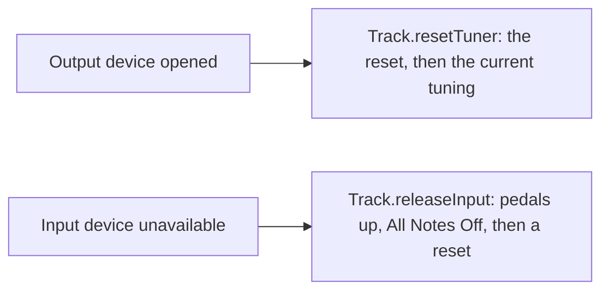

# #363 Extract a `track` module from `tuner` Implementation Plan

> **For agentic workers:** REQUIRED SUB-SKILL: Use superpowers:subagent-driven-development (recommended) or
> superpowers:executing-plans to implement this plan task-by-task. Steps use checkbox (`- [ ]`) syntax for tracking.

- Date: 2026-10-15
- Base: `refactoring/track-module` at `58d8c875` (`main` at `d1e49bdf`), draft PR #364
- Issue: [#363](https://github.com/calinburloiu/microtonalist/issues/363)

**Goal:** Move the tracks (the per-instrument MIDI pipelines) out of `tuner` into a new `track` module that depends on
`tuner`, without changing behaviour.

**Architecture:** `git mv` ten production files and eight test files from `tuner` to `track`, change their package to
`org.calinburloiu.music.microtonalist.track` and import the engine types they use. `TunerModule` shrinks to the tuning
session and service; a new `TrackModule` wires the track manager, session and service, and `MicrotonalistApp` builds
both. `format` and `app` import the moved types from their new package.

**Tech Stack:** Scala 3.9, sbt 1 (through `sbtn` on the dev stack's BSP server), Metals MCP, ScalaTest `AnyWordSpec`,
ScalaMock 7.6 `Stubs`.

**Spec:** [`2026-10-15-design.md`](2026-10-15-design.md) (committed in `58d8c875`). It is the source of truth; this plan
only adds the mechanics.

## Global Constraints

- **No behaviour change.** Every commit compiles and keeps the whole suite green.
- Module: directory `track`, `lazy val trackModule`, `.withId("track")`, `name := "microtonalist-track"`.
- Root package: `org.calinburloiu.music.microtonalist.track`. No split package: nothing in `track` keeps the `tuner`
  package.
- `track` depends on `tuner`, `businessync`, `common`, `sc-midi`, plus `commonTestUtilsModule % Test`; it declares
  `jsr305`. Nothing in `tuner` depends on `track`. `format` and `app` add `trackModule`; `ui` and `composition` don't
  change; `root` aggregates `trackModule`.
- Coverage: `tuner` and `track` both get `coverageSettings(stmt = 80, branch = 80)`. If `track` measures under 80%, it
  gets a floor 3% below the measured value and a `// TODO #<n>` naming a follow-up issue. `TrackModule` is held to 80%
  either way.
- Tests: `track` gets **trimmed copies** of `FakeTuner` (only `resetMessages`, `tuningMessages`, `processMessages`,
  `processedMessages`) and `TestTunings` (only `justCMaj`, `justCRast`). No `tuner-test-utils` module, no `test->test`
  dependency, no shared source directory.
- Move files with `git mv` and keep the edits small, so that git detects the renames.
- Commit messages start with `[#363] ` and end with the line
  `Co-Authored-By: Claude Opus 5.5 <noreply@anthropic.com>`.
- Compile with the Metals MCP (`mcp__metals__compile-full`, `mcp__metals__compile-module`); run tests with
  `sbtn "<module>/testOnly <class or *> -- -oNCXEHLOPQRMWS"`. After a `build.sbt` change, run
  `bin/mtlist-dev-stack restart` (10-minute timeout) so that Metals re-imports the build.
- Don't use git worktrees; work on `refactoring/track-module`.
- New `.scala` files are written **without** a license header: the pre-commit hook adds it. `Read` hides the header of
  existing files, so they appear to start at about line 17.
- TDD: Task 2 is a pure move, guarded by the existing suite (green before, green after). Following the design's order,
  `TrackModuleTest` (Task 3) comes after `TrackModule` exists, so Task 3 gets its red evidence by breaking `TrackModule`
  on purpose and watching each test fail.

## Review Focus

1. **Tuning changes stop reaching the tracks** if `TrackModule` no longer registers its `TrackManager` on the bus when
   it is built. Pinned by Task 3, "retune its tracks when the tunings of the tuning session change".
2. **Shutdown leaves outputs detuned or devices held** if `TrackModule.close()` doesn't close the tracks. Pinned by
   Task 3, "close its tracks, switching their outputs back to 12-EDO and releasing their devices, when closed".
3. **Opening tracks reaches the wrong collaborators** if `TrackModule` wires `trackService` to anything but the
   `TrackRepo` and `MidiManager` it is given. Pinned by Task 3, "open the tracks read from its repo through its track
   service".
4. **A composition without a tracks file** builds `TrackModule` but never touches `trackService`; shutdown must still
   close it cleanly. Pinned by Task 3, "close without releasing any device when no tracks were opened".
5. **ScalaDoc links that silently stop resolving.** Scala 3's Scaladoc ignores imports (today `tuner/doc` already can't
   resolve the imported `MidiManager`), so every link from a moved file to a `tuner` type breaks with the package
   change. Pinned by the `sbtn track/doc` check of Task 2 and the `sbtn tuner/doc` check of Task 4.

`MicrotonalistApp.run` has no test harness (`app`'s coverage floor is 0), so its shutdown order, `trackModule` before
`midiManager`, is checked by reading the diff in Task 2.

---

## File map

Paths below use these prefixes:

- `TUNER_MAIN` = `tuner/src/main/scala/org/calinburloiu/music/microtonalist/tuner`
- `TUNER_TEST` = `tuner/src/test/scala/org/calinburloiu/music/microtonalist/tuner`
- `TRACK_MAIN` = `track/src/main/scala/org/calinburloiu/music/microtonalist/track`
- `TRACK_TEST` = `track/src/test/scala/org/calinburloiu/music/microtonalist/track`
- `FORMAT_MAIN` = `format/src/main/scala/org/calinburloiu/music/microtonalist/format`
- `FORMAT_TEST` = `format/src/test/scala/org/calinburloiu/music/microtonalist/format`

| Change | Files |
| ------ | ----- |
| Move to `TRACK_MAIN` | `Track`, `TrackEvent`, `TrackIO`, `TrackManager`, `TrackRepo`, `TrackService`, `TrackSession`, `TrackSpecs`, `TunerProcessor`, `TuningChangeProcessor` (`.scala`) |
| Move to `TRACK_TEST` | `TrackTest`, `TrackManagerTest`, `TrackSessionTest`, `TrackServiceTest`, `TunerProcessorTest`, `TuningChangeProcessorTest`, `RecordingMidiReceiver`, `FakeMidiDeviceHandle` (`.scala`) |
| Create | `track/CLAUDE.md`, `TRACK_MAIN/TrackModule.scala`, `TRACK_TEST/FakeTuner.scala`, `TRACK_TEST/TestTunings.scala`, `TRACK_TEST/TrackModuleTest.scala`, `docs/architecture/track/README.md` |
| Modify | `build.sbt`, `TUNER_MAIN/TunerModule.scala`, `TUNER_MAIN/Tuner.scala`, `app/src/main/scala/org/calinburloiu/music/microtonalist/MicrotonalistApp.scala`, eight `FORMAT_MAIN` files and three `FORMAT_TEST` files (Task 2, step 10), nine docs under `docs/architecture/` (Task 5) |

---

### Task 1: Add the empty `track` module

**Files:**

- Modify: `build.sbt` (the `root` aggregate; a new `trackModule` after `tunerModule`)
- Create: `track/CLAUDE.md`

**Interfaces:**

- Produces: the sbt project `track` (`lazy val trackModule`), and the Metals build targets `track` and `track-test`.

- [ ] **Step 1: Add `trackModule` to `build.sbt`**

In `root`'s `.aggregate(...)`, add `trackModule,` on the line after `tunerModule,`:

```scala
    compositionModule,
    tunerModule,
    trackModule,
    formatModule,
```

Right after the whole `lazy val tunerModule = ...` definition (before `lazy val formatModule`), add:

```scala
lazy val trackModule = (project in file("track"))
  .withId("track")
  .dependsOn(
    businessyncModule,
    commonModule,
    commonTestUtilsModule % Test,
    scMidiModule,
    tunerModule,
  )
  .disablePlugins(AssemblyPlugin)
  .settings(
    name := "microtonalist-track",
    commonSettings,
    libraryDependencies ++= Seq(
      jsr305,
    ),
    coverageSettings(stmt = 80, branch = 80),
  )
```

- [ ] **Step 2: Create `track/CLAUDE.md`**

```markdown
# `track` module

@../docs/architecture/track/README.md
```

The imported README is written in Task 5; until then the import has no target, which Claude Code ignores.

- [ ] **Step 3: Restart the dev stack so that Metals imports the new module**

Run: `bin/mtlist-dev-stack restart` (timeout 600000 ms)
Expected: exit 0. Then call `mcp__metals__list-modules`.
Expected: the list contains `track` and `track-test`.

- [ ] **Step 4: Compile**

Call `mcp__metals__compile-full`.
Expected: success, with only the two existing deprecation warnings (`TuningServiceTest.scala`, `TuningListFrame.scala`).

Run: `sbtn 'show track/target'`
Expected: a path ending in `track/target-bsp`.

- [ ] **Step 5: Commit**

```bash
git add build.sbt track/CLAUDE.md
git commit -m "$(cat <<'EOF'
[#363] Add an empty track module

Co-Authored-By: Claude Opus 5.5 <noreply@anthropic.com>
EOF
)"
```

---

### Task 2: Move the tracks to `track`

Everything in this task lands in **one commit**: moving `Track*` breaks `format` and `app` until their imports change.

**Files:**

- Modify: `build.sbt` (`appModule`, `formatModule`)
- Move: the 10 production and 8 test files of the file map
- Create: `TRACK_TEST/FakeTuner.scala`, `TRACK_TEST/TestTunings.scala`, `TRACK_MAIN/TrackModule.scala`
- Modify: `TUNER_MAIN/TunerModule.scala`, `MicrotonalistApp.scala`, the `format` files of step 10

**Interfaces:**

- Consumes: the `track` sbt project from Task 1.
- Produces:
  - `org.calinburloiu.music.microtonalist.track.TrackModule(businessync: Businessync, trackRepo: TrackRepo, midiManager:
    MidiManager, tuningService: TuningService) extends AutoCloseable`, with `lazy val trackService: TrackService` and
    `close(): Unit`.
  - `org.calinburloiu.music.microtonalist.tuner.TunerModule(businessync: Businessync)` (no longer `AutoCloseable`),
    with `lazy val tuningService: TuningService` and `lazy val tuningSession: TuningSession`.
  - Test helpers in package `track`: `FakeTuner(resetMessages: Seq[MidiMsg] = Seq.empty, tuningMessages: Map[Tuning,
    Seq[MidiMsg]] = Map.empty, processMessages: Map[MidiMsg, Seq[MidiMsg]] = Map.empty)` with `processedMessages:
    Seq[MidiMsg]`; `TestTunings.justCMaj`, `TestTunings.justCRast`; and the moved `RecordingMidiReceiver` and
    `FakeMidiDeviceHandle`.
  - Every moved type keeps its name, in package `org.calinburloiu.music.microtonalist.track`.

- [ ] **Step 1: Add `trackModule` to the dependencies of `format` and `app`**

In `build.sbt`, in `appModule`'s `.dependsOn(...)`, add `trackModule,` before `tunerModule,`:

```scala
    scMidiModule,
    trackModule,
    tunerModule,
    uiModule,
```

In `formatModule`'s `.dependsOn(...)`, add `trackModule,` before `tunerModule,`:

```scala
    compositionModule,
    trackModule,
    tunerModule,
```

Run: `bin/mtlist-dev-stack restart` (timeout 600000 ms)
Expected: exit 0.

- [ ] **Step 2: Move the files with `git mv`**

```bash
TUNER_MAIN=tuner/src/main/scala/org/calinburloiu/music/microtonalist/tuner
TUNER_TEST=tuner/src/test/scala/org/calinburloiu/music/microtonalist/tuner
TRACK_MAIN=track/src/main/scala/org/calinburloiu/music/microtonalist/track
TRACK_TEST=track/src/test/scala/org/calinburloiu/music/microtonalist/track
mkdir -p "$TRACK_MAIN" "$TRACK_TEST"
for f in Track TrackEvent TrackIO TrackManager TrackRepo TrackService TrackSession TrackSpecs TunerProcessor \
    TuningChangeProcessor; do
  git mv "$TUNER_MAIN/$f.scala" "$TRACK_MAIN/$f.scala"
done
for f in TrackTest TrackManagerTest TrackSessionTest TrackServiceTest TunerProcessorTest TuningChangeProcessorTest \
    RecordingMidiReceiver FakeMidiDeviceHandle; do
  git mv "$TUNER_TEST/$f.scala" "$TRACK_TEST/$f.scala"
done
git status --short | grep -c '^R'
```

Expected: `18`.

- [ ] **Step 3: Change the package of the moved files**

```bash
perl -pi -e 's/^package org\.calinburloiu\.music\.microtonalist\.tuner$/package org.calinburloiu.music.microtonalist.track/' \
  track/src/main/scala/org/calinburloiu/music/microtonalist/track/*.scala \
  track/src/test/scala/org/calinburloiu/music/microtonalist/track/*.scala
grep -L '^package org.calinburloiu.music.microtonalist.track$' track/src/*/scala/org/calinburloiu/music/microtonalist/track/*.scala
```

Expected: the `grep -L` prints nothing.

- [ ] **Step 4: Import the engine types the moved files use**

Add exactly these imports; the other moved files (`TrackEvent`, `TrackIO`, `TrackRepo`, `TrackService`, `TrackSession`,
`TrackSessionTest`, `TrackServiceTest`, `RecordingMidiReceiver`, `FakeMidiDeviceHandle`) use no `tuner` type. The
position keeps the ASCII order that scalafix's `OrganizeImports` checks; `sbtn fix` (step 14) wraps the lines longer
than 120 characters.

| File | Import to add | Where |
| ---- | ------------- | ----- |
| `TRACK_MAIN/Track.scala` | `import org.calinburloiu.music.microtonalist.tuner.{Tuning, TuningService}` | after `import com.typesafe.scalalogging.StrictLogging` |
| `TRACK_MAIN/TrackManager.scala` | `import org.calinburloiu.music.microtonalist.tuner.{Tuning, TuningEvent, TuningService}` | after `import com.typesafe.scalalogging.{LazyLogging, StrictLogging}` |
| `TRACK_MAIN/TrackSpecs.scala` | `import org.calinburloiu.music.microtonalist.tuner.{Tuner, TuningChanger}` | after the `package` line, with a blank line before and after |
| `TRACK_MAIN/TunerProcessor.scala` | `import org.calinburloiu.music.microtonalist.tuner.{Tuner, Tuning}` | after `import com.typesafe.scalalogging.StrictLogging` |
| `TRACK_MAIN/TuningChangeProcessor.scala` | `import org.calinburloiu.music.microtonalist.tuner.{EffectiveTuningChange, NoTuningChange, TuningChange, TuningChanger, TuningService}` | before `import org.calinburloiu.music.scmidi.MidiProcessor` |
| `TRACK_TEST/TrackTest.scala` | `import org.calinburloiu.music.microtonalist.tuner.{NoTuningChange, Tuning, TuningChanger, TuningService}` | before `import org.calinburloiu.music.scmidi.message.{` |
| `TRACK_TEST/TrackManagerTest.scala` | `import org.calinburloiu.music.microtonalist.tuner.{MtsMessageGenerator, MtsOctave1ByteNonRealTimeTuner, Tuner, Tuning, TuningService, TuningSession}` | after `import org.calinburloiu.businessync.Businessync` |
| `TRACK_TEST/TunerProcessorTest.scala` | `import org.calinburloiu.music.microtonalist.tuner.Tuning` | before `import org.calinburloiu.music.scmidi.message.{CcMidiMsg, MidiMsg, NoteOnMidiMsg, PitchBendMidiMsg}` |
| `TRACK_TEST/TuningChangeProcessorTest.scala` | `import org.calinburloiu.music.microtonalist.tuner.{IndexTuningChange, MayTriggerTuningChange, NextTuningChange, NoTuningChange, TuningChanger, TuningService}` | before `import org.calinburloiu.music.scmidi.message.{CcMidiMsg, MidiCc, MidiMsg, NoteOnMidiMsg}` |

- [ ] **Step 5: Scope `TrackManager`'s thread members to `track`**

```bash
perl -pi -e 's/private\[tuner\]/private[track]/g' \
  track/src/main/scala/org/calinburloiu/music/microtonalist/track/TrackManager.scala
grep -rn 'private\[tuner\]' track/
```

Expected: the `grep` prints nothing. (`TrackThreadsNamePrefix` and `TrackThreadsGroup` are used only inside
`TrackManager`.)

- [ ] **Step 6: Qualify the ScalaDoc links from the moved files to `tuner` types**

Scala 3's Scaladoc resolves a link by the enclosing package, not by the imports, so a `[[Tuner]]` in package `track`
no longer resolves. A fully qualified link does, across modules.

```bash
TRACK_MAIN=track/src/main/scala/org/calinburloiu/music/microtonalist/track
perl -pi -e 's/\[\[(Tuner|TuningChanger|TuningChange|NoTuningChange)([.#][A-Za-z]+)?\]\]/[[org.calinburloiu.music.microtonalist.tuner.$1$2]]/g' \
  "$TRACK_MAIN/Track.scala" "$TRACK_MAIN/TrackSpecs.scala" "$TRACK_MAIN/TunerProcessor.scala" \
  "$TRACK_MAIN/TuningChangeProcessor.scala"
grep -oE '\[\[org\.calinburloiu\.music\.microtonalist\.tuner\.[A-Za-z.#]+\]\]' "$TRACK_MAIN"/*.scala | wc -l
grep -nE '\[\[(Tuner|TuningChanger|TuningChange|NoTuningChange)([.#][A-Za-z]+)?\]\]' "$TRACK_MAIN"/*.scala
```

Expected: the count is `17`: `Track.scala` (`TuningChanger`), `TrackSpecs.scala` (`TuningChanger`, `TuningChange`,
`Tuner`), `TunerProcessor.scala` (`Tuner` three times, `Tuner.canTune`) and `TuningChangeProcessor.scala`
(`TuningChanger` four times, `TuningChange` three times, `TuningChange#isChanging`, `NoTuningChange`); the second
`grep` prints nothing. `[[Track]]`, `[[TunerProcessor]]` and `[[TuningChangeProcessor]]` stay as they are: they now
live in `track` too.

- [ ] **Step 7: Add the trimmed test helpers**

Create `TRACK_TEST/FakeTuner.scala`:

```scala
package org.calinburloiu.music.microtonalist.track

import org.calinburloiu.music.microtonalist.tuner.{Tuner, Tuning}
import org.calinburloiu.music.scmidi.message.MidiMsg

import scala.collection.mutable

/**
 * A [[Tuner]] test double that returns canned messages and records the messages it is asked to process. It can apply
 * any tuning. It is not thread-safe.
 *
 * It is a trimmed copy of the `tuner` tests' `FakeTuner`, which `track`'s tests can't reach: a test-utils module would
 * form a dependency cycle with `tuner`.
 *
 * @param resetMessages What its [[onReset]] returns, which a reset follows with the messages of the current tuning.
 * @param tuningMessages What its [[onTune]] returns for each of these tunings; it returns nothing for any other.
 * @param processMessages What [[process]] returns for each of these messages; it returns nothing for any other.
 */
class FakeTuner(resetMessages: Seq[MidiMsg] = Seq.empty,
                tuningMessages: Map[Tuning, Seq[MidiMsg]] = Map.empty,
                processMessages: Map[MidiMsg, Seq[MidiMsg]] = Map.empty) extends Tuner {
  override val typeName: String = "fake"

  private val _processedMessages: mutable.Buffer[MidiMsg] = mutable.ArrayBuffer()

  /** The messages passed to [[process]] so far, in order. */
  def processedMessages: Seq[MidiMsg] = _processedMessages.toSeq

  override def canTune(tuning: Tuning): Boolean = true

  override protected def onReset(): Seq[MidiMsg] = resetMessages

  override protected def onTune(tuning: Tuning, previousTuning: Option[Tuning]): Seq[MidiMsg] =
    tuningMessages.getOrElse(tuning, Seq.empty)

  override def process(message: MidiMsg): Seq[MidiMsg] = {
    _processedMessages += message
    processMessages.getOrElse(message, Seq.empty)
  }
}
```

Create `TRACK_TEST/TestTunings.scala`:

```scala
package org.calinburloiu.music.microtonalist.track

import org.calinburloiu.music.microtonalist.tuner.Tuning

/** Tunings shared by the tests of `track`: a trimmed copy of the `tuner` tests' `TestTunings`. */
object TestTunings {
  val justCMaj: Tuning = Tuning("Just C Major",
    c = Some(0.0),
    d = Some(3.91),
    e = Some(-13.69),
    f = Some(-1.96),
    g = Some(1.96),
    a = Some(-15.64),
    b = Some(-11.73)
  )

  val justCRast: Tuning = Tuning("Just C Rast",
    c = Some(0.0),
    d = Some(3.91),
    e = Some(-13.69),
    f = Some(-1.96),
    g = Some(1.96),
    a = Some(5.87),
    aSharpOrBFlat = Some(-3.91),
    b = Some(-11.73)
  )
}
```

`TUNER_TEST/FakeTuner.scala` and `TUNER_TEST/TestTunings.scala` stay unchanged: `TunerTest`, `MtsTunerTest`,
`TuningServiceTest` and `TuningSessionTest` still use them.

- [ ] **Step 8: Split `TunerModule` and add `TrackModule`**

Replace everything after the license header of `TUNER_MAIN/TunerModule.scala` with:

```scala
package org.calinburloiu.music.microtonalist.tuner

import org.calinburloiu.businessync.Businessync

/**
 * Composition root of the `tuner` module: lazily wires the tuning session and its service.
 *
 * @param businessync The event bus and business thread the session and the service run on.
 */
class TunerModule(businessync: Businessync) {

  /** Thread-safe facade over [[tuningSession]] for the application and UI layers. */
  lazy val tuningService: TuningService = new TuningService(tuningSession, businessync)

  /** Holds the sequence of tunings and the current tuning index; may only be touched on the business thread. */
  lazy val tuningSession: TuningSession = new TuningSession(businessync)
}
```

Create `TRACK_MAIN/TrackModule.scala`:

```scala
package org.calinburloiu.music.microtonalist.track

import org.calinburloiu.businessync.Businessync
import org.calinburloiu.music.microtonalist.tuner.TuningService
import org.calinburloiu.music.scmidi.MidiManager

/**
 * Composition root of the `track` module: lazily wires the track session, its service and the [[TrackManager]] around
 * the [[org.calinburloiu.music.scmidi.MidiManager]] it is given.
 *
 * Building it registers the [[TrackManager]] on the bus, so that the tracks follow the tuning events of the session
 * behind `tuningService`.
 *
 * @param businessync The event bus and business thread the session and the service run on.
 * @param trackRepo Where [[TrackSession]] loads tracks from.
 * @param midiManager Opens the MIDI devices of the tracks. The caller owns it and closes it after this module; it is
 *   not closed by [[close]].
 * @param tuningService Where the tracks send the tuning changes that their triggers decide.
 */
class TrackModule(businessync: Businessync,
                  trackRepo: TrackRepo,
                  midiManager: MidiManager,
                  tuningService: TuningService) extends AutoCloseable {

  /** Thread-safe facade over this module's [[TrackSession]] for the application and UI layers. */
  lazy val trackService: TrackService = new TrackService(trackSession, businessync)

  private lazy val trackManager = new TrackManager(midiManager, tuningService)
  businessync.register(trackManager)

  private lazy val trackSession = new TrackSession(trackManager, trackRepo, businessync)

  override def close(): Unit = {
    trackManager.close()
  }
}
```

- [ ] **Step 9: Rewire `MicrotonalistApp`**

In `app/src/main/scala/org/calinburloiu/music/microtonalist/MicrotonalistApp.scala`:

Add the import after `import org.calinburloiu.music.microtonalist.format.FormatModule`:

```scala
import org.calinburloiu.music.microtonalist.track.TrackModule
```

Keep `import org.calinburloiu.music.microtonalist.tuner.*` (it brings `TunerModule`). Replace:

```scala
    val tunerModule = TunerModule(businessync, formatModule.defaultTrackRepo, midiManager)
    val trackService = tunerModule.trackService
```

with:

```scala
    val tunerModule = TunerModule(businessync)
    val trackModule = TrackModule(businessync, formatModule.defaultTrackRepo, midiManager, tunerModule.tuningService)
    val trackService = trackModule.trackService
```

In the shutdown hook, replace `tunerModule.close()` with `trackModule.close()`; it stays before `midiManager.close()`.
`tunerModule.tuningSession` and `tunerModule.tuningService` stay as they are.

- [ ] **Step 10: Import the moved types in `format`**

Each of these files has exactly one `tuner` import, which holds only moved types: point it at `track`.

```bash
FORMAT_MAIN=format/src/main/scala/org/calinburloiu/music/microtonalist/format
FORMAT_TEST=format/src/test/scala/org/calinburloiu/music/microtonalist/format
perl -pi -e 's/^import org\.calinburloiu\.music\.microtonalist\.tuner\./import org.calinburloiu.music.microtonalist.track./' \
  "$FORMAT_MAIN/DefaultTrackRepo.scala" "$FORMAT_MAIN/FileTrackRepo.scala" "$FORMAT_MAIN/FormatModule.scala" \
  "$FORMAT_MAIN/HttpTrackRepo.scala" "$FORMAT_MAIN/JsonTrackFormat.scala" "$FORMAT_MAIN/JsonTrackIOPluginFormat.scala" \
  "$FORMAT_MAIN/LibraryTrackRepo.scala" "$FORMAT_MAIN/TrackFormat.scala" \
  "$FORMAT_TEST/FormatTestUtils.scala" "$FORMAT_TEST/JsonTrackIOPluginFormatTest.scala"
```

Two files also use engine types:

- `FORMAT_MAIN/JsonTrackFormat.scala` (now `import org.calinburloiu.music.microtonalist.track.*`): its private
  `JsonTrackFormat` object names `Tuner` and `TuningChanger`. Add, right after the `track.*` import:

  ```scala
  import org.calinburloiu.music.microtonalist.tuner.{Tuner, TuningChanger}
  ```

- `FORMAT_TEST/JsonTrackFormatTest.scala`: keep `import org.calinburloiu.music.microtonalist.tuner.*` (it brings
  `PedalTuningChanger`, `MtsOctave1ByteNonRealTimeTuner` and `MonophonicPitchBendTuner`) and add, right before it:

  ```scala
  import org.calinburloiu.music.microtonalist.track.*
  ```

- [ ] **Step 11: Compile**

Call `mcp__metals__compile-full`.
Expected: success, with only the two existing deprecation warnings. Fix any other warning or error: a missing import
names its type; an unused import means a row of step 4 is wrong for that file.

- [ ] **Step 12: Check the module boundary**

```bash
git ls-files tuner | grep -E '/(Track[A-Za-z]*|TunerProcessor|TuningChangeProcessor)(Test)?\.scala$'
grep -rln 'microtonalist\.track' tuner/src
```

Expected: both print nothing. (`Tuner.scala` still links `[[Track]]` and `[[TunerProcessor]]`; Task 4 handles them.)

Read the `MicrotonalistApp` diff (`git diff -- app`) and check that the shutdown hook closes `trackModule`, then
`midiManager`.

- [ ] **Step 13: Check the ScalaDoc links of `track`**

Run: `sbtn "track/doc" 2>&1 | grep "Couldn't resolve"`
Expected: only the queries that the moved files already failed to resolve in `tuner`, all of types outside `tuner`
(fixing them is out of scope): `MidiManager` (`Track.scala`), `MidiDeviceId` and `Plugin` (`TrackIO.scala`),
`TrackFormat` (`TrackRepo.scala`), `MidiProcessor` (`TunerProcessor.scala`). If a query names a `tuner` type, qualify
it as in step 6.

- [ ] **Step 14: Run the tests of the four modules**

```bash
sbtn "tuner/testOnly * -- -oNCXEHLOPQRMWS"
sbtn "track/testOnly * -- -oNCXEHLOPQRMWS"
sbtn "format/testOnly * -- -oNCXEHLOPQRMWS"
sbtn "app/testOnly * -- -oNCXEHLOPQRMWS"
```

Expected: all pass. `track` runs `TrackTest`, `TrackManagerTest`, `TrackSessionTest`, `TrackServiceTest`,
`TunerProcessorTest` and `TuningChangeProcessorTest`.

- [ ] **Step 15: Format and commit**

Run: `sbtn fix`
Expected: success; it sorts and wraps the new imports. Then run `git status --short` and check that it lists only the
18 renames and the files of this task.

```bash
git add -A build.sbt tuner track format app
git commit -m "$(cat <<'EOF'
[#363] Move the tracks from tuner to a new track module

The tracks, their processors, sessions and repository move to package
org.calinburloiu.music.microtonalist.track. TunerModule keeps the tuning
session and service, and TrackModule wires the tracks around them.

Co-Authored-By: Claude Opus 5.5 <noreply@anthropic.com>
EOF
)"
git show --stat -M HEAD | grep -c '=>'
```

Expected: the last command prints `18` (every moved file detected as a rename).

---

### Task 3: Add `TrackModuleTest`

**Files:**

- Create: `TRACK_TEST/TrackModuleTest.scala`

**Interfaces:**

- Consumes: `TrackModule`, `TunerModule`, `FakeTuner`, `TestTunings`, `RecordingMidiReceiver`, `FakeMidiDeviceHandle`
  (Task 2); `org.scalamock.stubs.Stubs`, whose `StubbedMethod` has `returns(f: A => R)`, `calls: List[A]` and
  `times: Int` (`A` is the argument, or the tuple of arguments).

- [ ] **Step 1: Write the test**

Create `TRACK_TEST/TrackModuleTest.scala`:

```scala
package org.calinburloiu.music.microtonalist.track

import com.google.common.eventbus.EventBus
import org.calinburloiu.businessync.Businessync
import org.calinburloiu.music.microtonalist.tuner.{TunerModule, Tuning}
import org.calinburloiu.music.scmidi.message.{CcMidiMsg, MidiCc, MidiMsg, PitchBendMidiMsg}
import org.calinburloiu.music.scmidi.{MidiDeviceId, MidiDirection, MidiManager}
import org.scalamock.stubs.{Stub, Stubs}
import org.scalatest.matchers.should.Matchers
import org.scalatest.wordspec.AnyWordSpec

import java.net.URI
import scala.concurrent.duration.{DurationInt, FiniteDuration}
import scala.concurrent.{Await, Future}

class TrackModuleTest extends AnyWordSpec with Matchers with Stubs {

  /** How long a test waits for the tracks to open; the repo reads them at once. */
  private val OpenTimeout: FiniteDuration = 1.second

  private val tracksUri: URI = URI("file:///compositions/test.mtlist.tracks")

  private val keyboardId: MidiDeviceId = MidiDeviceId("CoreMIDI4J - Seaboard", "ROLI")
  private val pianoId: MidiDeviceId = MidiDeviceId("CoreMIDI4J - FP-90", "Roland")

  private val initMessage: MidiMsg = CcMidiMsg(0, MidiCc.DataEntryMsb, 2)

  /** What the fake tuner sends when it is tuned to 12-EDO. */
  private val standardTuningMessage: MidiMsg = PitchBendMidiMsg(1, -100)

  /** What the fake tuner sends when it is tuned to Just C Major. */
  private val justCMajTuningMessage: MidiMsg = PitchBendMidiMsg(1, 100)

  /**
   * A [[TrackModule]] on a real bus, given the tuning service of a [[TunerModule]] on the same bus. Its stubbed
   * [[MidiManager]] opens every device as a [[FakeMidiDeviceHandle]] whose receiver records what the device gets, and
   * its stubbed [[TrackRepo]] reads one track, "piano", which plays the keyboard on the piano.
   */
  private trait Fixture {
    val businessync: Businessync = Businessync(EventBus())
    val tunerModule: TunerModule = TunerModule(businessync)

    val deviceReceivers: Map[MidiDeviceId, RecordingMidiReceiver] =
      Seq(keyboardId, pianoId).map(_ -> RecordingMidiReceiver()).toMap

    val midiManager: Stub[MidiManager] = stub[MidiManager]
    midiManager.openDevice.returns { (deviceId, _) => FakeMidiDeviceHandle(deviceId, deviceReceivers(deviceId)) }
    midiManager.closeDevice.returns(_ => ())

    val trackSpecs: TrackSpecs = TrackSpecs(Seq(
      TrackSpec("piano", "Piano", input = Some(DeviceTrackInputSpec(keyboardId, None)),
        tuner = Some(FakeTuner(resetMessages = Seq(initMessage), tuningMessages = Map(
          Tuning.Standard -> Seq(standardTuningMessage), TestTunings.justCMaj -> Seq(justCMajTuningMessage)))),
        output = Some(DeviceTrackOutputSpec(pianoId, None)))
    ))
    val trackRepo: Stub[TrackRepo] = stub[TrackRepo]
    trackRepo.readTracksAsync.returns(_ => Future.successful(trackSpecs))

    val trackModule: TrackModule = TrackModule(businessync, trackRepo, midiManager, tunerModule.tuningService)

    def pianoMessages: Seq[MidiMsg] = deviceReceivers(pianoId).messages

    def openTracks(): Unit = Await.result(trackModule.trackService.open(tracksUri), OpenTimeout)
  }

  "a TrackModule" should {
    "open the tracks read from its repo through its track service" in new Fixture {
      // When
      openTracks()

      // Then
      trackRepo.readTracksAsync.calls shouldEqual List(tracksUri)
      midiManager.openDevice.calls should contain theSameElementsAs Seq(
        (keyboardId, MidiDirection.Input), (pianoId, MidiDirection.Output))
      pianoMessages shouldEqual Seq(initMessage, standardTuningMessage)
    }

    "retune its tracks when the tunings of the tuning session change" in new Fixture {
      // Given
      openTracks()
      deviceReceivers(pianoId).clear()

      // When
      tunerModule.tuningSession.tunings = Seq(TestTunings.justCMaj, TestTunings.justCRast)

      // Then
      pianoMessages shouldEqual Seq(justCMajTuningMessage)
    }

    "close its tracks, switching their outputs back to 12-EDO and releasing their devices, when closed" in
      new Fixture {
        // Given
        openTracks()
        deviceReceivers(pianoId).clear()

        // When
        trackModule.close()

        // Then
        pianoMessages shouldEqual Seq(standardTuningMessage)
        midiManager.closeDevice.calls should contain theSameElementsAs Seq(
          (keyboardId, MidiDirection.Input), (pianoId, MidiDirection.Output))
      }

    "close without releasing any device when no tracks were opened" in new Fixture {
      // When
      trackModule.close()

      // Then
      midiManager.openDevice.times shouldBe 0
      midiManager.closeDevice.times shouldBe 0
    }
  }
}
```

Why these messages: building the track attaches the piano's receiver, so the tuner's reset reaches it (`initMessage`)
followed by its current tuning, 12-EDO at first. Setting the session's tunings publishes a `TuningsUpdatedEvent` whose
current tuning is Just C Major. Closing the track detaches the piano, which the `TunerProcessor` switches back to
12-EDO.

- [ ] **Step 2: Run the test**

Run: `sbtn "track/testOnly org.calinburloiu.music.microtonalist.track.TrackModuleTest -- -oNCXEHLOPQRMWS"`
Expected: 4 tests pass. If one fails, the test is wrong, not `TrackModule` (Task 2 moved its wiring unchanged): fix
the expectation by reading `Track`, `TunerProcessor` and `TrackSession`.

- [ ] **Step 3: Watch the bus test fail without the registration**

Delete the line `businessync.register(trackManager)` from `TRACK_MAIN/TrackModule.scala` and run the command of step 2.
Expected: "retune its tracks when the tunings of the tuning session change" FAILS, because the piano receives nothing;
the other three pass.

Restore it: `git checkout -- track/src/main/scala/org/calinburloiu/music/microtonalist/track/TrackModule.scala`

- [ ] **Step 4: Watch the close test fail without closing**

Replace the body of `TrackModule.close()` with `()` (`override def close(): Unit = ()`) and run the command of step 2.
Expected: "close its tracks, switching their outputs back to 12-EDO and releasing their devices, when closed" FAILS;
the other three pass.

Restore it: `git checkout -- track/src/main/scala/org/calinburloiu/music/microtonalist/track/TrackModule.scala`

- [ ] **Step 5: Run the module's tests**

Run: `git diff --stat` (expected: no change to `TrackModule.scala`), then
`sbtn "track/testOnly * -- -oNCXEHLOPQRMWS"`.
Expected: all pass.

- [ ] **Step 6: Commit**

```bash
git add track/src/test/scala/org/calinburloiu/music/microtonalist/track/TrackModuleTest.scala
git commit -m "$(cat <<'EOF'
[#363] Test the wiring of TrackModule

Co-Authored-By: Claude Opus 5.5 <noreply@anthropic.com>
EOF
)"
```

---

### Task 4: Unlink the track types from the ScalaDoc of `Tuner`

`tuner` can't link to `track`, which depends on it: the four `[[Track]]` and two `[[TunerProcessor]]` links of
`Tuner.scala` become plain backticked names.

**Files:**

- Modify: `TUNER_MAIN/Tuner.scala` (ScalaDoc only)

- [ ] **Step 1: See the broken links**

Run: `sbtn "tuner/doc" 2>&1 | grep "Couldn't resolve"`
Expected: queries for `Track` and `TunerProcessor` in `Tuner.scala`, and nothing else.

- [ ] **Step 2: Rewrite them**

```bash
perl -pi -e 's/\[\[(Track|TunerProcessor)\]\]/`$1`/g' \
  tuner/src/main/scala/org/calinburloiu/music/microtonalist/tuner/Tuner.scala
grep -cE '\[\[(Track|TunerProcessor)\]\]' tuner/src/main/scala/org/calinburloiu/music/microtonalist/tuner/Tuner.scala
git diff --stat
```

Expected: the `grep -c` prints `0`; the diff touches only `Tuner.scala`, on the six lines that held a link (28, 34, 39,
50, 190 and 203).

- [ ] **Step 3: Check the ScalaDoc and compile**

Run: `sbtn "tuner/doc" 2>&1 | grep -c "Couldn't resolve"`
Expected: `0`.

Call `mcp__metals__compile-module` with `module = "tuner"`.
Expected: success.

- [ ] **Step 4: Commit**

```bash
git add tuner/src/main/scala/org/calinburloiu/music/microtonalist/tuner/Tuner.scala
git commit -m "$(cat <<'EOF'
[#363] Unlink the track types from the ScalaDoc of Tuner

Co-Authored-By: Claude Opus 5.5 <noreply@anthropic.com>
EOF
)"
```

---

### Task 5: Document the `track` module

**Files:**

- Create: `docs/architecture/track/README.md`
- Modify: `docs/architecture/tuner/README.md`, `docs/architecture/module-overview.md`,
  `docs/architecture/domain-concepts.md`, `docs/architecture/data-flow.md`, `docs/architecture/README.md`,
  `docs/architecture/app/README.md`, `docs/architecture/format/README.md`, `docs/architecture/common/README.md`,
  `docs/architecture/businessync/README.md`

- [ ] **Step 1: Invoke the `architecture-docs` skill**

Follow its rules for every doc below (shape, Mermaid, 1000-word budget, maintenance checklist).

- [ ] **Step 2: Write `docs/architecture/track/README.md`**

It takes, from `docs/architecture/tuner/README.md`, the "Tracks" and "Processors" paragraphs, the "Track pipeline",
"Tuning-change flow" and "Device changes" sections, the track part of "Threading", and the track items of "Subject to
change". Two things move that the design doesn't list by name:

- the "Tuning-change flow": a trigger enters it in a track and its event returns to `TrackManager`, so it is a track
  flow that passes through `tuner`;
- the #90 item of "Subject to change": `TrackManager` is the only `@Subscribe` handler in the two modules.

````markdown
# `track` module architecture

## Responsibility

`track` runs the *tracks*: the per-instrument pipelines that route MIDI from an input to an output while detecting
tuning-change triggers and applying the current tuning, with the tuning engine of [`tuner`](../tuner/README.md). It
holds the runtime track state, behind a thread-safe service.

It doesn't read or write tracks files: the `TrackRepo` trait lives here, its implementations in `format`.

## Key types

`TrackInputSpec` and `TrackOutputSpec` are plugins, which `format` (de)serializes by their `familyName` and `typeName`.

**Tracks.** A `Track` is one instrument pipeline built from a `TrackSpec`, whose `TrackInputSpec` and
`TrackOutputSpec` each name a device or another track. `TrackManager` builds and replaces the tracks, wires the links
between them, and reacts to tuning and device events.

**Processors.** They are the stages of a track. `TuningChangeProcessor` asks the track's tuning changers in order, the
first effective decision winning, and calls `TuningService.changeTuning`. `TunerProcessor` wraps a `Tuner`: it sends
the tuner's reset to every receiver attached to its transmitter and, as a courtesy, restores 12-EDO on every receiver
detached from it.

**Session and service.** `TrackSession` loads the tracks through a `TrackRepo` and edits them. It runs on the business
thread and publishes `TrackEvent`s, behind the thread-safe `TrackService`. `TrackModule` wires them around the
`MidiManager` that `app` gives it and the `TuningService` of `tuner`.

## Track pipeline


Either processor is optional. The output device's receiver is attached when the track is built, so the tuner's reset
reaches it at once; `TrackManager` attaches the downstream tracks afterwards. The channel of an input or output spec is
meant to filter the input or remap the output, but no track applies it yet (#97).

## Tuning-change flow


`TuningService`, `TuningSession` and `Tuner` are in `tuner`. Loading a composition sets the session's tunings, and
their `TuningsUpdatedEvent` makes `TrackManager` retune every track the same way.

## Device changes



- Only the tracks wired straight to the device react.
- A device available when its track is built needs no event: attaching it already sends the reset.
- `TrackManager` forgets the old tracks before building new ones, so that an event never reaches a closed track.

## Threading

`TrackSession` and `TrackManager` are `@NotThreadSafe` and run on the business thread (see
[`businessync`](../businessync/README.md)); other threads go through `TrackService`. The processors, and the tuners and
tuning changers they hold, are `@NotThreadSafe` too: MIDI messages run through them on the input device's callback
thread, and `tune` and `reset` come from the business thread; #121 will give each track a thread of its own.

Today, wrongly, `TrackManager` handles a `MidiEvent`, and so resets the tracks a device change concerns, on the thread
publishing the event; #90 will move it to the business thread.

## Subject to change

- `Track` doesn't run on a thread of its own yet (#121).
- Events are subscribed to with Guava's `@Subscribe`, and device events are handled on the publishing thread (#90).
- A link declared from both of its ends is wired twice (#296).
- A track fed by another track loses the messages that arrive before the link is wired (#298).
- The courtesy 12-EDO messages make 12-EDO the tuner's current tuning, and attaching and detaching will drive the
  device requests (#305; see [`midi-device-lifecycle.md`](../midi-device-lifecycle.md#subject-to-change-305)).
- A track fed by another track isn't released or reset when the feeding track's input device goes away (#316).
````

- [ ] **Step 3: Trim `docs/architecture/tuner/README.md` to the engine**

Replace the "Responsibility" section's two paragraphs with:

```markdown
`tuner` is the low-level MIDI tuning engine. It turns a `Tuning` into the MIDI messages an output instrument needs to
play microtonally, detects tuning-change triggers in the MIDI messages, and holds the runtime tuning state behind a
thread-safe service. The tracks, the per-instrument pipelines that run MIDI through this engine, live in
[`track`](../track/README.md).

It doesn't decide which tunings exist: `composition` builds them and hands over a `Seq[Tuning]`.
```

In "Key types":

- Replace the first line with: `` `Tuner` and `TuningChanger` are plugins, which `format` (de)serializes by their
  `familyName` and `typeName`. ``
- Delete the "**Processors.**" and "**Tracks.**" paragraphs.
- Replace the "**Sessions and services.**" paragraph with:

  ```markdown
  **Session and service.** `TuningSession` holds the tunings and the current index, and publishes a `TuningEvent` on
  every change, which the tracks and the UI follow. It runs on the business thread, behind the thread-safe
  `TuningService`. `TunerModule` wires the two.
  ```

Delete the "Track pipeline", "Tuning-change flow" and "Device changes" sections. Replace the "Threading" section's body
with:

```markdown
`TuningSession` is `@NotThreadSafe` and runs on the business thread (see [`businessync`](../businessync/README.md));
other threads go through `TuningService`. The tuners and the tuning changers are `@NotThreadSafe` too: a track runs MIDI
messages through them on the input device's callback thread, and tunes and resets them on the business thread (see
[`track`](../track/README.md#threading)).
```

Replace the "Subject to change" list with:

```markdown
- `TuningService.tunings` is deprecated until the UI moves to JavaFX (#99).
- A tuning beyond a tuner's limits is only warned about when applied (#326).
```

The `Tuner` paragraph, the protocol table, the `MpeTuner` sentence and "Tuning-change detection" stay unchanged.

- [ ] **Step 4: Update the overviews**

`docs/architecture/module-overview.md`, in the tree, change the `format` line and add a `track` line before `tuner`:

```
├── format        (JSON/file I/O, depends on composition + track + tuner)
├── track         (per-instrument MIDI pipelines, depends on tuner)
├── tuner         (MIDI tuning, depends on sc-midi + businessync)
```

In its "Packages" table, add after the `tuner` row:

```markdown
| `track` | `org.calinburloiu.music.microtonalist.track` |
```

`docs/architecture/domain-concepts.md`: remove the `Track` and `TrackManager` items from the **Tuner** group, and add
after that group:

```markdown
**Track (`track` module, `org.calinburloiu.music.microtonalist.track`):**

- `Track` — one instrument pipeline: input device → `TuningChangeProcessor` → `TunerProcessor` → output device
- `TrackManager` — lifecycle manager for tracks; reacts to MIDI device events
- `TrackSession` / `TrackService` — loads the tracks through a `TrackRepo` and exposes a thread-safe API for editing them
```

`docs/architecture/data-flow.md`: mark which module each half of the pipeline runs in, and link the track doc:

```
  → TuningSession.tunings          (tuner module)
  → TuningIndexUpdatedEvent (via Businessync)
  → TrackManager → Track.tune()    (track module)
  → TunerProcessor → Tuner
```

and in the "More detail" note, add "the tracks in [`track/`](track/README.md);" before "serialization in".

`docs/architecture/README.md`, in the "Module index" table, add after the `tuner` row:

```markdown
| `track` | `track` | [track/README.md](track/README.md) |
```

- [ ] **Step 5: Update the module docs that name the old home or wiring**

`docs/architecture/app/README.md`:

- "start the tuner runtime and open its tracks" → "start the tuner and track runtimes and open the tracks".
- "injects it into `TunerModule` as a `MidiManager`, so `tuner` uses a manager it neither builds nor closes. A JVM
  shutdown hook closes the tuner runtime and then the MIDI manager" → "injects it into `TrackModule` as a
  `MidiManager`, so `track` uses a manager it neither builds nor closes. A JVM shutdown hook closes the track runtime
  and then the MIDI manager".
- "(e.g. `FormatModule`, `TunerModule`)" → "(e.g. `FormatModule`, `TunerModule`, `TrackModule`)".
- In the "Dependencies" block, add `app → track → tuner` after the `ui` line, and change the `format` line to
  `app → format → { common, composition, track, tuner }`.

`docs/architecture/format/README.md`:

- "`TrackRepo` is the one repository trait that **lives in the `tuner` module** (because `Track`/`TrackSpecs` are tuner
  domain types)" → "`TrackRepo` is the one repository trait that **lives in the `track` module** (because `TrackSpecs`
  is a track domain type)".
- In "Dependencies", "`tuner` (`TrackSpecs`, the `TrackRepo` trait, and the tuner/tuning-changer plugin families)" →
  "`track` (`TrackSpecs`, the `TrackRepo` trait and the track I/O plugin families), `tuner` (the tuner and
  tuning-changer plugin families)".

`docs/architecture/common/README.md`:

- "(`tuner`, `format`, `sc-midi`, `config`, `app`)" → "(`tuner`, `track`, `format`, `sc-midi`, `config`, `app`)".
- "`SoftChromaticGenusMapping`) and `tuner` (`Tuner`, `TuningChanger`, and the track I/O specs `TrackInputSpec` /
  `TrackOutputSpec`)" → "`SoftChromaticGenusMapping`), `tuner` (`Tuner`, `TuningChanger`) and `track` (the track I/O
  specs `TrackInputSpec` / `TrackOutputSpec`)".
- "Implemented by `TrackSession` in `tuner`." → "Implemented by `TrackSession` in `track`."
- "depended on directly by `config`, `tuner`, `format`, `sc-midi`, and `app`" → "depended on directly by `config`,
  `tuner`, `track`, `format`, `sc-midi`, and `app`".

`docs/architecture/businessync/README.md`, in "Dependencies": "`tuner` (publishes/subscribes to `TuningEvent`/
`TrackEvent`)" → "`tuner` (publishes `TuningEvent`), `track` (publishes `TrackEvent`, subscribes to `TuningEvent` and
`MidiEvent`)".

`docs/architecture/midi-device-lifecycle.md` names the track types but not their module, so it needs no change. Check
it: `grep -n 'tuner' docs/architecture/midi-device-lifecycle.md` prints nothing.

- [ ] **Step 6: Run the `architecture-docs` maintenance checklist**

Run: `python3 .claude/skills/architecture-docs/scripts/check_arch_doc_size.py`
Expected: no error, and no warning for `track/README.md` or `tuner/README.md`.

Check that every type the two READMEs name exists, with `mcp__metals__glob-search` on each of: `Track`, `TrackSpec`,
`TrackInputSpec`, `TrackOutputSpec`, `TrackManager`, `TuningChangeProcessor`, `TunerProcessor`, `TrackSession`,
`TrackService`, `TrackModule`, `TrackRepo`, `TrackEvent`, `TunerModule`, `TuningSession`, `TuningService`,
`TuningEvent`. Expected: each one is found in its new package.

Run: `grep -rn 'tuner/README.md#' --include='*.md' . | grep -v '^./issues/'`
Expected: nothing (no link points into a heading that moved).

- [ ] **Step 7: Commit**

```bash
git add docs/architecture
git commit -m "$(cat <<'EOF'
[#363] Document the track module

Co-Authored-By: Claude Opus 5.5 <noreply@anthropic.com>
EOF
)"
```

---

### Task 6: Final checks

Create a task for each check below, as `AGENTS.md` asks.

- [ ] **Step 1: Module tests**

```bash
sbtn "tuner/testOnly * -- -oNCXEHLOPQRMWS"
sbtn "track/testOnly * -- -oNCXEHLOPQRMWS"
sbtn "format/testOnly * -- -oNCXEHLOPQRMWS"
sbtn "app/testOnly * -- -oNCXEHLOPQRMWS"
```

Expected: all pass.

- [ ] **Step 2: Coverage**

Invoke the `scoverage-inspector` skill and measure `tuner`, `track`, `format` and `app` with their own tests.
Expected, from the design: `tuner` about 95% statements / 94% branches, `track` about 88% / 91%; `format` and `app` no
lower than their floors (66/59, 0/0). `TrackModule.scala` at 80% or more (expected 100%).

If `track` is under 80%, open a follow-up issue with the `contributing` skill and set `track`'s floor to 3% below the
measured values, with the comment line `// TODO #<n> Raise toward 80% statement and branch coverage.` above
`coverageSettings(...)`, then `sbtn reload`, re-run the coverage, and commit `build.sbt`:

```bash
git add build.sbt
git commit -m "$(cat <<'EOF'
[#363] Set the coverage floor of track

Co-Authored-By: Claude Opus 5.5 <noreply@anthropic.com>
EOF
)"
```

- [ ] **Step 3: Full test suite**

Run: `sbtn "root/testOnly * -- -oNCXEHLOPQRMWS"`
Expected: all pass.

- [ ] **Step 4: Documentation**

Check that every new public identifier has a ScalaDoc (`TrackModule`, its `trackService`; the shrunk `TunerModule`) and
that Task 5 is committed. Nothing else in `docs/`, `README.md` or the agent docs names the module of a moved type
(checked while writing this plan: `README.md` says "and more", the development and agent docs only use `tuner` as an
example module name).

- [ ] **Step 5: Lint**

Run: `sbtn fixLint`
Expected: success. Fix what it reports by hand and repeat until it passes; commit any change:

```bash
git add -A build.sbt tuner track format app
git commit -m "$(cat <<'EOF'
[#363] Apply the lint fixes

Co-Authored-By: Claude Opus 5.5 <noreply@anthropic.com>
EOF
)"
```

- [ ] **Step 6: Hand over**

Run `git log --oneline main..HEAD` and `git status --short` (expected: clean). Ask the user whether to push the
branch to draft PR #364 and update its description.

---

## Self-review

- **Spec coverage.** Goal and success criteria: Tasks 2 (boundary, step 12), 5 (docs), 6 (tests, coverage). Module
  boundary table: Task 2 steps 2–8. Package section: steps 3–6 of Task 2 and Task 4. Composition roots: Task 2 steps
  8–9, Task 3. Build graph: Task 1 and Task 2 step 1. Tests section: Task 2 steps 2 and 7, Task 3. Coverage: Task 6
  step 2. Documentation: Task 5. Implementation order: Tasks 1–6 map one to one to the design's steps 1–6.
- **Placeholders.** None; the only open value is the follow-up issue number of Task 6 step 2, which exists only if
  coverage falls short.
- **Type consistency.** `TrackModule(businessync, trackRepo, midiManager, tuningService)`, `TunerModule(businessync)`,
  `FakeTuner(resetMessages, tuningMessages, processMessages)` and `TestTunings.{justCMaj, justCRast}` are spelled the
  same in Tasks 2, 3 and the docs.
- **Review Focus.** Lines 1–4 have tests in Task 3; line 5 has the `doc` checks of Tasks 2 and 4.
