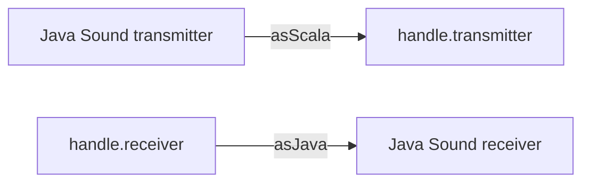

# `sc-midi-javamidi` Module Implementation Plan

> **For agentic workers:** REQUIRED SUB-SKILL: Use superpowers:subagent-driven-development (recommended) or
> superpowers:executing-plans to implement this plan task-by-task. Steps use checkbox (`- [ ]`) syntax for tracking.

- **Date:** 2026-10-16
- **Based on commit:** `9ea920f` (`refactoring/grouping-folders`, step 1 implemented and reviewed, not merged)
- **Issue:** #368, step 2 of #366

**Goal:** Move the `org.calinburloiu.music.scmidi.javamidi` package, with CoreMIDI4J, from `sc-midi` into a new
`sc-midi-javamidi` module that only `app` and `cli` depend on, without changing its behaviour.

**Architecture:** One commit moves the package's 12 files with `git mv` and declares the module in `build.sbt`; the
package name doesn't change, so no import does. A second commit fixes the docs: `sc-midi`'s ScalaDoc stops linking to
the types that moved downstream, the new module gets its docs, and `sc-midi`'s `ARCHITECTURE.md` splits.

**Tech Stack:** sbt 1, Scala 3, CoreMIDI4J, Markdown.

**Spec:** [`2026-10-16-design.md`](2026-10-16-design.md): *Module conventions* and step *2. `sc-midi-javamidi`*.

## Global Constraints

- The module: `lazy val scMidiJavamidiModule = (project in file("midi/sc-midi-javamidi")).withId("sc-midi-javamidi")`,
  with `name := "sc-midi-javamidi"`, which follows `sc-midi`'s library naming (no `microtonalist-` prefix).
- It depends on `sc-midi`, `common` and, until step 6, `businessync`, and on `common-test-utils` in `Test` scope (its
  tests use `LogCapture`). `commonSettings`, `disablePlugins(AssemblyPlugin)`, and `root` aggregates it.
- The CoreMIDI4J dependency and the `CoreMidi4JEnvironment` coverage exclusion move from `sc-midi` to it. `app` and
  `cli` depend on it.
- Done when CoreMIDI4J is on the `Compile` classpath of `sc-midi-javamidi`, `app` and `cli` only.
- `app` loses its own `coreMidi4j` dependency: it imports nothing from CoreMIDI4J, which reaches it through
  `sc-midi-javamidi`, so the library is declared in one place.
- `sc-midi` loses `common-test-utils`: only the `javamidi` tests use it.
- The package keeps its name, `org.calinburloiu.music.scmidi.javamidi`, and its files move unchanged with `git mv`.
  The only source edits are four ScalaDoc links in `sc-midi` (Task 3).
- Both modules keep a coverage floor of 80/80. Measured at `9ea920f`, the `javamidi` classes cover 97.74% of their
  statements and 93.94% of their branches, and the rest of `sc-midi` 98.78% and 98.11%.
- The move changes no behaviour, so the existing suite is its test. The red/green checks are the classpath check (8
  modules today, 3 after) and the ScalaDoc link warnings of `sc-midi`.
- Out of scope: `cli` imports `Businessync` without declaring `businessync`, which it gets through `sc-midi`; step 6
  removes that import. Java Sound used outside the module stays a review matter, since the JDK provides it to every
  module.
- Every commit message starts with `[#366/#368]` and ends with the attribution lines that your session's instructions
  give.
- Don't edit `issues/` (other than checking off this plan) or `docs/agent-evals/`. `docs/release-notes.md` is out of
  scope.
- Docs follow `docs/development/doc-conventions.md`, with lines of at most 120 columns.
- Work in this clone, on `refactoring/sc-midi-javamidi`, with `git switch`: no git worktree, and never touch the
  processes of another clone (`microtonalist2`). Don't push and don't open a PR.
- The plan deletes build output only under `target-bsp/`, which the development stack writes and an IDE doesn't.
- Shell notes: the Bash tool runs zsh, which doesn't word-split an unquoted `$VAR`, so module lists are spelled out;
  rtk rewrites `grep` to `rg` and filters `git status`, `git diff` and `ps`, so use `grep -F` for literal text and
  `rtk proxy <cmd>` where the exact output matters. In zsh, quote a bare `====` (`echo '===='`).
- `$SCRATCH` is your session's scratchpad directory.

## Review Focus

1. **Stale `javamidi` build output in `sc-midi`'s `target-bsp/`.** Zinc deletes the class files of a deleted source,
   but the SemanticDB files under `meta/` may stay, and Metals then reports the old location. Task 2, step 7 deletes
   what remains and checks the usages Metals reports.
2. **sbt or Metals on the old build definition.** A server that didn't reload `build.sbt` builds the old modules.
   `sbtn projects` and `mcp__metals__list-modules` must list the new module: Task 2, step 5.
3. **The fat JARs.** No test loads CoreMIDI4J (`JavaMidiManagerTest` runs over a fake environment), so only the JARs
   show that `app` and `cli` still ship the Java Sound implementation. Task 4, step 5 inspects both and runs `cli`'s
   `midi-devices` against the real devices.
4. **The coverage exclusion left in `sc-midi`.** The new module would then count `CoreMidi4JEnvironment` and still
   pass 80/80, hiding the mistake. Task 4, step 3 checks that the class is absent from its report.
5. **References to the old location that no compiler checks:** `sc-midi`'s ScalaDoc links to `javamidi` types, and
   docs that put Java Sound in `sc-midi`. Task 3, steps 2–4 and 10.

---

### Task 1: Baseline

**Files:**
- Create (untracked): `$SCRATCH/check_md_links.py`

**Interfaces:**
- Produces: the link checker, run as `python3 $SCRATCH/check_md_links.py .` from the repository root; the baseline
  numbers that Tasks 2–4 compare against.

- [ ] **Step 1: Check the starting point**

```bash
git switch refactoring/sc-midi-javamidi
rtk proxy git status --short
git log --oneline -2
bin/mtlist-dev-stack status; echo "exit=$?"
```

Expected: no output from `git status`; the log shows this plan's commit on top of `9ea920f`; `exit=0`. If the stack
isn't running, follow `docs/agents/dev-stack.md`. Then run `mcp__metals__compile-full`: success, with only the two
deprecation warnings on `TuningService.tunings` (in `TuningServiceTest` and `TuningListFrame`).

- [ ] **Step 2: Save the link checker**

Step 1's plan holds a link checker that checks every relative Markdown link, `#heading` link and `@import` outside
`issues/` and `docs/agent-evals/`. Extract it:

```bash
awk '/^````python$/{f=1;next} /^````$/{if(f){exit}} f' \
  issues/00366-modularization/2026-10-16-367-grouping-folders-plan.md > "$SCRATCH/check_md_links.py"
wc -l < "$SCRATCH/check_md_links.py"
```

Expected: `90`.

- [ ] **Step 3: Record the docs baseline**

```bash
python3 "$SCRATCH/check_md_links.py" .
python3 .claude/skills/architecture-docs/scripts/check_arch_doc_size.py | wc -l
```

Expected: `0 broken of 241 relative link(s) and import(s)`; `20` docs.

- [ ] **Step 4: Record the classpath check (red)**

The *Done when* criterion as a command: the projects whose `Compile` classpath holds CoreMIDI4J.

```bash
sbtn "show Compile/dependencyClasspath" 2>&1 \
  | awk '/ \/ Compile \/ dependencyClasspath/ {project = $2} /coremidi4j-/ {print project}' | sort | tr '\n' ' '; echo
```

Expected: `app cli composition format rig sc-midi tuner ui`.

- [ ] **Step 5: Record the test counts**

```bash
sbtn "sc-midi/testOnly * -- -oNCXEHLOPQRMWS"
sbtn "sc-midi/testOnly org.calinburloiu.music.scmidi.javamidi.* -- -oNCXEHLOPQRMWS"
sbtn "root/testOnly * -- -oNCXEHLOPQRMWS" 2>&1 \
  | awk '/Total number of tests run/ {n += $NF; m++} /FAILED|\[error\]/ {print} END {print m " modules, " n " tests"}'
```

Expected: 494 tests in 21 suites; 161 tests in 4 suites; `10 modules, 1475 tests` and no other line.

- [ ] **Step 6: Record `sc-midi`'s ScalaDoc links to `javamidi`**

```bash
sbtn "sc-midi/doc" 2>&1 | grep -F 'link query: org.calinburloiu.music.scmidi.javamidi'
```

Expected: nothing, since the linked types are still in the module. (`sc-midi/doc` warns about a dozen other links; no
check reads them.)

- [ ] **Step 7: Record the devices that `cli` lists**

```bash
sbtn "show cli/assembly"
java -jar app/cli/target-bsp/scala-*/microtonalist-cli.jar midi-devices
```

Expected: `=== Input Devices ===` and `=== Output Devices ===`, each with the devices of this computer; on a Mac,
those that CoreMIDI4J provides are named `CoreMIDI4J - …`. Note the device names: Task 4 compares against them.

---

### Task 2: Move the package and declare the module

**Files:**
- Move (`git mv`): `midi/sc-midi/src/main/scala/org/calinburloiu/music/scmidi/javamidi/` (6 files) to
  `midi/sc-midi-javamidi/src/main/scala/org/calinburloiu/music/scmidi/javamidi/`
- Move (`git mv`): `midi/sc-midi/src/test/scala/org/calinburloiu/music/scmidi/javamidi/` (6 files) to
  `midi/sc-midi-javamidi/src/test/scala/org/calinburloiu/music/scmidi/javamidi/`
- Modify: `build.sbt` (`root`'s `aggregate`, `appModule`, `cliModule`, `scMidiModule`; a new `scMidiJavamidiModule`)

**Interfaces:**
- Consumes: Task 1's baseline.
- Produces: the sbt project `sc-midi-javamidi` (`lazy val scMidiJavamidiModule`), whose Metals build targets are
  `sc-midi-javamidi` and `sc-midi-javamidi-test`; `JavaMidiManager` and the rest of the package, unchanged, in it.

- [ ] **Step 1: Move the package**

```bash
mkdir -p midi/sc-midi-javamidi/src/main/scala/org/calinburloiu/music/scmidi \
  midi/sc-midi-javamidi/src/test/scala/org/calinburloiu/music/scmidi
git mv midi/sc-midi/src/main/scala/org/calinburloiu/music/scmidi/javamidi \
  midi/sc-midi-javamidi/src/main/scala/org/calinburloiu/music/scmidi/
git mv midi/sc-midi/src/test/scala/org/calinburloiu/music/scmidi/javamidi \
  midi/sc-midi-javamidi/src/test/scala/org/calinburloiu/music/scmidi/
```

- [ ] **Step 2: Check that only renames are staged**

```bash
rtk proxy git diff --cached -M --name-status | cut -f1 | sort | uniq -c
ls -A midi
```

Expected: `12 R100`; `sc-midi sc-midi-javamidi`.

- [ ] **Step 3: Declare the module in `build.sbt`**

In `root`'s `aggregate`, replace:

```scala
    scMidiModule,
    experimentsModule,
```

with:

```scala
    scMidiModule,
    scMidiJavamidiModule,
    experimentsModule,
```

In `appModule`'s `dependsOn`, replace:

```scala
    scMidiModule,
    tunerModule,
    uiModule,
```

with:

```scala
    scMidiModule,
    scMidiJavamidiModule,
    tunerModule,
    uiModule,
```

and in its `libraryDependencies`, replace:

```scala
    libraryDependencies ++= Seq(
      coreMidi4j,
      guava,
      playJson,
    ),
```

with:

```scala
    libraryDependencies ++= Seq(
      guava,
      playJson,
    ),
```

In `cliModule`, replace:

```scala
  .withId("cli")
  .dependsOn(
    scMidiModule,
  )
```

with:

```scala
  .withId("cli")
  .dependsOn(
    scMidiModule,
    scMidiJavamidiModule,
  )
```

Replace the whole `scMidiModule` definition:

```scala
lazy val scMidiModule = (project in file("midi/sc-midi"))
  .withId("sc-midi")
  .dependsOn(
    businessyncModule,
    commonModule,
    commonTestUtilsModule % Test,
  )
  .disablePlugins(AssemblyPlugin)
  .settings(
    name := "sc-midi",
    commonSettings,
    libraryDependencies ++= Seq(
      coreMidi4j,
      jsr305,
    ),
    // * CoreMidi4JEnvironment only delegates to the CoreMIDI4J and MidiSystem statics, which need MIDI hardware; the
    //   JavaMidiEnvironment seam it implements lets JavaMidiManager be tested over a fake instead
    coverageExcludedFiles := ".*/org/calinburloiu/music/scmidi/javamidi/CoreMidi4JEnvironment",
    coverageSettings(stmt = 80, branch = 80),
  )
```

with:

```scala
lazy val scMidiModule = (project in file("midi/sc-midi"))
  .withId("sc-midi")
  .dependsOn(
    businessyncModule,
    commonModule,
  )
  .disablePlugins(AssemblyPlugin)
  .settings(
    name := "sc-midi",
    commonSettings,
    libraryDependencies ++= Seq(
      jsr305,
    ),
    coverageSettings(stmt = 80, branch = 80),
  )

lazy val scMidiJavamidiModule = (project in file("midi/sc-midi-javamidi"))
  .withId("sc-midi-javamidi")
  .dependsOn(
    businessyncModule,
    commonModule,
    commonTestUtilsModule % Test,
    scMidiModule,
  )
  .disablePlugins(AssemblyPlugin)
  .settings(
    name := "sc-midi-javamidi",
    commonSettings,
    libraryDependencies ++= Seq(
      coreMidi4j,
      jsr305,
    ),
    // * CoreMidi4JEnvironment only delegates to the CoreMIDI4J and MidiSystem statics, which need MIDI hardware; the
    //   JavaMidiEnvironment seam it implements lets JavaMidiManager be tested over a fake instead
    coverageExcludedFiles := ".*/org/calinburloiu/music/scmidi/javamidi/CoreMidi4JEnvironment",
    coverageSettings(stmt = 80, branch = 80),
  )
```

Then:

```bash
grep -nE 'scMidiJavamidiModule|coreMidi4j' build.sbt
```

Expected: `scMidiJavamidiModule` in `root`'s `aggregate`, in the `dependsOn` of `appModule` and `cliModule`, and in its
own definition; `coreMidi4j` only in `scMidiJavamidiModule`.

- [ ] **Step 4: Refresh the build**

Run `mcp__metals__import-build`, which reloads the build on the stack's sbt server too. Then:

```bash
sbtn projects
sbtn 'show sc-midi-javamidi/target'
```

Expected: 16 projects, the 15 of before and `sc-midi-javamidi`; a path ending in `/midi/sc-midi-javamidi/target-bsp`.
If `sc-midi-javamidi` is missing, run `sbtn reload` and check again.

- [ ] **Step 5: Check that Metals sees the module**

Run `mcp__metals__list-modules`. Expected: 33 build targets, the 31 of before and `sc-midi-javamidi` and
`sc-midi-javamidi-test`. If they are missing, restart the stack with `bin/mtlist-dev-stack restart`; if the Metals MCP
tools then stop answering, ask the user to reconnect them with `/mcp`.

- [ ] **Step 6: Compile**

Run `mcp__metals__compile-full`. Expected: success, with only the two deprecation warnings of Task 1. A compile error
in `app` or `cli` means a missing `dependsOn`; one in `sc-midi`'s tests, a helper that `common-test-utils` provided.

- [ ] **Step 7: Delete the stale `javamidi` build output of `sc-midi`**

Zinc has deleted the class files of the moved sources from `sc-midi`'s output, but SemanticDB files may remain.

```bash
find midi/sc-midi/target-bsp -type d -name javamidi -prune -print
find midi/sc-midi/target-bsp -type d -name javamidi -prune -exec rm -rf {} +
find midi/sc-midi/target-bsp -type d -name javamidi -prune -print
```

Expected: the first command lists at most folders under `meta/` and `test-meta/`; the last prints nothing. If the first
also listed folders under `classes/` or `test-classes/`, Zinc kept stale classes, which the deletion removed: rerun
`mcp__metals__compile-full` before going on.

Then run `mcp__metals__get-usages` with `fqcn = "org.calinburloiu.music.scmidi.javamidi.JavaMidiManager"` and
`module = "sc-midi-javamidi"`. Expected: the usages in `app/app/…/MicrotonalistApp.scala`,
`app/cli/…/MicrotonalistToolApp.scala` and under `midi/sc-midi-javamidi/src/`, and none under `midi/sc-midi/`.

- [ ] **Step 8: Run the classpath check (green)**

```bash
sbtn "show Compile/dependencyClasspath" 2>&1 \
  | awk '/ \/ Compile \/ dependencyClasspath/ {project = $2} /coremidi4j-/ {print project}' | sort | tr '\n' ' '; echo
```

Expected: `app cli sc-midi-javamidi`.

- [ ] **Step 9: Run the tests of the modules involved, then the full suite**

```bash
sbtn "sc-midi/testOnly * -- -oNCXEHLOPQRMWS"
sbtn "sc-midi-javamidi/testOnly * -- -oNCXEHLOPQRMWS"
sbtn "cli/testOnly * -- -oNCXEHLOPQRMWS"
sbtn "app/testOnly * -- -oNCXEHLOPQRMWS"
sbtn "root/testOnly * -- -oNCXEHLOPQRMWS" 2>&1 \
  | awk '/Total number of tests run/ {n += $NF; m++} /FAILED|\[error\]/ {print} END {print m " modules, " n " tests"}'
```

Expected: 333 tests in 17 suites; 161 tests in 4 suites; `cli` and `app` pass; `11 modules, 1475 tests` and no other
line.

- [ ] **Step 10: Commit**

```bash
git add build.sbt
git commit -m "[#366/#368] Move the javamidi package into a sc-midi-javamidi module" -m "<attribution lines>"
rtk proxy git show -M --format= --name-status HEAD | cut -f1 | sort | uniq -c
```

Expected: `1 M` (`build.sbt`) and `12 R100`, so `git log --follow` keeps each file's history.

---

### Task 3: Document the module

**Files:**
- Modify (ScalaDoc only): `midi/sc-midi/src/main/scala/org/calinburloiu/music/scmidi/MidiDeviceHandle.scala:40-41`,
  `midi/sc-midi/src/main/scala/org/calinburloiu/music/scmidi/MidiManager.scala:31-37`,
  `midi/sc-midi/src/main/scala/org/calinburloiu/music/scmidi/message/MidiMsg.scala:34-35,844-845`
- Create: `midi/sc-midi-javamidi/README.md`, `midi/sc-midi-javamidi/CLAUDE.md`,
  `midi/sc-midi-javamidi/docs/ARCHITECTURE.md`
- Modify: `midi/sc-midi/docs/ARCHITECTURE.md`
- Modify: `docs/architecture/module-overview.md`, `docs/architecture/README.md`
- Modify: `app/app/docs/ARCHITECTURE.md`, `app/cli/docs/ARCHITECTURE.md`, `base/businessync/docs/ARCHITECTURE.md`,
  `base/common/docs/ARCHITECTURE.md`

`domain-concepts.md` and `data-flow.md` name no type or stage of `sc-midi`, so they don't change.

**Interfaces:**
- Consumes: Task 2's module; Task 1's link checker.
- Produces: docs whose links resolve and which put the Java Sound implementation in `sc-midi-javamidi`.

- [ ] **Step 1: Invoke the `architecture-docs` skill**

`AGENTS.md` asks for it when a change adds a module. Its maintenance checklist applies to `sc-midi`'s doc, which
splits.

- [ ] **Step 2: See `sc-midi`'s ScalaDoc link to the moved types (red)**

```bash
sbtn "sc-midi/doc" 2>&1 | grep -F 'link query: org.calinburloiu.music.scmidi.javamidi'
```

Expected: a warning for each of the five links of step 3's three files, e.g. `Couldn't resolve a member for the
given link query: org.calinburloiu.music.scmidi.javamidi.JavaMidiManager`. The count may differ if scaladoc merges
some; what matters is that each line names a `javamidi` type.

- [ ] **Step 3: Name the moved types without linking them**

`sc-midi` can't link to a module that depends on it.

In `MidiDeviceHandle.scala`, replace:

```scala
 * transitions. [[org.calinburloiu.music.scmidi.javamidi.JavaMidiDeviceHandle]] is the Java Sound implementation.
```

with:

```scala
 * transitions. `JavaMidiDeviceHandle`, in the `sc-midi-javamidi` module, is the Java Sound implementation.
```

In `MidiManager.scala`, replace:

```scala
 * and documents which values it accepts. Every implementation today, including
 * [[org.calinburloiu.music.scmidi.javamidi.JavaMidiManager]], accepts [[MidiDirection.Input]] and
 * [[MidiDirection.Output]] and rejects [[MidiDirection.InputOutput]].
 *
 * An implementation scans the environment on [[refresh]] and typically also when the platform reports a change, and
 * publishes [[MidiEvent]]s about what it finds. [[org.calinburloiu.music.scmidi.javamidi.JavaMidiManager]] is the Java
 * Sound implementation; consumers receive a [[MidiManager]] and the composition root picks the implementation.
```

with:

```scala
 * and documents which values it accepts. Every implementation today, including `JavaMidiManager`, accepts
 * [[MidiDirection.Input]] and [[MidiDirection.Output]] and rejects [[MidiDirection.InputOutput]].
 *
 * An implementation scans the environment on [[refresh]] and typically also when the platform reports a change, and
 * publishes [[MidiEvent]]s about what it finds. `JavaMidiManager`, in the `sc-midi-javamidi` module, is the Java Sound
 * implementation; consumers receive a [[MidiManager]] and the composition root picks the implementation.
```

In `message/MidiMsg.scala`, replace:

```scala
 * Use [[org.calinburloiu.music.scmidi.javamidi.JavaMidiConverters]] to convert between [[Midi1Msg]] and
 * [[javax.sound.midi.MidiMessage]].
```

with:

```scala
 * Use `JavaMidiConverters`, in the `sc-midi-javamidi` module, to convert between [[Midi1Msg]] and
 * [[javax.sound.midi.MidiMessage]].
```

and replace:

```scala
 * [[org.calinburloiu.music.scmidi.javamidi.JavaMidiConverters]] can reconstruct the original Java message (a
 * `ShortMessage`, `SysexMessage`, or `MetaMessage`, detected from the status byte) via `asJava`.
```

with:

```scala
 * `JavaMidiConverters`, in the `sc-midi-javamidi` module, can reconstruct the original Java message (a
 * `ShortMessage`, `SysexMessage`, or `MetaMessage`, detected from the status byte) via `asJava`.
```

- [ ] **Step 4: Check that `sc-midi` names no `javamidi` symbol (green)**

```bash
sbtn "sc-midi/doc" 2>&1 | grep -F 'link query: org.calinburloiu.music.scmidi.javamidi'
git grep -nF 'scmidi.javamidi' -- midi/sc-midi
git grep -nE '^import (javax\.sound|uk\.co\.xfactorylibrarians)' -- midi/sc-midi
```

Expected: nothing from any of the three. Then run `mcp__metals__compile-module` with `module = "sc-midi"`: success.

- [ ] **Step 5: Create the new module's docs**

`midi/sc-midi-javamidi/README.md`:

```markdown
# `sc-midi-javamidi` module

See [`docs/ARCHITECTURE.md`](docs/ARCHITECTURE.md) for the module's architecture.
```

`midi/sc-midi-javamidi/CLAUDE.md`:

```markdown
# `sc-midi-javamidi` module

@docs/ARCHITECTURE.md
```

`midi/sc-midi-javamidi/docs/ARCHITECTURE.md`:

````markdown
# `sc-midi-javamidi` module architecture

## Responsibility

`sc-midi-javamidi` implements the device traits of [`sc-midi`](../../sc-midi/docs/ARCHITECTURE.md) over Java Sound
(`javax.sound.midi`). Only the composition roots, `app` and `cli`, depend on it: they construct a `JavaMidiManager` and
pass it on as a `MidiManager`, so the rest of the application sees only `sc-midi`'s traits and its `MidiMsg` model.

On macOS, devices come from CoreMIDI4J, which replaces Java Sound's default MIDI device provider; no other module
depends on CoreMIDI4J. The JDK provides Java Sound to every module, so keeping it here is a review matter, not a build
rule.

## Key types

- **`JavaMidiManager`** — the Java Sound `MidiManager`. Java Sound exposes a device working in both directions as two
  devices sharing a `MidiDeviceId`, so the manager accepts only the `Input` and `Output` directions, keeping a registry
  of live handles for each, which it reconciles with the devices found on every refresh. It publishes its `MidiEvent`s
  on the [Businessync](../../../base/businessync/docs/ARCHITECTURE.md) bus.
- **`JavaMidiDeviceHandle`** — the Java Sound `MidiDeviceHandle` for one direction of a device, and the one place
  where messages cross between `MidiMsg` and Java Sound.
- **`JavaMidiDeviceReferenceCounter`** — opens and closes the devices of all the handles of a manager, since Java
  Sound's `MidiDevice.close()` closes a device however many times it was opened.
- **`JavaMidiConverters`** — `asScala` and `asJava` between `MidiMsg` and Java Sound's `MidiMessage`. Only `Midi1Msg`
  has `asJava`, Java Sound speaking MIDI 1.0 only.
- **`JavaMidiEnvironment`** — the devices present, and the changes to them, as the manager sees them.
  `CoreMidi4JEnvironment` is the production one; the tests run the manager over a fake, without MIDI hardware.

## Message path



A handle drops a `Midi2Msg` sent to it, since a Java Sound device speaks MIDI 1.0 only.

## Threading

`JavaMidiManager` serialises its operations under its locks, whose order its ScalaDoc gives, and publishes the events
they collect only after releasing them, synchronously on the calling thread. For a platform change, that is
CoreMIDI4J's notification thread.

## Subject to change

- Two identical devices plugged in at once share a `MidiDeviceId`, so only the one resolved last gets a handle (#306).
- A vanished device is noticed only once CoreMIDI4J reports it, and a handle whose device failed to open stays unusable
  until the tracks are rebuilt (#302).
- `JavaMidiManager` takes a `Businessync` to publish its events; a `MidiEventPublisher` will replace it (#366).
````

- [ ] **Step 6: Split `sc-midi`'s `ARCHITECTURE.md`**

In `midi/sc-midi/docs/ARCHITECTURE.md`, replace the body of *Responsibility*:

```markdown
`sc-midi` is a Scala-idiomatic MIDI API: an immutable, typed message model; composable receivers, transmitters and
processors; and device handling that publishes its events on the
[Businessync](../../../base/businessync/docs/ARCHITECTURE.md) bus. It knows nothing about scales, tunings or the GUI.

Java Sound is confined to the `javamidi` package, by convention rather than by the build. `rig` and `cli` see only the
`MidiManager` / `MidiDeviceHandle` traits and the `MidiMsg` model, and the composition roots instantiate
`JavaMidiManager`. Within `javamidi`, messages cross to and from Java Sound in one place, `JavaMidiDeviceHandle`;
everything upstream of it carries `MidiMsg`. On macOS, devices come from CoreMIDI4J, which replaces Java Sound's
default MIDI device provider.
```

with:

```markdown
`sc-midi` is a Scala-idiomatic MIDI API: an immutable, typed message model; composable receivers, transmitters and
processors; and the traits of device handling, whose events go on the
[Businessync](../../../base/businessync/docs/ARCHITECTURE.md) bus. It knows nothing about scales, tunings or the GUI.

It doesn't use Java Sound: the [`sc-midi-javamidi`](../../sc-midi-javamidi/docs/ARCHITECTURE.md) module implements its
device traits over it. Only the composition roots, `app` and `cli`, depend on that module; the rest of the
application, `rig` included, sees only the `MidiManager` / `MidiDeviceHandle` traits and the `MidiMsg` model.
```

Delete the `JavaMidiManager` bullet of *Device handling*:

```markdown
- **`JavaMidiManager`** — the Java Sound implementation. Java Sound exposes a device working in both directions as two
  devices sharing a `MidiDeviceId`, so the manager accepts only the `Input` and `Output` directions, keeping a registry
  of live handles for each, which it reconciles with the devices found on every refresh. Its handles share a
  `JavaMidiDeviceReferenceCounter`, since Java Sound's `MidiDevice.close()` closes a device however many times it was
  opened.
```

and the `JavaMidiConverters` bullet of *Messages*:

```markdown
- **`JavaMidiConverters`** — `asScala` and `asJava` between `MidiMsg` and Java Sound's `MidiMessage`. Only `Midi1Msg`
  has `asJava`, Java Sound speaking MIDI 1.0 only.
```

In *Message path*, replace the diagram's edges with labels:

```text
  inDev["Input device"] -->|asScala| inHandle["Input handle's transmitter"]
```

```text
  outHandle -->|asJava| outDev["Output device"]
```

with:

```text
  inDev["Input device"] --> inHandle["Input handle's transmitter"]
```

```text
  outHandle --> outDev["Output device"]
```

and add, after the diagram's closing fence:

```markdown

A handle converts between `MidiMsg` and the messages of its platform.
```

In *Using a device*, replace:

```markdown
1. Construct one `JavaMidiManager` at the composition root and pass it around as a `MidiManager`.
```

with:

```markdown
1. Construct one `MidiManager` at the composition root, e.g. `sc-midi-javamidi`'s `JavaMidiManager`, and pass it
   around as a `MidiManager`.
```

Delete the whole *Threading* section, which describes `JavaMidiManager` and moved to the new doc:

```markdown
## Threading

`JavaMidiManager` serialises its operations under its locks, whose order its ScalaDoc gives, and publishes the events
they collect only after releasing them, synchronously on the calling thread. For a platform change, that is
CoreMIDI4J's notification thread.

```

and, from *Subject to change*, the two lines about the manager, which moved too:

```markdown
- Two identical devices plugged in at once share a `MidiDeviceId`, so only the one resolved last gets a handle (#306).
- A vanished device is noticed only once CoreMIDI4J reports it, and a handle whose device failed to open stays unusable
  until the tracks are rebuilt (#302).
```

leaving `- \`Midi2Msg\` has no messages yet (#292).` as the section's only line.

Then, as the skill's checklist asks, run `mcp__metals__glob-search` for each type that the two docs name and check
that it exists: `MidiManager`, `MidiDeviceHandle`, `MidiEvent`, `MidiEnvironmentChangedEvent`, `MidiMsg`,
`UnsupportedMidiMsg`, `JavaMidiManager`, `JavaMidiDeviceHandle`, `JavaMidiDeviceReferenceCounter`,
`JavaMidiConverters`, `JavaMidiEnvironment`, `CoreMidi4JEnvironment`.

- [ ] **Step 7: Add the module to the cross-cutting docs**

In `docs/architecture/module-overview.md`, replace the tree:

```text
app
├── ui            (GUI, depends on tuner)
├── composition   (domain model, depends on intonation + tuner)
├── format        (JSON/file I/O, depends on composition + rig + tuner)
├── rig           (setup of per-instrument MIDI tracks, depends on tuner)
├── tuner         (MIDI tuning, depends on sc-midi + businessync)
├── sc-midi       (Scala-idiomatic MIDI API; Java Sound confined to its javamidi package, depends on businessync)
├── intonation    (interval math, no application deps)
├── businessync   (event bus + threading, no application deps)
├── common        (shared utilities)
└── config        (HOCON config, depends on common)
```

with:

```text
app
├── ui               (GUI, depends on tuner)
├── composition      (domain model, depends on intonation + tuner)
├── format           (JSON/file I/O, depends on composition + rig + tuner)
├── rig              (setup of per-instrument MIDI tracks, depends on tuner)
├── tuner            (MIDI tuning, depends on sc-midi + businessync)
├── sc-midi-javamidi (Java Sound implementation of sc-midi, with CoreMIDI4J, depends on sc-midi + businessync)
├── sc-midi          (Scala-idiomatic MIDI API, depends on businessync)
├── intonation       (interval math, no application deps)
├── businessync      (event bus + threading, no application deps)
├── common           (shared utilities)
└── config           (HOCON config, depends on common)
```

replace:

```text
`cli` is a separate executable (a utility tool, e.g. listing MIDI devices) that depends only on `sc-midi`;
`experiments` is a separate executable for ad-hoc research studies that depends on `intonation`.
```

with:

```text
`cli` is a separate executable (a utility tool, e.g. listing MIDI devices) that depends only on `sc-midi` and
`sc-midi-javamidi`; `experiments` is a separate executable for ad-hoc research studies that depends on `intonation`.
```

and, in the *Packages* table, add after the `sc-midi` row:

```text
| `sc-midi-javamidi` | `midi/sc-midi-javamidi` | `org.calinburloiu.music.scmidi.javamidi` |
```

In `docs/architecture/README.md`, add after the `sc-midi` row of the *Module index*:

```text
| `sc-midi-javamidi` | [midi/sc-midi-javamidi/docs/ARCHITECTURE.md](../../midi/sc-midi-javamidi/docs/ARCHITECTURE.md) |
```

- [ ] **Step 8: Fix the module docs that put the Java Sound implementation in `sc-midi`**

In `app/app/docs/ARCHITECTURE.md`, replace:

```text
`app` also **owns the MIDI manager's lifecycle** (#282): it picks the Java Sound implementation by constructing
`JavaMidiManager(businessync)` and injects it into `RigModule` as a `MidiManager`, so `rig` uses a manager it
neither builds nor closes. A JVM shutdown hook closes the rig runtime and then the MIDI manager for clean teardown.
```

with:

```text
`app` also **owns the MIDI manager's lifecycle** (#282): it picks the Java Sound implementation, from
`sc-midi-javamidi`, by constructing `JavaMidiManager(businessync)` and injects it into `RigModule` as a `MidiManager`,
so `rig` uses a manager it neither builds nor closes. A JVM shutdown hook closes the rig runtime and then the MIDI
manager for clean teardown.
```

and, in its *Dependencies* block, add after `app → ui → tuner → sc-midi → businessync`:

```text
app → sc-midi-javamidi → sc-midi
```

In `app/cli/docs/ARCHITECTURE.md`, replace:

```text
In the layered architecture it sits to the side of the main stack: it depends only on `sc-midi` (and the transitive
`businessync` that a `MidiManager` implementation requires). Nothing depends on `cli`.
```

with:

```text
In the layered architecture it sits to the side of the main stack: it depends only on `sc-midi` and `sc-midi-javamidi`
(and the transitive `businessync` that `JavaMidiManager` requires). Nothing depends on `cli`.
```

replace:

```text
composition root: it constructs a `Businessync` and a `JavaMidiManager` (`sc-midi`'s Java Sound implementation, from
its `javamidi` package), injects the manager into the command and closes it when done.
```

with:

```text
composition root: it constructs a `Businessync` and a `JavaMidiManager` (the Java Sound implementation, from
`sc-midi-javamidi`), injects the manager into the command and closes it when done.
```

and replace:

```text
`cli` declares exactly one application dependency, `sc-midi`, used for the `MidiManager` trait, its
`JavaMidiManager` implementation and the `MidiDeviceInfo` / `MidiConnectionLimit` value types;
`businessync` and Guava's `EventBus` are pulled in transitively (referenced directly only to build the
`Businessync` that `JavaMidiManager`'s constructor takes). The module imports nothing from
```

with:

```text
`cli` declares two application dependencies: `sc-midi`, for the `MidiManager` trait and the `MidiDeviceInfo` /
`MidiConnectionLimit` value types, and `sc-midi-javamidi`, for the `JavaMidiManager` implementation. `businessync` and
Guava's `EventBus` are pulled in transitively (referenced directly only to build the `Businessync` that
`JavaMidiManager`'s constructor takes). The module imports nothing from
```

The doc's "inside `javamidi`" stays: the package keeps its name.

In `base/businessync/docs/ARCHITECTURE.md`, replace:

```text
Modules that depend on it: `sc-midi` (publishes `MidiEvent`s), `tuner` (publishes `TuningEvent`), `rig`
(publishes `RigEvent`, subscribes to `TuningEvent` and `MidiEvent`), `app` (constructs the instance and wires it in),
`cli` (constructs one for `MidiManager`), and transitively `format` (publishes `ScaleLossyConversionEvent`) and `ui`
```

with:

```text
Modules that depend on it: `sc-midi` (defines `MidiEvent`), `sc-midi-javamidi` (publishes `MidiEvent`s), `tuner`
(publishes `TuningEvent`), `rig` (publishes `RigEvent`, subscribes to `TuningEvent` and `MidiEvent`), `app` (constructs
the instance and wires it in), `cli` (constructs one for `JavaMidiManager`), and transitively `format` (publishes
`ScaleLossyConversionEvent`) and `ui`
```

In `base/common/docs/ARCHITECTURE.md`, replace:

```text
It sits near the bottom of the dependency graph and is **widely depended upon** (`tuner`, `rig`, `format`,
`sc-midi`, `config`, `app`), so it deliberately keeps almost no dependencies of its own. Each utility here is
independent of the others.
```

with:

```text
It sits near the bottom of the dependency graph and is **widely depended upon** (`tuner`, `rig`, `format`,
`sc-midi`, `sc-midi-javamidi`, `config`, `app`), so it deliberately keeps almost no dependencies of its own. Each
utility here is independent of the others.
```

and replace:

```text
common logging/test stack. It is depended on directly by `config`, `tuner`, `rig`, `format`, `sc-midi`, and `app`,
and transitively by `composition` and `ui` (via `tuner`); `cli` and `experiments` do not depend on it.
```

with:

```text
common logging/test stack. It is depended on directly by `config`, `tuner`, `rig`, `format`, `sc-midi`,
`sc-midi-javamidi`, and `app`, and transitively by `composition` and `ui` (via `tuner`) and `cli` (via `sc-midi`);
`experiments` does not depend on it.
```

The old sentence was already wrong about `cli`, which reaches `common` through `sc-midi`.

- [ ] **Step 9: Check the links and the size budget**

```bash
python3 "$SCRATCH/check_md_links.py" .
python3 .claude/skills/architecture-docs/scripts/check_arch_doc_size.py
```

Expected: `0 broken of 247 relative link(s) and import(s)`, six more than the baseline: the new module's `README.md`
link, `CLAUDE.md` import and two `ARCHITECTURE.md` links, `sc-midi`'s link to it and the *Module index* row. The size
script lists 21 docs, `midi/sc-midi-javamidi/docs/ARCHITECTURE.md` among them, and exits 0.

- [ ] **Step 10: Grep for statements that put Java Sound in `sc-midi`**

```bash
git grep -nF -e 'Java Sound confined' -e 'Java Sound is confined' -e "sc-midi\`'s Java Sound" \
  -e 'its `javamidi` package' -- ':!issues/' ':!docs/agent-evals/' ':!docs/release-notes.md'
```

Expected: nothing; at `9ea920f` it prints four lines, in `module-overview.md`, `sc-midi`'s doc and `cli`'s doc. Fix
any line it prints.

- [ ] **Step 11: Commit**

```bash
git add midi docs app/app/docs app/cli/docs base/businessync/docs base/common/docs
rtk proxy git status --short
git commit -m "[#366/#368] Document the sc-midi-javamidi module" -m "<attribution lines>"
```

Expected before the commit: only the files listed under this task's **Files** are staged.

---

### Task 4: Final checks

**Files:**
- Modify: whatever `sbtn fixLint` reformats (expected: at most the ScalaDoc of Task 3, step 3)

**Interfaces:**
- Consumes: everything above; Task 1's baseline.

- [ ] **Step 1: Full test suite**

```bash
sbtn "root/testOnly * -- -oNCXEHLOPQRMWS" 2>&1 \
  | awk '/Total number of tests run/ {n += $NF; m++} /FAILED|\[error\]/ {print} END {print m " modules, " n " tests"}'
```

Expected: `11 modules, 1475 tests` and no other line.

- [ ] **Step 2: Lint**

Lint comes before coverage, so that a reformatted file doesn't leave a stale report behind.

```bash
sbtn fixLint
rtk proxy git status --short
```

Expected: `fixLint` passes. If it reformatted a file, commit it:
`git commit -am "[#366/#368] Format the code" -m "<attribution lines>"`.

- [ ] **Step 3: Coverage**

Invoke the `scoverage-inspector` skill. The build changed the floors of no module, but `sc-midi` lost a package and
`sc-midi-javamidi` is new, so run the whole workflow, as CI does:

```bash
bin/mtlist-coverage-all
```

Expected: every module passes its floor, and the aggregate passes its own. Then read the two modules' reports with the
CLI:

```bash
bin/mtlist-scoverage-inspector module-summary sc-midi --overall-only
bin/mtlist-scoverage-inspector module-summary sc-midi-javamidi --overall-only
bin/mtlist-scoverage-inspector module-summary sc-midi | grep -F javamidi
bin/mtlist-scoverage-inspector class-summary sc-midi-javamidi \
  org.calinburloiu.music.scmidi.javamidi.CoreMidi4JEnvironment
```

Expected: `sc-midi` near 98.78% for statements and 98.11% for branches, and `sc-midi-javamidi` near 97.74% and
93.94%, the shares of each measured at `9ea920f`; nothing from the `grep`; an error that `CoreMidi4JEnvironment` isn't
in the report, which shows that its exclusion moved with it.

- [ ] **Step 4: The *Done when* criterion**

```bash
sbtn "show Compile/dependencyClasspath" 2>&1 \
  | awk '/ \/ Compile \/ dependencyClasspath/ {project = $2} /coremidi4j-/ {print project}' | sort | tr '\n' ' '; echo
```

Expected: `app cli sc-midi-javamidi`.

- [ ] **Step 5: The fat JARs ship the Java Sound implementation**

Delete the JARs that the stack built before the move, so that what follows reads new ones:

```bash
find app/app/target-bsp app/cli/target-bsp -name 'microtonalist-*.jar' -delete
sbtn "show app/assembly"
sbtn "show cli/assembly"
for jar in app/app/target-bsp/scala-*/microtonalist-app.jar app/cli/target-bsp/scala-*/microtonalist-cli.jar; do
  echo "$jar:"
  unzip -l "$jar" | grep -F -e 'scmidi/javamidi/JavaMidiManager.class' -e 'coremidi4j/CoreMidiDeviceProvider.class'
done
java -jar app/cli/target-bsp/scala-*/microtonalist-cli.jar midi-devices
```

Expected: two `show` commands that print the paths of the JARs; for each JAR, a line with
`org/calinburloiu/music/scmidi/javamidi/JavaMidiManager.class` and one with
`uk/co/xfactorylibrarians/coremidi4j/CoreMidiDeviceProvider.class`; `midi-devices` lists the same devices as
Task 1, step 7.

- [ ] **Step 6: Links, size budget and stale statements**

Rerun Task 3's steps 4, 9 and 10. Expected: the same results.

- [ ] **Step 7: Metals**

Run `mcp__metals__list-modules` and `mcp__metals__get-usages` as in Task 2, steps 5 and 7. Expected: the same
results.

- [ ] **Step 8: Hand over**

Don't push and don't open a PR. Report to the user the results of the steps above and of the final review, with the
branch's commits (`git log --oneline 9ea920f..HEAD`). Remind them that an IDE such as IntelliJ must re-import the sbt
project to see the new module.
