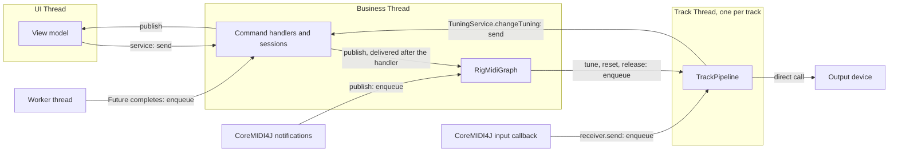

# Threading and UI design

- **Date:** 2026-10-20
- **Based on commit:** `e32ca68e` (`doc/threading`)
- **Issue:** #383, implemented by #90 (threading) and #99 (UI)
- **Status:** approved; its sub-issues are created (see [Delivery](#delivery)).
- **Inputs:** [`requirements.md`](requirements.md), [`track-node-proposal.md`](track-node-proposal.md),
  [`2026-10-20-gap-decisions.md`](2026-10-20-gap-decisions.md) and the PoC repository
  `calinburloiu/javafx-pekko-poc`. Where this design disagrees with them, it takes precedence: notably, a UI actor
  replaces the UI-thread hook of gap decision 1. The [decision log](#decision-log) says who took each decision.

Packages abbreviate `org.calinburloiu.music.microtonalist` as `…`.

## Goals

- Run the UI on the JavaFX Application Thread, the domain logic on one pinned Business Thread, and each track's MIDI
  pipeline on a pinned Track Thread of its own, at a higher priority. Code confined to one of them needs no lock.
- Communicate between them by message passing only: typed commands and events, no lambda submitted to a thread.
- Keep Apache Pekko behind a small runtime interface, so that only `app` and one runtime module see it.
- Remove Guava's `EventBus`.
- Port the Swing GUI to JavaFX with MVVM, keeping today's UX.
- Leave room for sequential consistency and for the MIDI graph of #310, without building either.

## Non-goals

- Sequential consistency, optimistic UI updates, and a direct reply to a view model's own command. They come together
  in a later issue.
- The MIDI graph refactoring (#310), editing the rig while it runs (#121), the attach/detach semantics of #305, and the
  transitive release of #316.
- New UI features. FXML, ScalaFX and TestFX. Cross-platform packaging (jlink, jpackage, a JAR with every JavaFX
  classifier).
- Moving blocking work off the Business Thread: opening a MIDI device stays a synchronous call there, as today.
- Applying a pedal's tuning change before the notes that follow it on its track (#385). Today the whole chain runs on
  the input callback thread, so the next note always uses the new tuning; with the round trip through Business, a
  note played inside it, normally well under a millisecond, or already queued behind the pedal message, sounds in
  the old one.

## Constraints

- **The note path.** A Note On going from an input device to an output device crosses exactly one thread boundary,
  the track's inlet, plus one more per inter-track link. Our code on it takes no lock and no map lookup beyond what the
  pipeline does today, and allocates only the message it enqueues; from slice 6, it takes no lock at all
  ([No locks on the note path](#no-locks-on-the-note-path)). Pekko's own hand-off, its envelope and the queues
  of the mailbox and the pinned executor, is accepted; should latency demand it, a lock-free track mailbox can replace
  it behind the runtime interface; busy-spinning is ruled out, since it burns a core per track. Slice 5 checks the
  constraint by review and by its manual test, and a follow-up measures it (see [Delivery](#delivery)).
- **No blocked UI or Business Thread.** Neither waits for another thread, at run time or at shutdown. The PoC found
  that awaiting the actor system's termination from `Application.stop()` deadlocks: the UI actor needs the thread
  that `stop()` runs on.
- **Module boundaries.** `tuner`, `rig`, `ui`, `format` and `intonation-format` depend on `businessync` only, so a
  Pekko import there doesn't compile.
- **Thread priorities are hints.** The JVM passes a Java priority to the OS, which may ignore it. Setting it meets the
  requirement; latency is checked by hand on a real instrument.
- **Pekko's `config` dependency.** Pekko 1.7.1 depends on `com.typesafe:config` 1.4.9, while `ficus` brings 1.3.4,
  which `Dependencies.scala` pins. The pin moves to Pekko's version, and the `config` module's tests check that
  `ficus` still reads the HOCON configuration.

## Context

At `e32ca68e`:

- **`Businessync`** wraps a Guava `EventBus`. `publish` delivers synchronously on the caller's thread, `run` runs its
  lambda inline, `call` uses the global `ExecutionContext`, and the UI methods are stubs. Its call sites:
  - `TuningService.changeTuning` wraps its body in `run`; `RigService.open` uses `callAsync` and
    `RigService.replaceAllTracks` uses `run`.
  - `RigSession.open` maps the repo's `Future` through `call`, then publishes `RigOpenedEvent`.
  - `TuningSession` and `RigSession` publish their events; `ScaleContextConverter` publishes
    `ScaleLossyConversionEvent`, which nothing subscribes to.
  - `RigManager` and `TuningListFrame` subscribe with Guava's `@Subscribe`, so they run on the publisher's thread.
    For a `MidiEvent`, that's CoreMIDI4J's notification thread, which races the business thread and the input
    callback over the tuners (the `TODO #90` on `RigManager.onMidiEvent`).
  - `app` forwards `JavaMidiManager`'s `MidiEvent`s to `publish`, sets `TuningSession.tunings` from the main thread,
    and awaits `RigService.open` for 10 seconds.
- **Tracks.** `Track` opens its devices in its constructor and chains `TuningChangeProcessor` → `TunerProcessor`
  in a `MidiSerialProcessor`. MIDI runs through it on the input device's callback thread, and `tune` and `reset`
  come from whoever calls `RigManager`. `RigManager.createExecutorService` (unused) names track threads `Track-<id>`,
  in a `Track` thread group, at `NORM_PRIORITY + 2`.
- **Devices.** `JavaMidiManager` and `JavaMidiDeviceHandle` are `@ThreadSafe`: a device's receiver may be called
  from any thread.
- **`sc-midi`'s plumbing** is thread-safe. `MidiProcessor`'s transmitter is a `ConcurrentMidiTransmitter`, behind a
  read-write lock, and `MidiSerialProcessor` guards its chain with another. So a message through a track with a tuning
  changer and a tuner takes four read locks in the pipeline, plus one in the input device's transmitter.
  `MidiSerialProcessor`'s ScalaDoc expects a thread per track to remove its lock-ordering caveat. The `rig`
  processors, the tuners and the tuning changers are `@NotThreadSafe`.
- **UI.** `TuningListFrame`, a Swing `JFrame` titled "Microtuner": a `JList` of tuning names, seeded from the
  deprecated `TuningService.tunings`; Up at the top wraps to the bottom and Down at the bottom to the top; digits
  `1`–`9` select tunings 1–9, and a digit past the end does nothing; a settled selection calls
  `changeTuning(IndexTuningChange(i))`; `TuningIndexUpdatedEvent` moves the selection.
- **PoC.** It proved Pekko Typed with pinned dispatchers (`thread-pool-executor`, `allow-core-timeout = off`), a UI
  actor on a dispatcher whose executor calls `Platform.runLater` (`throughput = 1`), and a shutdown that sends
  `Close` through each track's mailbox and waits only on the Business and track threads. It set no thread priority,
  and had no pub/sub, no `Future` routing and no MIDI input. Pekko 1.7.1's `reference.conf` has no thread priority
  setting.

## Overview

| Thread | Runs | Priority | Implemented by |
| ------ | ---- | -------- | -------------- |
| UI Thread (JavaFX Application Thread) | views, view models, UI subscribers | JavaFX's | the UI actor |
| Business Thread | sessions, `RigMidiGraph`, command handlers, Business subscribers | `NORM_PRIORITY` | the Business actor |
| Track Thread `Track-<id>` | one track's `TrackPipeline` | `NORM_PRIORITY + 2` | a pinned mailbox per track |
| CoreMIDI4J threads | device callbacks and notifications | the driver's | not ours |
| Worker threads | `Future`s, e.g. file and HTTP reads | the pool's | the global `ExecutionContext` |



## 1. The messaging layer

### Modules

- **`businessync`** (`org.calinburloiu.businessync`) holds the API, the dispatch logic, the runtime interface and the
  hand-drained test runtime. It depends on no Pekko, no JavaFX and no Guava.
- **`businessync-pekko`** (`org.calinburloiu.businessync.pekko`, in `base/`) implements the runtime interface with
  Pekko Typed, and holds the JavaFX executor of the UI actor, so it depends on `javafx-graphics`. Only `app` depends
  on it.

The current `Businessync` class is deleted, with `BusinessyncUiHandler`, `register` and the lambda methods (`run`,
`runIf`, `call`, `callAsync`, `runOnUi`, `callOnUi`, `handle`, `handleOnUi`).

### Messages

- A **command** extends `Command`: exactly one handler, on the Business Thread. A command expecting a reply extends
  `Request[R]`, a `Command`.
- An **event** is any `AnyRef`, so that a library's events, such as `sc-midi`'s `MidiEvent`, need no wrapper. It has
  zero or more subscribers, each on the Business or the UI Thread.
- Both are immutable values. Commands are typed messages rather than closures, so that a command type can later opt
  in to sequencing with a marker trait.

Each module declares its commands next to its service, e.g. `ChangeTuning(change)` and `ReplaceTunings(tunings)` in
`tuner`, `OpenRig(uri): Request[Unit]` and `ReplaceRig(spec)` in `rig`.

### API

A sketch; the builder settles the signatures within it.

```scala
trait Businessync {
  def send(command: Command): Unit
  def ask[R](request: Request[R]): Future[R]
  def publish(event: AnyRef): Unit

  def handle[C <: Command](commandClass: Class[C])(handler: C => Unit): Unit
  def handleRequest[R, C <: Request[R]](requestClass: Class[C])(handler: C => Future[R]): Unit
  def subscribe[E <: AnyRef](eventClass: Class[E])(handler: E => Unit): Subscription
  def subscribeOnUi[E <: AnyRef](eventClass: Class[E])(handler: E => Unit): Subscription

  def onComplete[T](future: Future[T])(continuation: Try[T] => Unit): Unit

  def requireBusinessThread(): Unit
  def requireUiThread(): Unit
}
```

- **`send`** may be called from any thread and enqueues the command to the Business Thread. A command class must
  match exactly one registered handler class, itself or a supertype, so that a module may handle a sealed family with
  one handler; `send` throws `IllegalStateException` on the caller's thread when none or several match.
- **`ask`** is `send` with a reply: the `Future` the request handler returns. It's for code outside the managed
  threads: `app`'s startup and shutdown, and tests. It throws when called on the Business or UI Thread, where awaiting
  its result would block, and where a result arrives as an event instead.
- **`publish`** may be called from any thread:
  - An event matches the subscribers of its runtime class and of every supertype, class or trait. A subscriber
    registered for two matching classes receives it twice. Subscribers run in the order they subscribed.
  - **Business subscribers.** When `publish` runs inside a Business handler, the event goes to a local queue, which
    the layer drains after the handler returns and before it takes the next mailbox message. Events published while
    the queue drains join it. So no subscriber runs nested in the publisher's code, and everything a command causes
    is handled before the next command starts. Published from any other thread, the event is enqueued to the Business
    mailbox.
  - **UI subscribers.** The event is enqueued to the UI actor at once, in publish order.
  - A later issue may let a publisher opt in to delivery during `publish`; nothing needs it now.
- **`handle`** and **`handleRequest`** are called while the modules are wired, before any command is sent; a second
  handler for the same class throws. A request handler that returns a value wraps it in `Future.successful`.
- **`subscribe`** and **`subscribeOnUi`** may be called from any thread; the registry is copy-on-write. The returned
  `Subscription` cancels it.
- **`onComplete`** may be called on the Business Thread only, so that it continues work that Business started. When
  the `Future` completes, the layer enqueues the continuation to the Business mailbox, where it runs as the rest of the
  handler: with the same causing command (below), and with its own published events drained after it returns. This
  is Pekko's `pipeToSelf` with the message handled in place:

  ```scala
  // RigSession.open, on the Business Thread
  val opened = Promise[Unit]()
  businessync.onComplete(rigRepo.readRigAsync(uri)) {
    case Success(rigSpec) =>
      tracks = rigSpec
      _uri = Some(uri)
      businessync.publish(RigOpenedEvent(uri, rigSpec))
      opened.success(())
    case Failure(exception) => opened.failure(exception)
  }
  opened.future
  ```
- **Thread checks** throw `IllegalStateException` off their thread. The sessions and `RigMidiGraph` call
  `requireBusinessThread` in their public methods, the view models `requireUiThread` in theirs.
- **Errors.** A non-fatal exception thrown by a handler, a continuation or a subscriber is logged, and fails the
  `ask`'s `Future` if there is one. The other subscribers still run and the thread keeps going.

### The causing command

Every `send` and `ask` gives its command an id, from one counter. While the layer runs the handler of command N, a
continuation it started, or a subscriber draining its events, every event published is stamped N; an event published
anywhere else carries none. The stamp travels in the layer's internal envelope. The test runtime exposes it, so that
tests can check it; the public API exposes it when sequential consistency needs it.

### The runtime interface

What the layer needs from a threading runtime, and all that Pekko implements:

- **Start a pinned mailbox** with a name and a thread priority, around a handler of its messages. It runs on a thread
  of its own, one message at a time, in arrival order. `send` may be called from any thread. Stopping it processes
  the messages already queued, then completes a `Future`.
- **Start the UI mailbox**, the same on the UI Thread.
- **Tell whether the current thread is a mailbox's.** Each mailbox records the thread it runs on with its first
  message, and the runtime's start returns only once the Business and UI mailboxes have. So the checks compare
  `Thread.currentThread`, for any UI toolkit.

The layer owns two mailboxes, the Business mailbox and the UI mailbox. `rig` starts one per track through the same
interface, as [section 3](#3-track-threads) describes.

### The test runtime

`ManualRuntime`, in `businessync`'s main sources so that every module's tests use it without a `test->test`
dependency, and so that coverage counts its tests. Each mailbox is a queue that the test drains by hand, e.g.
`drainAll()` until every queue is empty. A mailbox's thread is "current" while its queue drains, so the thread checks
behave as in production. Sessions, services, `RigMidiGraph`, `TrackMidiNode` and view models are tested on it, with
no `ActorSystem`, and see messages in production order. A repo stubbed with `Future.successful` completes its
`onComplete` at once, so a test stays deterministic.

### The Pekko runtime

- **Versions.** Pekko Typed 1.7.x, the PoC's line (`pekko-actor-typed`, `pekko-slf4j`; `pekko-actor-testkit-typed` in
  `Test`), on one `ActorSystem`.
- **Pinned mailboxes.** One actor per mailbox on a `PinnedDispatcher` with `thread-pool-executor` and
  `allow-core-timeout = off`. Pekko has no priority setting, so the runtime sets the priority and the thread name
  itself: from the actor's setup on its own thread, since a pinned thread serves one actor only, or through a custom
  dispatcher configurator. Builder's call. Names: `Business`, `Track-<id>`.
- **The UI actor** runs on a dispatcher whose executor calls `Platform.runLater`, with `throughput = 1`, as in the PoC.
  The executor class is named by the configuration, so that `app` can name a throwaway Swing executor until #99
  lands (slice 3).
- **Startup.** SLF4J initialises before the `ActorSystem` starts, as the PoC found. The UI mailbox needs the JavaFX
  toolkit started first.
- **Errors.** The layer catches non-fatal exceptions, so Pekko's supervision never stops a mailbox.
- **Shutdown.** Stop the track mailboxes, then the Business mailbox, then terminate the `ActorSystem`. It's never
  awaited on the UI or Business Thread.
- **Tests.** The runtime's own tests use the `ActorTestKit` with latches, no sleeps. The UI actor's tests use a
  stand-in executor, since they have no JavaFX toolkit.
- **Packaging.** `assembly` concatenates the `reference.conf`s.

## 2. The Business side

- **Services** stay `@ThreadSafe` facades that only send: `TuningService.changeTuning(change)` sends
  `ChangeTuning(change)`; a new `TuningService.replaceTunings` replaces `app`'s direct write to the session;
  `RigService.open(uri)` asks `OpenRig(uri)` and returns its `Future`.
- **Handlers.** Each `*Module` registers its commands' handlers when it's built, e.g. `TunerModule` maps `ChangeTuning`
  to `TuningSession`.
- **Sessions** stay `@NotThreadSafe` on the Business Thread, publish through the layer, and continue `Future`s with
  `onComplete`.
- **`RigMidiGraph`**, renamed from `RigManager`, subscribes on the Business Thread to `TuningEvent` and `MidiEvent`.
  `MidiEvent`s, published by `app`'s `MidiEventPublisher` on CoreMIDI4J's thread, are then handled on Business, which
  removes the race of `RigManager.onMidiEvent`.
- **Startup in `app`.** Start the runtime; build the modules, which registers the handlers; subscribe the view models;
  then `ask` `OpenRig` and await it as today, and replace the tunings. The composition is still read on the main
  thread, until #100's composition-opening workflow.

## 3. Track threads

### `TrackMidiNode`

One concrete class in `rig`, built on the runtime interface, that replaces `Track` together with `TrackPipeline`.

- **Its mailbox** carries MIDI and the control messages: `Tune(tuning)`, `ResetTuner`, `ReleaseInput`,
  `SetReceivers(receivers)` and `Close`. A control message applies between two MIDI messages, never during one.
- **Its inlet.** `receiver.send` only enqueues a MIDI message, and is safe from any thread: the input device's
  callback and the upstream tracks call it. Business wires it but never sends through it.
- **Its outlet.** `transmitter`, a `MutableMidiTransmitter` confined to Business, keeps the Business-side copy of the
  receivers. Its `setReceivers` override enqueues `SetReceivers` with the new `Seq` on every change, and the track
  thread installs it in the pipeline. The track sends to its output device directly, so `DeviceMidiNode` has no thread
  concerns.
- **Errors.** Each message is handled in a `try`: a non-fatal exception is logged with the track's id, the message is
  dropped, a `TrackErrorEvent(trackId, exception)` is published, and the track goes on. Nothing subscribes to the event
  yet; the UI or a crash reporter can later. It's the one use of the messaging API from a track thread, through
  `publish`, which any thread may call.
- **Track→Business** goes through the services only: `TuningChangeProcessor` calls `TuningService.changeTuning`,
  which sends `ChangeTuning`. A pedal and the UI changing the tuning at once both reach the Business mailbox.

### `TrackPipeline`

It holds today's chain, `TuningChangeProcessor` → `TunerProcessor` in a `MidiSerialProcessor`, which #312 can replace
without touching threads. Business builds it from the `TrackSpec` with no receivers and hands it to the mailbox,
whose enqueue publishes it safely; from then on only the track thread uses it, and its methods check that. The first
`SetReceivers` attaches the output, so the tuner's reset runs on the track thread.

A `TrackSpec` holds its `Tuner` and `TuningChanger` instances, which are stateful (#354). Once a track runs, Business
must not call them, not even a read such as `canTune` (#326).

### No locks on the note path

Once slice 5 confines each pipeline to its track's thread, the locks of `sc-midi`'s plumbing inside it guard nothing,
yet they stay on the note path, next to the read lock of the input device's transmitter. Slice 6 removes them all:

- **Processors.** `MidiProcessor`'s transmitter extends `MutableMidiTransmitter` instead of `ConcurrentMidiTransmitter`,
  and `MidiSerialProcessor` drops its read-write lock.
  - Both become `@NotThreadSafe`: a processor is used from one thread at a time, and handed to another only through a
    happens-before edge, such as the track mailbox's enqueue. `sc-midi` can't check threads, since it doesn't depend
    on `businessync`, so `TrackPipeline`'s checks guard its processors.
  - Their ScalaDoc loses its lock clauses, the hooks' write lock and `MidiSerialProcessor`'s lock-ordering caveat, and
    the test that the hooks run inside the write lock goes with that contract.
  - The pipeline's processors are the only `MidiProcessor`s, so no concurrent variant is kept.
- **Device transmitters.** A device's transmitter stays a `ConcurrentMidiTransmitter`, since the input callback reads
  it while Business changes it, but its readers stop locking: they read a volatile `Seq`.
  - Writers still take a lock among themselves, so that a read-modify-write such as `addReceiver` loses no concurrent
    update.
  - A read sees the same snapshot as under the read lock. Besides the atomic updates it saves per message, the input
    callback no longer waits for a write lock held by the lower-priority Business Thread.
  - A change no longer holds readers off while a `setReceivers` override runs: a message may reach a new receiver as
    soon as the new `Seq` is stored. `MidiProcessorTransmitter` relies on the old contract, so that no note reaches an
    output before the tuner's reset, which is why the switch waits for the first bullet. No other subclass in the main
    code overrides `setReceivers`. The tests that check that readers are held off become tests that writers lose no
    update and that a reader never waits for a writer.
  - `MutableMidiTransmitter`'s `private var` can't be made volatile from a subclass, so the storage changes, e.g. by
    becoming a hook of its own. Builder's call.
- **MIDI after `Close`.** A reader may still send to a receiver it read just before that receiver was removed, under
  the lock as under the volatile. So a track's inlet may get a MIDI message after `RigMidiGraph` unsubscribed it and
  enqueued `Close`. The runtime interface then says that a stopped mailbox drops what it gets, and the track drops
  such MIDI silently. How the Pekko runtime keeps it out of its dead-letter log, e.g. with Pekko's
  `DeadLetterSuppression`, is the builder's call. Until slice 6, it reaches the dead letters, which log it, harmlessly.

A device's receiver stays safe to call from several tracks, as today.

Slice 6 takes from #311 the removal of the processors' locks, which leaves #311 to turn the transmitter into an outlet.

### `RigMidiGraph`

The outer graph, on the Business Thread: it builds the tracks from a `RigSpec`, opens and closes their devices, and
wires devices and tracks. It replaces `RigManager`; device ownership moves to it from `Track`.

- **Building a rig:**
  1. open the devices and create the nodes;
  2. set every node's receivers: its output device's receiver and the inlets of the tracks it feeds;
  3. tune each node with the last tuning `RigMidiGraph` received from a `TuningEvent`, if any;
  4. subscribe each node's inlet to its input device's transmitter.

  The enqueues of step 2 happen before any input arrives, so no MIDI reaches a track before its outlet is wired. That
  probably fixes #298 too; if a test shows it, the slice's PR closes it.
- **Tuning, resets and releases** fan out to the nodes as enqueues: a `TuningEvent` tunes every track, an output
  device opening resets the tuners of the tracks wired to it, an input device going away releases the tracks wired
  to it.
- **Closing a track:** unsubscribe its inlet from the input device; enqueue `Close`, which drains the queued MIDI,
  detaches the output, so that the tuner sends the courtesy 12-EDO messages, and completes the `Future` the node
  returns; on that `Future`, through `onComplete`, release the devices with `MidiManager.closeDevice`.
- **Closing several tracks**, as closing or replacing the rig does, closes them one at a time in rig order, each once
  the previous one's `Close` completed, as today's sequential `close` calls do. So an upstream track's 12-EDO
  messages pass through the tracks it feeds, e.g. a track without a tuner, before they close. An order that follows
  the links is #310's.
- **Replacing the rig** builds the new tracks only once every old track has closed, so that on a shared device the
  old track's 12-EDO messages come before the new track's reset, as today. Until then the graph holds no tracks, and a
  tuning event only updates the last tuning that step 3 applies. The handshake also hands a `Tuner` instance that a
  new spec reuses from the old thread to the new one safely. Replacing returns a `Future` that completes once the new
  rig is built, so that closing the rig, a replacement with an empty one, can be awaited.

### Renames

- `MidiDeviceHandle` → `DeviceMidiNode`, and `JavaMidiDeviceHandle` → `JavaDeviceMidiNode`.
- `RigManager` → `RigMidiGraph`, matching `DeviceMidiNode` and `TrackMidiNode`. When #312's `MidiGraph` arrives,
  `RigMidiGraph` holds one.
- `Track` disappears into `TrackMidiNode` and `TrackPipeline`.

## 4. The JavaFX UI

### Build

- OpenJFX: the latest stable release supporting JDK 25 at plan time (26.0.2 today). `ui` depends on `javafx-base`,
  `javafx-graphics` and `javafx-controls`, with the classifier of the build host, as the PoC does; the fat JAR is
  therefore per platform.
- `app`'s main class doesn't extend `Application`, which avoids the "JavaFX runtime components are missing" error.
  Whether `main` starts the toolkit with `Platform.startup` or launches an `Application` subclass is the builder's
  call; the PoC did the latter.
- `ui` loses Swing and its Guava `@Subscribe`. `TuningService.tunings` is removed.

### MVVM

As #99 decides: views are built in Scala code, styled with CSS, and hold no logic; view models are plain Scala over
JavaFX properties and observable collections, hold all presentation logic, and are tested without the toolkit.

- **`TuningListViewModel`**:
  - subscribes on the UI Thread to `TuningsUpdatedEvent`, which sets the tuning names and the selection, and to
    `TuningIndexUpdatedEvent`, which sets the selection;
  - on a settled user selection, ignoring the transient `-1`, sends `changeTuning(IndexTuningChange(i))`, unless `i`
    is the index it last applied from an event;
  - handles a key and tells the view whether it consumed it: Up on the first tuning selects the last, Down on the
    last selects the first, `1`–`9` select tunings 1–9, and a digit past the end does nothing. Other keys, and Up and
    Down elsewhere, are left to the `ListView`.
  - Whether it takes JavaFX's `KeyCode` or a small key type of its own is the builder's call.
- **`TuningListView`**: a `ListView` bound to the view model, in a window titled "Microtuner", 480×640, forwarding
  its selection and key presses.
- `app` builds the view model, which subscribes, before it sends the startup commands, so that the first
  `TuningsUpdatedEvent` isn't missed.

### Shutdown

Closing the window, or a JVM shutdown hook, starts one idempotent shutdown sequence on a thread that is neither the UI
nor the Business Thread:

1. ask Business to close the rig, e.g. through a `RigService.close()` asking `CloseRig`, which closes every track as
   [section 3](#rigmidigraph) describes, and await it with a timeout;
2. close the `MidiManager`, and give the devices time to send what's queued, as today's one-second sleep does;
3. shut the runtime down;
4. `Platform.exit()`.

### Tests and coverage

- `TuningListViewModel` is built with TDD on `ManualRuntime` and meets 80% statements and branches.
- Views have no unit tests, and `coverageExcludedFiles` excludes them by a naming pattern such as `.*/ui/.*View`,
  with a justifying comment. Scala 3 ignores inline `$COVERAGE-OFF$` markers.
- The `ui` architecture doc or `test-conventions.md` documents the exemption, so that agents following TDD don't
  test views.

## Delivery

One sub-issue per slice, each with its own plan, `<date>-<sub-issue>-<topic>-plan.md` in this folder, written just in
time against the code as the previous slices left it, and its own PR onto `main`. Each slice ends with the final
checks of `AGENTS.md`.

| # | Slice | Parent | Needs | Sub-issue |
| - | ----- | ------ | ----- | --------- |
| 1 | The new `businessync` API on `ManualRuntime` | #90 | — | #386 |
| 2 | `businessync-pekko` | #90 | 1 | #387 |
| 3 | Move the Business side onto the new layer | #90 | 2 | #388 |
| 4 | Rename to `DeviceMidiNode` and `RigMidiGraph` | #90 | 3 | #389 |
| 5 | Track threads | #90 | 4 | #390 |
| 6 | No locks on the note path | #90 | 5 | #391 |
| 7 | `TuningListViewModel` | #99 | 3 | #392 |
| 8 | The JavaFX app | #99 | 7 | #393 |

Slices 4–6 and 7–8 are independent of each other.

1. **The new `businessync` API on `ManualRuntime`.** Section 1 without Pekko: messages, `send`, `ask`, `publish`,
   handlers, subscriptions, `onComplete`, the causing command, the thread checks, the runtime interface and
   `ManualRuntime`. It ships unused, next to the old class, which keeps working until slice 3 deletes it; the builder
   resolves the name clash, e.g. by renaming the old class. Done when its tests cover dispatch by base class, draining after the handler, stamping, `onComplete`, the thread
   checks and the errors, at 80/80.
2. **`businessync-pekko`.** The Pekko runtime: pinned mailboxes with names and priorities, the UI mailbox on a
   configurable executor, startup and shutdown. It ships unused. Done when its tests show a pinned mailbox keeps one
   thread with the given name and priority, and that stopping it processes what's queued first.
3. **Move the Business side.** Services, sessions, handlers and `RigManager`'s subscriptions move to the new API,
   `app` runs on the Pekko runtime, and Guava's `EventBus` and the old `Businessync` go. The Swing frame stays: its
   UI actor runs on a throwaway Swing executor in `app` (`SwingUtilities.invokeLater`, `// TODO #393`), and `app`
   awaits the tunings before building it, since it still reads `TuningService.tunings`. Tracks still run on the
   input callback thread, while every tuning change now reaches them from the Business Thread, so until slice 5
   `Track` serialises its pipeline, `tune`, `resetTuner` and `releaseInput` with a lock (`// TODO #390`). A
   `// TODO #385` at `TuningChangeProcessor`'s call to `changeTuning` marks the round trip. Done when no `@Subscribe` and no `EventBus` remains, and the app plays and switches tunings
   as before.
4. **Rename to `DeviceMidiNode` and `RigMidiGraph`.** Mechanical, code and docs. Done when neither old name appears
   outside git history.
5. **Track threads.** Section 3: `TrackMidiNode`, `TrackPipeline`, `RigMidiGraph`'s device ownership, the close and
   replace handshake, `TrackErrorEvent`. Done when a track's pipeline runs only on its `Track-<id>` thread, the note
   path meets the constraint above, and a manual test on a real instrument finds no audible latency change.
6. **No locks on the note path.** [No locks on the note path](#no-locks-on-the-note-path): `MidiProcessor` and
   `MidiSerialProcessor` lose their locks, a device transmitter's readers read a volatile, and a track drops MIDI that
   arrives after `Close` silently. Done when our code on the note path takes no lock, a test shows that a reader of a
   device transmitter never waits for a writer, and `sc-midi`'s docs say that a processor is confined to one thread.
7. **`TuningListViewModel`.** On `javafx-base` only, with TDD on `ManualRuntime`, against the `TuningService` that
   slice 3 moved onto the new API. It ships unused. Done at 80/80.
8. **The JavaFX app.** Section 4: the JavaFX dependencies, the launch, `TuningListView`, the JavaFX executor in
   `businessync-pekko`, the shutdown sequence, the coverage exclusion and the docs. Swing, the Swing executor and
   `TuningService.tunings` go. Done when the app behaves as the Swing one did, including the shortcuts, and quits
   without leaving notes held or blocking.

**Docs**, updated by the slice that changes what they describe, through the `architecture-docs` skill: `businessync`'s,
`sc-midi`'s, `rig`'s, `tuner`'s, `ui`'s and `app`'s `ARCHITECTURE.md`, a new one for `businessync-pekko`, `module-overview.md`,
`domain-concepts.md`, `data-flow.md`, `midi-device-lifecycle.md`, and the wiki's *Threading Model* page.

**Follow-ups:**

- #385: applying a pedal's tuning change before the notes that follow it on its track.
- Measuring the MIDI latency end to end, against `main` at `a8ba00df`, before #90. The app runs from its JAR, a
  probe in another process sends through one IAC bus and timestamps the output on another, and the track has an
  `mtsOctave1ByteNonRealTime` tuner and a `pedal` tuning changer. The cases are note pass-through, a pedal's tuning
  change, and a pedal followed at once by a note; the same cases with the `monophonicPitchBend` and `mpe` tuners
  tell their own overhead apart from the architecture's. The flow becomes a project skill, reusable for tuner
  regressions and other end-to-end flows. Its issue is #394.

**Issues to update:** #310–#313, #121 and #97 are updated to match this design.

## Decision log

| Decision | Taken by |
| -------- | -------- |
| Pekko behind our own layer; `businessync` / `businessync-pekko`; tracks use the runtime, not the messaging API; layered graph | gap decisions |
| Message passing only: no `run` / `call` with lambdas; the `businessync` API may be rewritten | user |
| A direct reply only for code outside the managed threads; none for view models | user |
| `onComplete` continuations written as a lambda in place | user |
| A UI actor on a `Platform.runLater` executor, as in the PoC, instead of an injected UI hook | user |
| Delivery to Business subscribers after the handler returns; publish-time delivery left for later | proposed by Claude, agreed by the user |
| A track error is logged, the message dropped, the track kept running, and `TrackErrorEvent` published | user |
| The slices and their order, including the throwaway Swing executor | proposed by Claude, agreed by the user |
| Single-threaded `sc-midi` processors in the track pipeline | user |
| The processors' locks removed in a slice of their own, after track threads | Claude |
| Devices' transmitters read through a volatile, and MIDI after `Close` dropped silently, both in slice 6 | proposed by Claude, agreed by the user |
| `RigManager` → `RigMidiGraph` | user |
| The pedal-to-note round trip accepted for now, with #385 and a `TODO` | user |
| #121 is rig editability, after #90 | user |
| Thread checks by recorded thread, not `Platform.isFxApplicationThread`; the JavaFX executor in `businessync-pekko` | Claude, unopposed |
| Device ownership in `RigMidiGraph`; close and replace by handshake; the last tuning applied to new tracks | Claude |
| `ask` forbidden on the Business and UI Threads; one handler per command, matched by class or supertype | Claude |
| `ManualRuntime` in `businessync`'s main sources | Claude |
| `TrackPipeline` built on Business without receivers; Business never calls a running track's tuner | Claude |
| Tracks closed one at a time in rig order; a temporary lock in `Track` during slices 3–4 | Claude |
| The note-path constraint covers our code; Pekko's hand-off is accepted; no busy-spinning | proposed by Claude, agreed by the user |
| An end-to-end latency measurement against `a8ba00df`, as a reusable skill | user |
| Keeping the names `businessync` and `businessync-pekko` | Claude |
