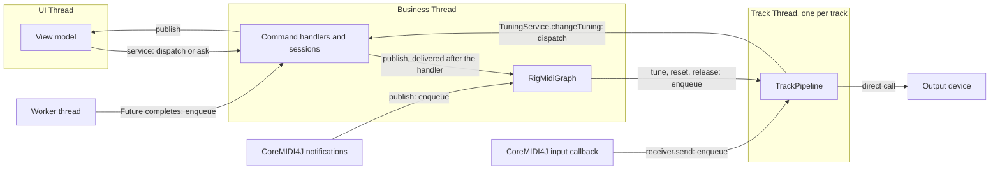

# Threading and UI design

- **Date:** 2026-10-20, revised on 2026-10-23 after a review
- **Based on commit:** `e32ca68e` (`doc/threading`); the revision checked its facts at `adc1f137`
- **Issue:** #383, implemented by #90 (threading) and #99 (UI)
- **Status:** approved; its sub-issues are created, and some need updating to the revision (see
  [Delivery](#delivery)).
- **Inputs:** [`requirements.md`](requirements.md), [`track-node-proposal.md`](track-node-proposal.md),
  [`2026-10-20-gap-decisions.md`](2026-10-20-gap-decisions.md), the review in
  [`design-review-prompt.md`](design-review-prompt.md) and the PoC repository `calinburloiu/javafx-pekko-poc`. Where
  this design disagrees with them, it takes precedence: notably, a UI actor replaces the UI-thread hook of gap
  decision 1, and the layer is named `messaging` rather than `businessync`. The [decision log](#decision-log) says who
  took each decision.

Packages abbreviate `org.calinburloiu.music.microtonalist` as `…`.

## Goals

- Run the UI on the JavaFX Application Thread, the domain logic on one pinned Business Thread, and each track's MIDI
  pipeline on a pinned Track Thread of its own, at a higher priority. Code confined to one of them needs no lock.
- Communicate between them by message passing only: typed commands and events, no lambda submitted to a thread.
- Keep Apache Pekko behind a small runtime interface, so that only `app` and one runtime module see it.
- Remove Guava's `EventBus`.
- Port the Swing GUI to JavaFX with MVVM, keeping today's UX.
- Leave room for sequential consistency and for the MIDI graph of #310, without building either.

## Non-goals

- Sequential consistency and optimistic UI updates. They come in a later issue, on the infrastructure this design
  puts in place: `ask` on every thread and the causing command.
- The MIDI graph refactoring (#310), editing the rig while it runs (#121), muting or unmuting a running track
  included, the attach/detach semantics of #305, and the transitive release of #316.
- New UI features. FXML, ScalaFX and TestFX. Cross-platform packaging (jlink, jpackage, a JAR with every JavaFX
  classifier).
- Moving blocking work off the Business Thread: opening a MIDI device stays a synchronous call there, as today.
- Applying a pedal's tuning change before the notes that follow it on its track (#385). Today the whole chain runs on
  the input callback thread, so the next note always uses the new tuning; with the round trip through Business, a
  note that the track processes inside it, normally well under a millisecond, sounds in the old one. The urgent
  `Tune` ([`TrackMidiNode`](#trackmidinode)) spares only the notes still queued when it arrives.

## Constraints

- **The note path.** A Note On going from an input device to an output device crosses exactly one thread boundary,
  the track's inlet, plus one more per inter-track link. Our code on it takes no lock and no map lookup beyond what the
  pipeline does today, and allocates only the message it enqueues; from slice 6, it takes no lock at all
  ([No locks on the note path](#no-locks-on-the-note-path)). Pekko's own hand-off, its envelope and the queues
  of the mailbox and the pinned executor, is accepted; should latency demand it, a lock-free track mailbox can replace
  it behind the runtime interface; busy-spinning is ruled out, since it burns a core per track. Slice 5 checks the
  constraint by review and by its manual test, and a follow-up measures it (see [Delivery](#delivery)).
- **No blocked UI or Business Thread.** Neither waits for another thread, at run time or at shutdown, and the layer
  makes an `Await` there fail fast ([API](#api)). The PoC found that awaiting the actor system's termination from
  `Application.stop()` deadlocks: the UI actor needs the thread that `stop()` runs on.
- **Module boundaries.** `tuner`, `rig`, `ui`, `format` and `intonation-format` depend on `messaging` only, so a
  Pekko import there doesn't compile.
- **Thread priorities are hints.** The JVM passes a Java priority to the OS, which may ignore it. Setting it meets the
  requirement; latency is checked by hand on a real instrument.
- **Pekko's `config` dependency.** Pekko 1.7.1 depends on `com.typesafe:config` 1.4.9, while `ficus` brings 1.3.4,
  which `Dependencies.scala` pins. The pin moves to Pekko's version, and the `config` module's tests check that
  `ficus` still reads the HOCON configuration.

## Context

At `e32ca68e`:

- **`Businessync`** wraps a Guava `EventBus`. `publish` delivers synchronously on the caller's thread, `run` runs its
  lambda inline, `call` uses the global `ExecutionContext`, and the UI methods are stubs. Its call sites:
  - `TuningService.changeTuning` wraps its body in `run`; `RigService.open` uses `callAsync` and
    `RigService.replaceAllTracks` uses `run`.
  - `RigSession.open` maps the repo's `Future` through `call`, then publishes `RigOpenedEvent`.
  - `TuningSession` and `RigSession` publish their events; `ScaleContextConverter` publishes
    `ScaleLossyConversionEvent`, which nothing subscribes to.
  - `RigManager` and `TuningListFrame` subscribe with Guava's `@Subscribe`, so they run on the publisher's thread.
    For a `MidiEvent`, that's CoreMIDI4J's notification thread, which races the business thread and the input
    callback over the tuners (the `TODO #90` on `RigManager.onMidiEvent`).
  - `app` forwards `JavaMidiManager`'s `MidiEvent`s to `publish`, sets `TuningSession.tunings` from the main thread,
    and awaits `RigService.open` for 10 seconds.
- **Tracks.** `Track` opens its devices in its constructor and chains `TuningChangeProcessor` → `TunerProcessor`
  in a `MidiSerialProcessor`. MIDI runs through it on the input device's callback thread, and `tune` and `reset`
  come from whoever calls `RigManager`. `RigManager.createExecutorService` (unused) names track threads `Track-<id>`,
  in a `Track` thread group, at `NORM_PRIORITY + 2`. `RigManager` builds no track for a muted `TrackSpec`, so a link
  to a muted track throws `NoSuchElementException`, and nothing rejects a cycle of links.
- **Devices.** `JavaMidiManager` and `JavaMidiDeviceHandle` are `@ThreadSafe`: a device's receiver may be called
  from any thread. `closeDevice` releases one reference to a device.
- **`sc-midi`'s plumbing** is thread-safe. `MidiProcessor`'s transmitter is a `ConcurrentMidiTransmitter`, behind a
  read-write lock, and `MidiSerialProcessor` guards its chain with another. So a message through a track with a tuning
  changer and a tuner takes four read locks in the pipeline, plus one in the input device's transmitter.
  `MidiSerialProcessor`'s ScalaDoc expects a thread per track to remove its lock-ordering caveat. The `rig`
  processors, the tuners and the tuning changers are `@NotThreadSafe`.
- **UI.** `TuningListFrame`, a Swing `JFrame` titled "Microtuner": a `JList` of tuning names, seeded from the
  deprecated `TuningService.tunings`; Up at the top wraps to the bottom and Down at the bottom to the top; digits
  `1`–`9` select tunings 1–9, and a digit past the end does nothing; a settled selection calls
  `changeTuning(IndexTuningChange(i))`; `TuningIndexUpdatedEvent` moves the selection.
- **Shutdown.** `app`'s JVM shutdown hook closes the rig and the `MidiManager`, then sleeps one second so that the
  devices send what's queued.
- **PoC.** It proved Pekko Typed with pinned dispatchers (`thread-pool-executor`, `allow-core-timeout = off`), a UI
  actor on a dispatcher whose executor calls `Platform.runLater` (`throughput = 1`), and a shutdown that sends
  `Close` through each track's mailbox and waits only on the Business and track threads. It set no thread priority,
  and had no pub/sub, no `Future` routing and no MIDI input. Pekko 1.7.1's `reference.conf` has no thread priority
  setting.

## Overview

| Thread | Runs | Priority | Implemented by |
| ------ | ---- | -------- | -------------- |
| UI Thread (JavaFX Application Thread) | views, view models, UI subscribers | JavaFX's | the UI actor |
| Business Thread | sessions, `RigMidiGraph`, command handlers, Business subscribers | `NORM_PRIORITY` | the Business actor |
| Track Thread `Track-<id>` | one track's `TrackPipeline` | `NORM_PRIORITY + 2` | a pinned mailbox per track |
| CoreMIDI4J threads | device callbacks and notifications | the driver's | not ours |
| Worker threads | `Future`s, e.g. file and HTTP reads | the pool's | the global `ExecutionContext` |
| Pekko's default dispatcher | the shutdown sequence | the pool's | Pekko's `CoordinatedShutdown` |



## 1. The messaging layer

### Modules

- **`messaging`** (`…messaging`, in `base/`) holds the API, the dispatch logic and the runtime interface; its test
  sources hold the hand-drained test runtime. It depends on no Pekko, no JavaFX and no Guava.
- **`messaging-pekko`** (`…messaging.pekko`, in `base/`) implements the runtime interface with Pekko Typed. It
  doesn't depend on JavaFX, since `app` holds the UI actor's executor. Only `app` depends on it.

Both are new modules, so they sit next to the old `businessync` module until slice 3 deletes it, with `Businessync`,
`BusinessyncUiHandler`, `register` and the lambda methods (`run`, `runIf`, `call`, `callAsync`, `runOnUi`,
`callOnUi`, `handle`, `handleOnUi`).

### Messages

- A **command** extends `Command`: exactly one handler, on the Business Thread. A command expecting a reply extends
  `Request[R]`, a `Command`.
- An **event** is any `AnyRef`, so that a library's events, such as `sc-midi`'s `MidiEvent`, need no wrapper. It has
  zero or more subscribers, each on the Business or the UI Thread.
- Both are immutable values. Commands are typed messages rather than closures, so that a command type can later opt
  in to sequencing with a marker trait.

Each module declares its commands next to its service, e.g. `ChangeTuning(change)` and `ReplaceTunings(tunings)` in
`tuner`, `OpenRig(uri): Request[Unit]`, `ReplaceRig(spec)` and `CloseRig: Request[Unit]` in `rig`.

### API

A sketch; the builder settles the signatures within it.

```scala
trait MessageBus {
  def dispatch(command: Command): Unit
  def ask[R](request: Request[R]): Future[R]
  def publish(event: AnyRef): Unit

  def handle[C <: Command](commandClass: Class[C])(handler: C => Unit): Unit
  def handleRequest[R, C <: Request[R]](requestClass: Class[C])(handler: C => Future[R]): Unit
  def subscribe[E <: AnyRef](eventClass: Class[E])(handler: E => Unit): Subscription
  def subscribeOnUi[E <: AnyRef](eventClass: Class[E])(handler: E => Unit): Subscription

  def requireBusinessThread(): Unit
  def requireUiThread(): Unit
}

extension [T](future: Future[T])(using messageBus: MessageBus) {
  def mapOnBusiness[U](f: T => U): Future[U]
  def flatMapOnBusiness[U](f: T => Future[U]): Future[U]
  def onCompleteOnBusiness(f: Try[T] => Unit): Unit
  def mapOnUi[U](f: T => U): Future[U]
  def onCompleteOnUi(f: Try[T] => Unit): Unit
}
```

- **`dispatch`** may be called from any thread and enqueues the command to the Business Thread. A command class must
  match exactly one registered handler class, itself or a supertype, so that a module may handle a sealed family with
  one handler; `dispatch` throws `IllegalStateException` on the caller's thread when none or several match. Several
  can match although registration rejects related handler classes, since a command class may mix in two unrelated
  handled traits, e.g. `X extends TunerCommand with RigCommand`. `dispatch` resolves each command class once, and
  caches the result.
- **`ask`** is `dispatch` with a reply: the `Future` the request handler returns. Any thread may call it, the Business
  and UI Threads included, which continue its reply with `mapOnBusiness` or `mapOnUi`. The layer completes that
  `Future` only after the drain that follows the reply, that of the handler or of the continuation that completed the
  handler's `Future`. So the events the command published up to its reply come before it, and a `mapOnUi`
  continuation of the reply runs after their UI subscribers; sequential consistency will build on that.
- **Awaiting** an incomplete `Future` throws `IllegalStateException` on the Business Thread and in a UI mailbox
  message: the layer runs each of their messages inside `BlockContext.withBlockContext`, with a context that refuses to
  block, which `Await.result` and `Await.ready` consult. On Business, awaiting a request's reply would deadlock, since
  its handler runs only after the await. The check misses code that JavaFX calls directly, such as a view's event
  handler, and blocking without `Await`, e.g. on a latch.
- **`publish`** may be called from any thread:
  - An event matches the subscribers of its runtime class and of every supertype, class or trait. A subscriber
    registered for two matching classes receives it twice. Subscribers run in the order they subscribed.
  - **Business subscribers.** When `publish` runs inside a Business handler, the event goes to a local queue, which
    the layer drains after the handler returns and before it takes the next mailbox message. Events published while
    the queue drains join it. So no subscriber runs nested in the publisher's code, and everything a command causes
    is handled before the next command starts. Published from any other thread, the event is enqueued to the Business
    mailbox.
  - **UI subscribers.** The event is enqueued to the UI actor at once, in publish order.
  - A later issue may let a publisher opt in to delivery during `publish`; nothing needs it now.
- **`handle`** and **`handleRequest`** are called while the modules are wired, before any command is dispatched; a
  handler for a class that is the same as, a subtype of or a supertype of an already registered one throws. A request
  handler that returns a value wraps it in `Future.successful`.
- **`subscribe`** and **`subscribeOnUi`** may be called from any thread; the registry is copy-on-write. The returned
  `Subscription` cancels it.
- **Continuations.** The `Future` extension methods continue a `Future` on the Business or the UI Thread; the builder
  adds others, e.g. `flatMapOnUi`, when a call site needs them. Each may be called on its own thread only, so that it
  continues work started there rather than let another thread run a lambda there. When the `Future` completes, the
  layer enqueues the continuation to that thread's mailbox, where it runs as the rest of the handler: with the causing
  command (below) captured at the call, and on Business with its own published events drained after it returns.
  - They run on a private `ExecutionContext` per thread. It stays private, since a public one would let any thread
    run a lambda on Business, as `run` did. It can't be a plain `given` either: Scala calls `execute` on the thread
    that completes the `Future`, where the causing command is unknown.
  - This is Pekko's `pipeToSelf` with the message handled in place. A failure of the read or of the continuation
    fails the returned `Future`, and so the `ask` of `OpenRig`:

    ```scala
    // RigSession.open, on the Business Thread
    rigRepo.readRigAsync(uri).mapOnBusiness { rigSpec =>
      tracks = rigSpec
      _uri = Some(uri)
      messageBus.publish(RigOpenedEvent(uri, rigSpec))
    }
    ```
- **Thread checks** throw `IllegalStateException` off their thread. The sessions and `RigMidiGraph` call
  `requireBusinessThread` in their public methods, the view models `requireUiThread` in theirs.
- **Errors.** A non-fatal exception thrown by a handler, an `onComplete…` continuation or a subscriber is logged, and
  fails the `ask`'s `Future` if there is one; one thrown by a `map…` or `flatMap…` continuation fails the `Future` it
  returns. The other subscribers still run and the thread keeps going.

### The causing command

Every `dispatch` and `ask` gives its command an id, from one counter. While the layer runs the handler of command N, a
continuation started while one of them ran, or a subscriber draining its events, every event published is stamped N;
an event published anywhere else carries none. The stamp travels in the layer's internal envelope. The test runtime
exposes it, so that tests can check it; the public API exposes it when sequential consistency needs it.

### The runtime interface

What the layer needs from a threading runtime, and all that Pekko implements:

- **Start a pinned mailbox** with a name and a thread priority, around a handler of its messages. It runs on a thread
  of its own, one message at a time. Its messages keep their arrival order, except that one extending the marker
  trait `Urgent` overtakes the others queued: two FIFO lanes, the urgent one taken first. Enqueuing is safe from any
  thread. Stopping it processes the messages already queued, then completes a `Future`.
- **Start the UI mailbox**, the same on the UI Thread.
- **Tell whether the current thread is a mailbox's.** Each mailbox records the thread it runs on with its first
  message, and the runtime's start returns only once the Business and UI mailboxes have. So the checks compare
  `Thread.currentThread`, for any UI toolkit.

The layer owns two mailboxes, the Business mailbox and the UI mailbox. `rig` starts one per track through the same
interface, as [section 3](#3-track-threads) describes.

Only a track's `Tune` is urgent ([`TrackMidiNode`](#trackmidinode)). `ChangeTuning` isn't: when a pedal fires, the
Business mailbox is nearly always empty, and a handler running there can't be overtaken anyway. Making it urgent
would also reorder one sender's commands, e.g. a `ChangeTuning` overtaking a `ReplaceTunings` sent before it, the
order that sequential consistency builds on. The latency measurement (#394) can reopen this.

### The test runtime

`ManualRuntime`, in `messaging`'s test sources. A module whose tests use it depends on `messaging` with
`"compile->compile;test->test"`, as [`test-conventions.md`](../../docs/development/test-conventions.md) shares test
helpers. Each mailbox is a pair of lanes that the test drains by hand, e.g. `drainAll()` until every queue is empty. A
mailbox's thread is "current" while its queue drains, so the thread checks behave as in production. Sessions,
services, `RigMidiGraph`, `TrackMidiNode` and view models are tested on it, with no `ActorSystem`, and see messages in
production order. A repo stubbed with `Future.successful` enqueues its continuation at once, so a test stays
deterministic.

### The Pekko runtime

- **Versions.** Pekko Typed 1.7.x, the PoC's line (`pekko-actor-typed`, `pekko-slf4j`; `pekko-actor-testkit-typed` in
  `Test`), on one `ActorSystem`.
- **Pinned mailboxes.** One actor per mailbox on a `PinnedDispatcher` with `thread-pool-executor` and
  `allow-core-timeout = off`.
  - Pekko has no priority setting, so the runtime sets the priority and the thread name itself: from the actor's
    setup on its own thread, since a pinned thread serves one actor only, or through a custom dispatcher
    configurator. Builder's call. Names: `Business`, `Track-<id>`.
  - The actor's mailbox is Pekko's `UnboundedControlAwareMailbox`, selected with `MailboxSelector.fromConfig`: two
    lock-free `ConcurrentLinkedQueue`s, the control one taken first. An `Urgent` message travels in an envelope that
    extends Pekko's `ControlMessage`, which Typed hands to the mailbox unwrapped.
  - Not a priority mailbox: `UnboundedPriorityMailbox` is a heap, which reorders messages of equal priority, notes
    among them, and `UnboundedStablePriorityMailbox` takes a lock and allocates on every enqueue.
- **The UI actor** runs on a dispatcher whose executor calls `Platform.runLater`, with `throughput = 1`, as in the PoC.
  The executor, a Pekko `ExecutorServiceConfigurator`, is named by the configuration, and `app` holds it: a throwaway
  Swing executor from slice 3, replaced by the JavaFX one when #99 lands (slice 8).
- **Startup.** SLF4J initialises before the `ActorSystem` starts, as the PoC found. The UI mailbox needs the JavaFX
  toolkit started first.
- **Errors.** The layer catches non-fatal exceptions, so Pekko's supervision never stops a mailbox.
- **Shutdown** runs on Pekko's `CoordinatedShutdown`, which the runtime offers without Pekko types, e.g. as
  `addShutdownTask` and `shutdown()`; builder's call. Its tasks run phase by phase, as a `Future` chain on the
  `ActorSystem`'s default dispatcher, and the last ones stop any track mailbox left, then the Business mailbox, then
  terminate the `ActorSystem`. Nothing awaits it on the UI or Business Thread. [Shutdown](#shutdown) gives the
  sequence.
- **Tests.** The runtime's own tests use the `ActorTestKit` with latches, no sleeps. The UI actor's tests use a
  stand-in executor, since they have no JavaFX toolkit.
- **Packaging.** `assembly` concatenates the `reference.conf`s.

## 2. The Business side

- **Services** stay `@ThreadSafe` facades that only dispatch or ask: `TuningService.changeTuning(change)` dispatches
  `ChangeTuning(change)`; a new `TuningService.replaceTunings` replaces `app`'s direct write to the session;
  `RigService.open(uri)` asks `OpenRig(uri)` and returns its `Future`, and a new `RigService.close()` asks `CloseRig`.
- **Handlers.** Each `*Module` registers its commands' handlers when it's built, e.g. `TunerModule` maps `ChangeTuning`
  to `TuningSession`.
- **Sessions** stay `@NotThreadSafe` on the Business Thread, publish through the layer, and continue `Future`s with
  the `…OnBusiness` methods.
- **`RigMidiGraph`**, renamed from `RigManager`, subscribes on the Business Thread to `TuningEvent` and `MidiEvent`.
  `MidiEvent`s, published by `app`'s `MidiEventPublisher` on CoreMIDI4J's thread, are then handled on Business, which
  removes the race of `RigManager.onMidiEvent`.
- **Startup in `app`.** Start the runtime; build the modules, which registers the handlers; subscribe the view models;
  then `ask` `OpenRig` and await it as today, and replace the tunings. The composition is still read on the main
  thread, until #100's composition-opening workflow.

## 3. Track threads

### `TrackMidiNode`

One concrete class in `rig`, built on the runtime interface, that replaces `Track` together with `TrackPipeline`.

- **Its mailbox** carries MIDI and the control messages: `Tune(tuning)`, `ResetTuner`, `ReleaseInput`,
  `SetReceivers(receivers)` and `Close`. A control message applies between two MIDI messages, never during one.
- **`Tune` is urgent**: it overtakes the MIDI queued before it. On the pedal's own track that MIDI all came after the
  pedal, so the new tuning reaches it, which narrows #385's window without closing it. The other control messages
  keep their place: `Close` comes after the queued MIDI, whose Note Offs it drains, and after an upstream track's
  12-EDO messages; `ReleaseInput` after the notes it releases; `SetReceivers` after the MIDI meant for the old
  receivers.
- **Its inlet.** `receiver.send` only enqueues a MIDI message, and is safe from any thread: the input device's
  callback and the upstream tracks call it. Business wires it but never sends through it.
- **Its outlet.** `transmitter`, a `MutableMidiTransmitter` confined to Business, keeps the Business-side copy of the
  receivers. Its `setReceivers` override enqueues `SetReceivers` with the new `Seq` on every change, and the track
  thread installs it in the pipeline. The track sends to its output device directly, so `DeviceMidiNode` has no thread
  concerns.
- **Muting.** A muted track (`TrackSpec.muted`) is silent both ways, as in a DAW, yet its node is built, so the links
  to it hold.
  - Its thread discards each MIDI message it takes from the mailbox, which only a track feeding it sends: its tuning
    changers see nothing, and the feeding track sends into nothing, while still processing its own input.
  - It opens no device and gets no receivers, so it sends nothing. An unmuted track may share its output device, as
    `rig-format`'s test fixture `basic.mtlist.tracks` does to choose between two setups of one synth, and a muted
    track's resets, pitch bends or All Notes Off would break that track.
  - Its tuner still follows the tuning, silently, so that attaching its output on unmuting resets the tuner, which
    restates the current tuning.
  - Discarding at the node, rather than leaving the links into it unwired, keeps a track whose only output is a muted
    track processing its own input, e.g. a pedal, which a processor with no receivers doesn't do today (#297).
  - Muting and unmuting a running track come with #121: unmuting opens the devices and attaches the output; muting
    releases the held notes and detaches the output, without the courtesy 12-EDO messages, which would retune a shared
    output.
- **Errors.** Each message is handled in a `try`: a non-fatal exception is logged with the track's id, the message is
  dropped, a `TrackErrorEvent(trackId, exception)` is published, and the track goes on. Nothing subscribes to the event
  yet; the UI or a crash reporter can later. It's the one use of the messaging API from a track thread, through
  `publish`, which any thread may call.
- **Track→Business** goes through the services only: `TuningChangeProcessor` calls `TuningService.changeTuning`,
  which dispatches `ChangeTuning`. A pedal and the UI changing the tuning at once both reach the Business mailbox.

### `TrackPipeline`

It holds today's chain, `TuningChangeProcessor` → `TunerProcessor` in a `MidiSerialProcessor`, which #312 can replace
without touching threads. Business builds it from the `TrackSpec` with no receivers and hands it to the mailbox,
whose enqueue publishes it safely; from then on only the track thread uses it, and its methods check that. The first
`SetReceivers` attaches the output, so the tuner's reset runs on the track thread.

A `TrackSpec` holds its `Tuner` and `TuningChanger` instances, which are stateful (#354). Once a track runs, Business
must not call them, not even a read such as `canTune` (#326).

### No locks on the note path

Once slice 5 confines each pipeline to its track's thread, the locks of `sc-midi`'s plumbing inside it guard nothing,
yet they stay on the note path, next to the read lock of the input device's transmitter. Slice 6 removes them all:

- **Processors.** `MidiProcessor`'s transmitter extends `MutableMidiTransmitter` instead of `ConcurrentMidiTransmitter`,
  and `MidiSerialProcessor` drops its read-write lock.
  - Both become `@NotThreadSafe`: a processor is used from one thread at a time, and handed to another only through a
    happens-before edge, such as the track mailbox's enqueue. `sc-midi` can't check threads, since it doesn't depend
    on `messaging`, so `TrackPipeline`'s checks guard its processors.
  - Their ScalaDoc loses its lock clauses, the hooks' write lock and `MidiSerialProcessor`'s lock-ordering caveat, and
    the test that the hooks run inside the write lock goes with that contract.
  - The pipeline's processors are the only `MidiProcessor`s, so no concurrent variant is kept.
- **Device transmitters.** A device's transmitter stays a `ConcurrentMidiTransmitter`, since the input callback reads
  it while Business changes it, but its readers stop locking: they read a volatile `Seq`.
  - Writers still take a lock among themselves, so that a read-modify-write such as `addReceiver` loses no concurrent
    update.
  - A read sees the same snapshot as under the read lock. Besides the atomic updates it saves per message, the input
    callback no longer waits for a write lock held by the lower-priority Business Thread.
  - A change no longer holds readers off while a `setReceivers` override runs: a message may reach a new receiver as
    soon as the new `Seq` is stored. `MidiProcessorTransmitter` relies on the old contract, so that no note reaches an
    output before the tuner's reset, which is why the switch waits for the first bullet. No other subclass in the main
    code overrides `setReceivers`. The tests that check that readers are held off become tests that writers lose no
    update and that a reader never waits for a writer.
  - `MutableMidiTransmitter`'s `private var` can't be made volatile from a subclass, so the storage changes, e.g. by
    becoming a hook of its own. Builder's call.
- **MIDI after `Close`.** A reader may still send to a receiver it read just before that receiver was removed, under
  the lock as under the volatile. So a track's inlet may get a MIDI message after `RigMidiGraph` unsubscribed it and
  enqueued `Close`. The runtime interface then says that a stopped mailbox drops what it gets, and the track drops
  such MIDI silently. How the Pekko runtime keeps it out of its dead-letter log, e.g. with Pekko's
  `DeadLetterSuppression`, is the builder's call. Until slice 6, it reaches the dead letters, which log it, harmlessly.

A device's receiver stays safe to call from several tracks, as today.

Slice 6 takes from #311 the removal of the processors' locks, which leaves #311 to turn the transmitter into an outlet.

### `RigMidiGraph`

The outer graph, on the Business Thread: it builds the tracks from a `RigSpec`, opens and closes their devices, and
wires devices and tracks. It replaces `RigManager`; device ownership moves to it from `Track`.

A track *feeds* another when its output is a `ToTrackOutputSpec` naming the other, or the other's input is a
`FromTrackInputSpec` naming it. *Upstream first* orders the tracks so that each comes after every track feeding it.

- **Validating a rig.** `RigSpec` validates its links, e.g. with a `require` as `TrackSpec` does, so that opening a
  rig whose links don't hold fails with the reason:
  - every link names a track of the rig, muted or not;
  - the links form no cycle, those of muted tracks included, so that unmuting can't create one. With track threads, a
    cycle would pass messages between them forever.
- **Building a rig:**
  1. create the nodes, those of muted tracks included, and open the devices of the unmuted ones;
  2. set the receivers of every unmuted node, its output device's receiver and the inlets of the tracks it feeds, in
     reverse upstream-first order: a node's first `SetReceivers` makes its tuner send its reset at once, from the
     node's thread, so the tracks it feeds must have theirs queued already, or they would drop the reset;
  3. tune each node, muted ones included, with the last tuning `RigMidiGraph` received from a `TuningEvent`, if any;
  4. subscribe each unmuted node's inlet to its input device's transmitter.

  So no MIDI reaches a track before its outlet is wired: not from an input device, since step 2 happens before step
  4, nor from a track feeding it. That probably fixes #298 too; if a test shows it, the slice's PR closes it.
- **Tuning, resets and releases** fan out to the nodes as enqueues: a `TuningEvent` tunes every track, muted ones
  included, an output device opening resets the tuners of the tracks wired to it, an input device going away releases
  the tracks wired to it.
- **Closing a track:** unsubscribe its inlet from the input device; enqueue `Close`, which drains the queued MIDI,
  detaches the output, so that the tuner sends the courtesy 12-EDO messages, and completes the `Future` the node
  returns; on that `Future`, with `onCompleteOnBusiness`, release the devices with `MidiManager.closeDevice`. A muted
  track has no device, so its `Close` only stops it.
- **Closing several tracks**, as closing or replacing the rig does, closes them upstream first, each once every track
  feeding it has closed. So an upstream track's 12-EDO messages pass through the tracks it feeds, e.g. a track without
  a tuner, before they close: they reach a fed track's mailbox before its `Close`, which isn't urgent.
  - Tracks that don't wait for each other close in parallel: each track's close is chained, with
    `flatMapOnBusiness`, on the closes of the tracks feeding it.
  - Each track releases its own reference to a device that tracks closing in parallel share.
- **Replacing the rig** builds the new tracks only once every old track has closed, so that on a shared device the
  old track's 12-EDO messages come before the new track's reset, as today. Until then the graph holds no tracks, and a
  tuning event only updates the last tuning that step 3 applies. The handshake also hands a `Tuner` instance that a
  new spec reuses from the old thread to the new one safely. Replacing returns a `Future` that completes once the new
  rig is built, so that closing the rig, a replacement with an empty one, can be awaited.

### Renames

- `MidiDeviceHandle` → `DeviceMidiNode`, and `JavaMidiDeviceHandle` → `JavaDeviceMidiNode`.
- `RigManager` → `RigMidiGraph`, matching `DeviceMidiNode` and `TrackMidiNode`. When #312's `MidiGraph` arrives,
  `RigMidiGraph` holds one.
- `Track` disappears into `TrackMidiNode` and `TrackPipeline`.

## 4. The JavaFX UI

### Build

- OpenJFX: the latest stable release supporting JDK 25 at plan time (26.0.2 today). `ui` depends on `javafx-base`,
  `javafx-graphics` and `javafx-controls`, with the classifier of the build host, as the PoC does; the fat JAR is
  therefore per platform.
- `app`'s main class doesn't extend `Application`, which avoids the "JavaFX runtime components are missing" error.
  Whether `main` starts the toolkit with `Platform.startup` or launches an `Application` subclass is the builder's
  call; the PoC did the latter.
- `app` holds the UI actor's JavaFX executor, which replaces the Swing one.
- `ui` loses Swing and its Guava `@Subscribe`. `TuningService.tunings` is removed.

### MVVM

As #99 decides: views are built in Scala code, styled with CSS, and hold no logic; view models are plain Scala over
JavaFX properties and observable collections, hold all presentation logic, and are tested without the toolkit.

- **`TuningListViewModel`**:
  - subscribes on the UI Thread to `TuningsUpdatedEvent`, which sets the tuning names and the selection, and to
    `TuningIndexUpdatedEvent`, which sets the selection;
  - on a settled user selection, ignoring the transient `-1`, calls `changeTuning(IndexTuningChange(i))`, unless `i`
    is the index it last applied from an event;
  - handles a key and tells the view whether it consumed it: Up on the first tuning selects the last, Down on the
    last selects the first, `1`–`9` select tunings 1–9, and a digit past the end does nothing. Other keys, and Up and
    Down elsewhere, are left to the `ListView`.
  - Whether it takes JavaFX's `KeyCode` or a small key type of its own is the builder's call.
- **`TuningListView`**: a `ListView` bound to the view model, in a window titled "Microtonalist", 480×640, forwarding
  its selection and key presses.
- `app` builds the view model, which subscribes, before it sends the startup commands, so that the first
  `TuningsUpdatedEvent` isn't missed.

### Shutdown

Pekko's `CoordinatedShutdown` runs one sequence, whatever starts it. Its phases run as a `Future` chain on the
`ActorSystem`'s default dispatcher, a thread pool of Pekko's, so no step runs or blocks on the UI or the Business
Thread. Each phase has a timeout, 5 seconds by default, so a stuck step can't hang quitting, and starting it again
returns the run in progress.

- **Closing the window.** `Platform.setImplicitExit(false)` keeps JavaFX running once the window closes. The window's
  `onCloseRequest` starts the sequence through the runtime's `shutdown()`, on the UI Thread, and returns at once.
- **A JVM shutdown**, e.g. Ctrl+C or SIGTERM. Pekko's own JVM shutdown hook, on by default
  (`run-by-jvm-shutdown-hook`), starts the same sequence and waits for it, so the JVM halts only once it's done. `app`
  registers no hook of its own: JVM hooks run in parallel, so Pekko's would terminate the `ActorSystem` while ours
  closed the rig.

The tasks, in phase order; which phase each takes is the builder's call:

1. close the rig: `RigService.close()` asks `CloseRig`, which closes every track as [section 3](#rigmidigraph)
   describes;
2. close the `MidiManager`, then wait one second on Pekko's scheduler, e.g. with `pekko.pattern.after`, so that the
   devices send what's queued, as today's sleep does;
3. stop any track mailbox left, then the Business mailbox, then terminate the `ActorSystem`;
4. once it has terminated, `Platform.exit()`.

### Tests and coverage

- `TuningListViewModel` is built with TDD on `ManualRuntime` and meets 80% statements and branches.
- Views have no unit tests, and `coverageExcludedFiles` excludes them by a naming pattern such as `.*/ui/.*View`,
  with a justifying comment. Scala 3 ignores inline `$COVERAGE-OFF$` markers.
- The `ui` architecture doc or `test-conventions.md` documents the exemption, so that agents following TDD don't
  test views.

### Manual GUI test

Slice 8's plan comes with a test plan, `<date>-393-javafx-app-test-plan.md` in this folder, written as the
[GUI QA guide](../00397-gui-qa-agent/2026-10-22-gui-qa-in-process-guide.md) says. Once the slice is implemented, an ad
hoc QA sub-agent tests the GUI by hand through that plan, with the app as a black box; making it a skill is #397.
After testing, it writes a retrospective, dated and tied to the commit it tested, in `issues/00397-gui-qa-agent/`,
for #397 to build on.

## Delivery

One sub-issue per slice, each with its own plan, `<date>-<sub-issue>-<topic>-plan.md` in this folder, written just in
time against the code as the previous slices left it, and its own PR onto `main`. Each slice ends with the final
checks of `AGENTS.md`.

| # | Slice | Parent | Needs | Sub-issue |
| - | ----- | ------ | ----- | --------- |
| 1 | The new `messaging` API on `ManualRuntime` | #90 | — | #386 |
| 2 | `messaging-pekko` | #90 | 1 | #387 |
| 3 | Move the Business side onto the new layer | #90 | 2 | #388 |
| 4 | Rename to `DeviceMidiNode` and `RigMidiGraph` | #90 | 3 | #389 |
| 5 | Track threads | #90 | 4 | #390 |
| 6 | No locks on the note path | #90 | 5 | #391 |
| 7 | `TuningListViewModel` | #99 | 3 | #392 |
| 8 | The JavaFX app | #99 | 7 | #393 |

Slices 4–6 and 7–8 are independent of each other.

1. **The new `messaging` API on `ManualRuntime`.** Section 1 without Pekko: messages, `dispatch`, `ask`, `publish`,
   handlers, subscriptions, the continuations, the refused `Await`, the causing command, the thread checks, the
   runtime interface with its urgent lane, and `ManualRuntime`. It ships unused, in the new `messaging` module next to
   the old `businessync`, which keeps working until slice 3 deletes it. Done when its tests cover dispatch by base
   class and its ambiguity, draining after the handler, an `ask`'s reply after the drain, stamping, the
   continuations, the urgent lane, the refused `Await`, the thread checks and the errors, at 80/80.
2. **`messaging-pekko`.** The Pekko runtime: pinned control-aware mailboxes with names and priorities, the UI mailbox
   on a configurable executor, startup, and shutdown on `CoordinatedShutdown`. It ships unused. Done when its tests
   show that a pinned mailbox keeps one thread with the given name and priority, that an urgent message overtakes the
   queued ones while each lane keeps its order, and that stopping it processes what's queued first.
3. **Move the Business side.** Services, sessions, handlers and `RigManager`'s subscriptions move to the new API,
   `app` runs on the Pekko runtime, and Guava's `EventBus` and the `businessync` module go.
   - The Swing frame stays: its UI actor runs on a throwaway Swing executor in `app` (`SwingUtilities.invokeLater`,
     `// TODO #393`), and `app` awaits the tunings before building it, since it still reads `TuningService.tunings`.
   - The shutdown moves onto `CoordinatedShutdown`, since Pekko's JVM shutdown hook would race `app`'s: closing the
     rig through `CloseRig`, closing the `MidiManager` and the one-second wait become its tasks, and `app`'s hook goes.
   - Tracks still run on the input callback thread, while every tuning change now reaches them from the Business
     Thread, so until slice 5 `Track` serialises its pipeline, `tune`, `resetTuner` and `releaseInput` with a lock
     (`// TODO #390`). A `// TODO #385` at `TuningChangeProcessor`'s call to `changeTuning` marks the round trip.

   Done when no `@Subscribe` and no `EventBus` remains, and the app plays, switches tunings and quits as before.
4. **Rename to `DeviceMidiNode` and `RigMidiGraph`.** Mechanical, code and docs. Done when neither old name appears
   outside git history.
5. **Track threads.** Section 3: `TrackMidiNode` with its urgent `Tune` and muting, `TrackPipeline`, `RigMidiGraph`'s
   device ownership, the rig validation, building and closing in link order, the replace handshake,
   `TrackErrorEvent`. Done when a track's pipeline runs only on its `Track-<id>` thread, a link to a muted track
   works and a cycle is rejected, the note path meets the constraint above, and a manual test on a real instrument
   finds no audible latency change.
6. **No locks on the note path.** [No locks on the note path](#no-locks-on-the-note-path): `MidiProcessor` and
   `MidiSerialProcessor` lose their locks, a device transmitter's readers read a volatile, and a track drops MIDI that
   arrives after `Close` silently. Done when our code on the note path takes no lock, a test shows that a reader of a
   device transmitter never waits for a writer, and `sc-midi`'s docs say that a processor is confined to one thread.
7. **`TuningListViewModel`.** On `javafx-base` only, with TDD on `ManualRuntime`, against the `TuningService` that
   slice 3 moved onto the new API. It ships unused. Done at 80/80.
8. **The JavaFX app.** Section 4: the JavaFX dependencies, the launch, `TuningListView`, the JavaFX executor in `app`,
   the window-close path of the shutdown, the coverage exclusion, the docs, and the
   [manual GUI test](#manual-gui-test). Swing, the Swing executor and `TuningService.tunings` go. Done when the app
   behaves as the Swing one did, including the shortcuts, quits without leaving notes held or blocking, and passes
   the QA sub-agent's test plan.

**Docs**, updated by the slice that changes what they describe, through the `architecture-docs` skill: new
`ARCHITECTURE.md`s for `messaging` and `messaging-pekko`, replacing `businessync`'s; `sc-midi`'s, `rig`'s, `tuner`'s,
`ui`'s and `app`'s; `base/README.md`, `module-overview.md`, `domain-concepts.md`, `data-flow.md`,
`midi-device-lifecycle.md`, and the wiki's *Threading Model* page.

**Follow-ups:**

- #385: applying a pedal's tuning change before the notes that follow it on its track.
- Measuring the MIDI latency end to end, against `main` at `a8ba00df`, before #90. The app runs from its JAR, a
  probe in another process sends through one IAC bus and timestamps the output on another, and the track has an
  `mtsOctave1ByteNonRealTime` tuner and a `pedal` tuning changer. The cases are note pass-through, a pedal's tuning
  change, and a pedal followed at once by a note; the same cases with the `monophonicPitchBend` and `mpe` tuners
  tell their own overhead apart from the architecture's. The flow becomes a project skill, reusable for tuner
  regressions and other end-to-end flows. Its issue is #394. Should it find a backlog in the Business mailbox,
  `ChangeTuning` can become urgent.
- #121: muting and unmuting a running track, with the rest of rig editing.
- #397: a QA skill for the GUI, built on slice 8's retrospective.

**Issues to update:** #310–#313, #121 and #97 match this design. #386–#388, #390, #393 and #121 need updating to its
revision: the module names, and the scope that the slices above give them.

## Decision log

| Decision | Taken by |
| -------- | -------- |
| Pekko behind our own layer, in two modules, an API and a runtime; tracks use the runtime, not the messaging API; layered graph | gap decisions |
| The names `messaging`, `MessageBus`, `dispatch` and `messaging-pekko` | proposed by Claude, agreed by the user |
| Message passing only: no `run` / `call` with lambdas; the old API may be rewritten | user |
| `ask` allowed on every thread, the UI Thread included, so that direct replies have their infrastructure | user |
| An `ask`'s reply completed after the drain that follows it | Claude |
| `Await` refused on the Business Thread and in UI mailbox messages, through a `BlockContext` | Claude |
| Continuations written as a lambda in place, as `Future` extension methods per thread, e.g. `mapOnBusiness` and `mapOnUi` | user |
| The continuations on a private `ExecutionContext`, each callable on its own thread only, capturing the causing command | Claude |
| A UI actor on a `Platform.runLater` executor, as in the PoC, instead of an injected UI hook | user |
| Delivery to Business subscribers after the handler returns; publish-time delivery left for later | proposed by Claude, agreed by the user |
| A track error is logged, the message dropped, the track kept running, and `TrackErrorEvent` published | user |
| The slices and their order, including the throwaway Swing executor | proposed by Claude, agreed by the user |
| Single-threaded `sc-midi` processors in the track pipeline | user |
| The processors' locks removed in a slice of their own, after track threads | Claude |
| Devices' transmitters read through a volatile, and MIDI after `Close` dropped silently, both in slice 6 | proposed by Claude, agreed by the user |
| `RigManager` → `RigMidiGraph` | user |
| The pedal-to-note round trip accepted for now, with #385 and a `TODO` | user |
| An urgent lane on Pekko's control-aware mailbox, used by a track's `Tune` only; `ChangeTuning` not urgent for now | proposed by Claude, agreed by the user |
| #121 is rig editability, after #90 | user |
| Thread checks by recorded thread, not `Platform.isFxApplicationThread` | Claude, unopposed |
| The UI actor's executors in `app`, so that `messaging-pekko` doesn't depend on JavaFX | proposed by Claude, agreed by the user |
| Device ownership in `RigMidiGraph`; close and replace by handshake; the last tuning applied to new tracks | Claude |
| One handler per command, matched by class or supertype; related handler classes rejected at registration | Claude |
| `ManualRuntime` in `messaging`'s test sources, shared through `test->test` | user |
| `TrackPipeline` built on Business without receivers; Business never calls a running track's tuner | Claude |
| Tracks closed upstream first, in parallel where independent; `RigSpec` rejects cycles, in slice 5 | user |
| Receivers set in reverse upstream-first order when building a rig | Claude |
| A muted track silent both ways: its node built, so links to it hold, discarding what reaches it, opening no device and sending nothing, its tuner following the tuning silently | user, after the builder check found an output shared with an unmuted track |
| Muted MIDI discarded at the node rather than by unwired links; muting in slice 5 | Claude |
| A temporary lock in `Track` during slices 3–4 | Claude |
| The note-path constraint covers our code; Pekko's hand-off is accepted; no busy-spinning | proposed by Claude, agreed by the user |
| An end-to-end latency measurement against `a8ba00df`, as a reusable skill | user |
| Shutdown on Pekko's `CoordinatedShutdown`, with no JVM shutdown hook of our own | proposed by Claude, agreed by the user |
| The shutdown moved onto `CoordinatedShutdown` in slice 3, since Pekko's hook would race `app`'s from then on | Claude |
| A test plan and an ad hoc QA sub-agent for slice 8, with a retrospective for #397 | user |
