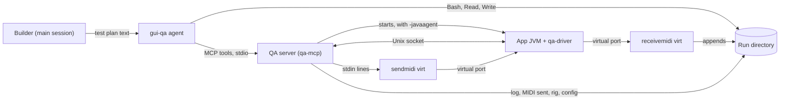

# GUI QA agent design

- **Date:** 2026-10-26
- **Based on commit:** `6d41684f`
- **Issue:** #397. Related: #99, #383, #393.
- **Status:** approved.
- **Inputs:** [`2026-10-22-gui-qa-research.md`](2026-10-22-gui-qa-research.md), which holds the rationale, the spikes and
  the alternatives; [`docs/research/mcp.md`](../../docs/research/mcp.md), for the MCP library; and the
  [in-process guide](2026-10-22-gui-qa-in-process-guide.md), whose throwaway driver is a starting point. Where this
  design disagrees with them, it takes precedence: notably, the module groups are named `ai` and `testbench`, and #397
  comes before #393 instead of after it. The [decision log](#decision-log) says who took each decision.

Packages abbreviate `org.calinburloiu.music.microtonalist` as `…`.

## Intent

#99 gives JavaFX views no unit tests and adds no automated end-to-end (E2E) GUI tests: views hold no logic, and E2E
suites are flaky. That leaves untested the wiring between views and view models, the application wiring and its thread
hops, the layout, and the loop from a GUI action to the MIDI output and from MIDI input back to the GUI. So a feature
that changes the GUI gets a manual E2E test before its PR, from a written test plan.

A QA subagent runs that plan against the fat JAR as a black box. A QA MCP server in Scala starts the app with an
in-process driver, headless by default, drives the GUI through the driver, and moves MIDI in and out through virtual
ports. A human can run the same plan by hand.

## Goals

- A `gui-qa` skill and a `gui-qa` agent that test a GUI change from its test plan before the PR.
- Test plans in user terms, which both the agent and a human tester can run.
- The agent's GUI access confined to the one app process that the QA server started, and its MIDI confined to the
  run's virtual ports.
- No macOS permission for a headless run; only Screen Recording for OS screenshots on the desktop platform.
- An `mcp` module, in the `ai` group, that every MCP server of the project shares.
- Ready before #393, whose JavaFX app is its first real use.

## Non-goals

- Gating CI, an automated E2E suite, TestFX.
- Driving `FileChooser` and `DirectoryChooser` (replaced through `Instrumentation` in the research), and drag and drop.
  The GUI has neither yet; until a feature adds them, they are `human` checks, and that feature adds the driver
  support.
- Peekaboo, the IAC buses, operating systems other than macOS.
- The app's own MCP server over HTTP, and `mcp-http`.
- Testing the real JavaFX app: it doesn't exist until #393.

## Anti-goals

The work fails, even if everything runs, if:

- the server lets the agent reach another process's GUI, a real MIDI instrument, or a command line of its choice;
- the decoder shares code or logic with the tuners' encoders, so that a bug in both cancels out;
- test code ships in the production JAR;
- the agent reads the diff or the sources, and so confirms what the builder meant instead of testing what a user sees;
- an agent that passes every scenario can't be told apart from one that can't detect a failure.

## Constraints

- macOS only, like the rest of the agent setup. JDK 25, Scala 3, the coding, test and documentation conventions, TDD,
  and 80% statements and branches for the new modules.
- `sendmidi` and `receivemidi` ([gbevin](https://github.com/gbevin/SendMIDI)) are required, installed from their
  releases' `.pkg`. They are GPLv3, run as external programs, never linked or shipped.
- OpenJFX 26.0.2, pinned: the headless platform is experimental, selected by the undocumented
  `-Dglass.platform=Headless`.
- The MCP Java SDK 2.1.0, `mcp-core` and `mcp-json-jackson2`, with the Jackson pin of
  [`mcp.md`](../../docs/research/mcp.md#dependencies).
- CI runs on Ubuntu, without `sendmidi` and `receivemidi`.
- Another clone, such as `microtonalist2`, may run a QA run, a dev stack or a build at the same time. Nothing kills a
  process by name.

## Context

At `6d41684f`:

- The GUI is Swing: `TuningListFrame`. The build has no JavaFX; slice 8 of #383, #393, ports the GUI to it.
- `MicrotonalistApp` takes `<composition URL or path> [<config path>]`. A composition finds its rig in
  `<composition>.tracks` next to it, or through its `tracksUrl`.
- `sbtn assembly` writes `app/app/target-bsp/scala-<version>/microtonalist-app.jar`; `<version>` is in
  `project/scala-version`.
- play-json 3.0.6 brings Jackson 2.14.3; `jacksonVersion` is in `project/Dependencies.scala`.
- Skill scripts are Python, with `unittest` tests in `scripts/tests/`; CI runs only `architecture-docs`'s.
- `.claude/agents/` doesn't exist. `.mcp.json` registers Metals and `scoverage-inspector`.
- The #383 design plans an ad hoc QA subagent for slice 8, driven by the guide, and a retrospective for #397.

## Overview



| Module | Group | Package | Is |
| ------ | ----- | ------- | -- |
| `mcp` | `ai` | `…ai.mcp` | The only module that depends on the MCP SDK: the JSON mapper and the tool helper |
| `qa-driver` | `testbench` | `…testbench.driver` | The Java agent that reads and drives the app's JavaFX scene graph |
| `qa-mcp` | `testbench` | `…testbench.qa` | The QA MCP server: the run, the MIDI ports, the app's process, the driver's tools |

All three are in `root`'s aggregate. `app` depends on none of them.

## 1. The `mcp` module

As [`mcp.md`](../../docs/research/mcp.md#the-mcp-module) describes it, in the `ai` group:

- the `ObjectMapper`, with play-json's `PlayJsonMapperModule`, and its `McpJsonMapper`;
- the helper that builds a `SyncToolSpecification` from an input `Reads`, an output `OWrites`, an input schema written
  as a `JsObject`, and a function, turning a failure into a result with `isError` set;
- a form of the helper for tools that return images: one or more PNGs as `ImageContent`, with a JSON result beside
  them. The QA server's snapshot and OS screenshot tools use it.

Its tests build the SDK's own `CallToolRequest` and call the handler the helper built, so that a breaking SDK release
fails them. The Jackson pin follows the SDK's Jackson, for every Jackson artifact, across the whole build: the app's
Jackson moves from 2.14.3 to the SDK's 2.21, which the format modules' tests check, rather than one build mixing two
Jackson versions.

## 2. The `qa-driver` module

A Java agent, loaded with `-javaagent` on the QA command line only. Its `premain` starts a daemon thread, which waits
until the app has started JavaFX and shown a window, then serves the server's requests one at a time, each on the
JavaFX Application Thread, with a timeout.

- **Build.** A plain JAR with `Premain-Class` in its manifest, holding only its own classes. It compiles against
  JavaFX (`javafx-base`, `javafx-graphics`, `javafx-controls`, with the host's classifier) and play-json as
  `Provided`, and at run time uses the JavaFX, the Scala 3 library and the play-json of the app's JAR. #397 adds the
  OpenJFX version to `project/Dependencies.scala`, and #393 reuses it.
- **Link to the server.** A Unix domain socket in the run directory, whose path the server passes as the agent's
  argument. The messages and who listens are the builder's call.
- **Input.** On the headless platform, the JavaFX `Robot`, which injects through Glass's input path. On the desktop
  platform, where the `Robot` is OS-level, `Event.fireEvent` on the node that the driver picks under the point, so
  that macOS sees nothing and needs no grant.
- **Idle.** Every input waits until the Application Thread has drained, twice to let a pulse pass, before it answers;
  a snapshot waits too, so it doesn't catch an animation midway.

### Selectors

A selector is a string. Among the visible nodes, the driver looks for those whose `accessibleText` equals it; if none,
those whose `id` equals it; if none, those whose visible text equals it: a `Labeled`'s text, such as a button, a label
or a list cell. It acts on the single match and says which of the three matched, so that the report can quote it.
Several matches of the first kind that matches are an error that lists them, and so is no match. A selector can be
scoped to one window.

This rests on a view convention for #99: every control without visible text sets `accessibleText`, which also serves
screen-reader users. See [Changes to #99, #383 and #393](#5-changes-to-99-383-and-393).

### What it does

| Request | Does |
| ------- | ---- |
| Windows | Lists the windows, `Window.getWindows()`: type, title, position, size, focus. A menu, a tooltip or a dialog is a window of its own. |
| Dump | The scene graph of every window, or of one: the controls, the nodes with an `id` and the canvases, each with its type, `id`, text, value, `accessibleText`, and whether it is selected, focused, disabled or truncated. Invisible nodes and empty cells are skipped. |
| Snapshot | A PNG of a window, with the popups it owns pasted over it at their offsets, or of a node; at scale 1 by default. |
| Click | Primary or secondary, single or double, on a selector. |
| Key | A JavaFX `KeyCode` name, or a combination such as `Shortcut+N`. |
| Type | Text into the focused control. |
| Idle | Waits for the Application Thread. |
| Clipboard | Reads or writes the JavaFX clipboard's text: in memory when headless, the macOS pasteboard on the desktop. |

The guide's `QaDriver.java` shows the dump, the truncation check, the snapshot and the `Robot` input that the spike ran.

### Tests

Unit tests against a stand-in scene in the test sources, on the headless platform, in a forked JVM, since JavaFX can
start only once per JVM and sbt's JVM is the long-lived BSP server.

The plan's first driver task checks that the headless platform starts in a forked test JVM on CI's Ubuntu runner. If it
doesn't, the driver's tests and its coverage check move to a CI job of their own on a macOS runner, and the Ubuntu
`build` job leaves `qa-driver` out.

## 3. The `qa-mcp` module

A stdio MCP server on the `mcp` module. Its log goes to standard error, through a Logback configuration of its own,
since standard output carries the protocol.

### The run

- **Fixed at startup:** the app's JAR, the driver's JAR, and the base directory of the runs, `$TMPDIR/microtonalist-qa/`.
  No tool chooses a JAR, a JVM option or a command line. By default the JARs are the ones `sbtn assembly` builds; how
  the builder points the server at a stand-in for #397's own acceptance run is the builder's call.
- **Run directory:** `<base>/<run>/`, created when the server starts, one per server and so one per agent. `<run>` is
  short and unique, since it goes into the port names, e.g. `qa-3f9c`. A tool reports it, and the agent copies the
  fixtures or writes its own composition there.
- **Paths:** every path a tool takes must be inside the run directory.

### Starting the app

`start_app` takes the composition's path, the platform, `headless` (the default) or `desktop`, and the QA devices to
leave unplugged at startup. It:

1. finds the rig: `<composition>.tracks` next to it, or a `tracksUrl` that names a file in the run directory, and
   refuses any other;
2. rewrites the rig in place with play-json, as a JSON tree, so that it depends on no plugin format and passes the
   rest through unchanged, an invalid rig included. Each `midiDeviceId` named `qa:<device>` becomes
   `{ "name": "CoreMIDI4J - <run>-<device>", "vendor": "<Unknown Manufacturer>" }`. A name that an earlier start of the
   same run wrote counts as a QA device;
3. refuses a rig that names any device other than a QA device, plugged in or not, so that the app can't tune a real
   instrument, even one plugged in during the run. A scenario that needs a device missing at startup leaves a QA
   device unplugged instead, and plugs it in later with `replug`;
4. opens the ports of every QA device but those left unplugged: a device used as a track's input gets
   `sendmidi virt <run>-<device> --`, one used as an output gets `receivemidi virt <run>-<device> ts nn`, appending to
   `midi-out-<device>.txt`, and one used as both gets both, under one name;
5. writes `qa.conf`, with `core.libraryBaseUrl` set to the run directory, so that `~/.microtonalist/` is never read;
6. runs `java -Dglass.platform=Headless -javaagent:<driver JAR>=<socket> -jar <app JAR> <composition> qa.conf`,
   without the property on the desktop platform, its output going to `app.log`;
7. answers once the driver has connected and the app has shown a window, with the app's PID, the devices and the
   files; or, if the app dies first, with an error pointing at `app.log`.

The skill's fixture rig, which the agent copies:

```json
{
  "tracks": [
    {
      "id": "qa",
      "name": "QA",
      "input": { "midiDeviceId": { "name": "qa:keys" } },
      "tuningChangers": ["pedal"],
      "tuner": "mtsOctave1ByteNonRealTime",
      "output": { "midiDeviceId": { "name": "qa:synth" } }
    }
  ]
}
```

### Tools

The names and schemas are the builder's call; these are the tools:

| Tool | Does |
| ---- | ---- |
| `get_run` | The run directory and the run's ID |
| `start_app`, `stop_app` | Start the app as above; stop it, then its MIDI tools. `stop_app` sends `SIGTERM`, waits for the app's shutdown, which takes about a second, then kills it. |
| `send_midi` | Writes SendMIDI command lines to a device's `sendmidi`, and appends each, with the time sent, to `midi-in-<device>.txt`. It rejects `dev`, `virt`, `file`, `syf`, `mpp`, `hex` and `dec`, and their long forms, and checks every token against an allowlist of SendMIDI's commands and parameter shapes, each parameter where its command takes one, so that no token can name a program file. |
| `unplug`, `replug` | Stop and restart both tools of a device, like pulling and plugging its cable. The output keeps going to the same file. |
| `list_windows`, `dump`, `snapshot`, `click`, `press_key`, `type_text`, `wait_idle`, `read_clipboard`, `write_clipboard` | The driver's requests. `snapshot` returns the PNG inline and saves it in the run directory. |
| `os_screenshot` | Desktop platform only: one PNG per window of the app, inline, from `screencapture -x -o -l <window ID>`. |

The app's log and the MIDI files are files, not tools: the agent reads them with its own tools.

### Boundary and cleanup

- The GUI tools reach only the app this server started. No tool attaches to another process.
- The server stops the app and the MIDI tools when the agent finishes, i.e. when its standard input closes, and in a
  JVM shutdown hook. It stops only the processes it started, by their handles, never by name. What happens to the
  processes of a server that was killed is the builder's call.

### OS screenshots

The window IDs come from `CGWindowListCopyWindowInfo`, filtered by the app's PID, called from JXA
(`osascript -l JavaScript`), which needs nothing installed. It is untested: the plan spikes it first, and falls back to
a short Python script on `pyobjc`. Without the Screen Recording grant, the tool says so instead of returning a blank
image.

### Tests

Unit tests for the run, the rig rewrite, the refusals and `send_midi`'s validation, with the processes behind an
interface that the tests fake. An integration test drives the server over stdio, writing JSON-RPC lines to a pipe, as
[`mcp.md`](../../docs/research/mcp.md#testing) describes. No test needs `sendmidi`, `receivemidi` or a display; the
acceptance run covers the real tools. Whether a test also runs the server against the driver in a child JVM is the
builder's call.

## 4. The skill and the agent

### The `gui-qa` skill

`.claude/skills/gui-qa/`, in files of the builder's choosing:

- **For the builder:** when to write a test plan; the procedure of a run: build the JARs with `sbtn assembly`, ask the
  user before a desktop run since a window shows on screen, record `git status --porcelain` and `git diff`, dispatch
  the agent with the plan's text, compare git's state afterwards, write the report, and triage the bugs: a bug in
  view-model logic gets a failing test first, a wiring bug in a view gets fixed and its scenario rerun.
- **For the agent:** the procedure and the rules of [The `gui-qa` agent](#the-gui-qa-agent); the SendMIDI conventions,
  every line starting with `ch <n>` and hex numbers written with an `H` suffix, e.g. `raw 90H 3CH 00H`; the pedal
  tuning changer's defaults, CC 67 (soft pedal) for the previous tuning and CC 66 (sostenuto) for the next; reading
  the output by line count, `wc -l` before acting and `tail -n +<N>` after; the layouts that the tuners send: MTS
  octave 1-byte and 2-byte, non-real-time and real-time, MPE with its pitch bend ranges, and monophonic pitch bend,
  RPNs being read from their CC lines; the versions of `sendmidi` and `receivemidi` known to work, and their quirks.
- **`test-plan-template.md`.**
- **Fixtures:** `qa.mtlist`, the guide's composition with three tunings on C and inline scales, and
  `qa.mtlist.tracks`, the rig above. No config: the server writes it.
- **The decoder,** a Python script on the standard library, that annotates ReceiveMIDI's lines: each MTS message with
  the cents of each pitch class, each pitch bend with its cents for a given range. It is written from the MIDI
  specification, not ported from the tuners. Its `unittest` tests run in CI, like `architecture-docs`'s.

### Test plan

- **File:** `issues/<NNNNN>-<slug>/<date>-test-plan.md`, dated and tied to a commit.
- **When:** after the design is approved and before the implementation plan, from the design's acceptance criteria.
  The implementation plan's last task runs QA against it.
- **Audience:** the agent and human testers. Steps in user terms; expected results that both can observe: what the
  window shows, what the instrument receives in cents per pitch class, a log without errors. No tool commands.
- **Contents:** the scope and what is out of it; the fixtures, the skill's or feature-specific ones next to the plan;
  scenarios in Given/When/Then, each with an ID and a priority, `must` or `should`; `human` checks, which the agent
  reports as not run; a time-boxed list of areas to explore.

```markdown
### TP-03 The pedal changes the selected tuning (must)

Given the QA composition is open with "C Just Major" selected
When the input receives Sostenuto pressed, then released
Then the tuning list selects "C Romanian Minor"
And the output receives one MTS message: C 0, D +4, E♭ +16, F♯ −17, G +2, A +6, B♭ −4 cents, other keys 0
And the log has no ERROR
```

### QA report

- **File:** `issues/<NNNNN>-<slug>/<date>-qa-report.md`, one per run, with the commit tested, whether the working tree
  was dirty, and the platform. The test plan stays unchanged between runs, and the PR links the latest report.
- **Contents:** a result per scenario, `pass`, `fail`, `flaky` (failed, then passed when retried) or `not run`; each
  bug with minimal steps to reproduce it; what the exploration found; the MIDI, log and dump lines quoted as evidence.
  Snapshots stay in the run directory.

### The `gui-qa` agent

`.claude/agents/gui-qa.md`:

- **Model:** `opus`, at `high` effort.
- **Tools:** Bash, Read, Write, and the QA server's tools. `mcpServers:` defines the server inline, so the main
  session doesn't get its tools; it runs `bin/mtlist-qa-mcp`, a launcher that finds the server's JAR from the repo's
  root. Whether the agent preloads the skill through its frontmatter is the builder's call, once checked against
  Claude Code's agent format.
- **Input:** the test plan's text, never the diff.
- **Procedure:** check that the server's tools are there; start the app; run each scenario, acting then checking the
  GUI, the MIDI output and the log, and retrying a failure once; explore the listed areas; stop the app; return the
  report.
- **Rules,** in its prompt:
  - Change no code, and write only in the run directory.
  - Read nothing outside the repo and the temp directories. In the repo, read no source, diff or git history.
  - Never kill a process by name; stop the app through the server.
  - Send MIDI through the server only, never with `sendmidi dev`.
  - If the server's tools are missing, stop and report, rather than start the app another way. An inline server loads
    only once the folder is trusted.

### Workflow and docs

- **`CLAUDE.md`, coding workflow:** "For a change that affects the GUI, write a test plan; see the `gui-qa` skill."
- **`CLAUDE.md`, final checks:** "Manual E2E, for GUI changes only: dispatch the `gui-qa` agent with the test plan."
- **`docs/development/gui-qa.md`,** for human testers: the one-time setup, the MIDI tools included, and running a test
  plan by hand on the desktop platform, with ports opened by hand and the decoder. How a human turns the fixture's
  `qa:` names into real port names is the builder's call.
- **Architecture docs,** through the `architecture-docs` skill: `module-overview.md`, the `ai` and `testbench` group
  READMEs and `CLAUDE.md`s, and an `ARCHITECTURE.md` per module.

## 5. Changes to #99, #383 and #393

#397 now comes before #393, which becomes its first real use:

- **The #383 design**, [`2026-10-20-design.md`](../00383-arch-threading-and-ui/2026-10-20-design.md):
  - *Manual GUI test:* slice 8 writes its test plan with the `gui-qa` skill and runs the `gui-qa` agent, instead of an
    ad hoc subagent driven by the guide. It still writes the retrospective in `issues/00397-gui-qa-agent/`, as the
    skill's first real use, for follow-up improvements.
  - *Delivery:* slice 8's "passes the QA sub-agent's test plan" becomes "passes the `gui-qa` agent's run of its test
    plan"; the follow-up "#397: a QA skill for the GUI, built on slice 8's retrospective" becomes improvements to the
    `gui-qa` skill from that retrospective.
  - *MVVM:* every control without visible text sets `accessibleText`.
  - *Decision log:* a row each for #397 coming first and for the `accessibleText` rule, taken by the user.
- **#393's issue** says the same as the *Manual GUI test* above.
- **#99's issue** adds the `accessibleText` rule to its decisions.
- **#397's issue** drops "Planned after #99", and its deliverables name the `ai` and `testbench` groups.
- **The research's** *Ports of a rig* and *Open questions* point to this design.

## 6. Acceptance

#397 is done when:

- the new modules meet 80% statements and branches, the full suite and `sbtn lint` pass, and the docs above are
  written;
- the builder has run the agent against a throwaway JavaFX stand-in, our app or not, kept out of the repo, with a
  throwaway test plan from the template. The run:
  - goes through every tool of the server, on the headless and on the desktop platform;
  - sends and receives MIDI through the rewritten rig, the output including MTS messages for the decoder, and unplugs
    and replugs a device;
  - targets controls by `accessibleText`, by `id` and by visible text, and uses a context menu, a dialog, typing and
    the clipboard;
  - catches a bug planted in the stand-in, reported as `fail` with steps to reproduce it;
  - leaves `git status` and `git diff` unchanged.

## Left to the builder

- The driver's protocol, and where its message types live, as long as `qa-mcp` loads no JavaFX.
- The tools' exact names and schemas, the dump's format, the run ID's format.
- How the server is pointed at a stand-in.
- The skill's file layout, and whether the agent preloads it.
- What happens to the processes of a killed server.

## Risks

- The headless platform is experimental: an OpenJFX upgrade may break the driver.
- Only stand-ins have been driven in process. The real app on the headless platform, with Pekko and CoreMIDI4J, is
  first tried by #393.
- JavaFX's headless platform in a forked test JVM on CI's Ubuntu runner is untested; the fallback is a macOS job.
- The desktop platform's input, with the driver picking the node, is untested beyond the spike's stand-in.
- The `.pkg` versions of `sendmidi` and `receivemidi` are untested, and the versions tested have quirks; see the
  research's *MIDI verification*.
- The SDK's major releases break its tool API; the `mcp` module keeps an upgrade out of the tools.
- Claude Code may read agent definitions only at startup, and loads an inline MCP server only in a trusted folder.

## Decision log

| Decision | Taken by |
| -------- | -------- |
| A QA subagent tests the fat JAR from a test plan, outside CI | user, in the research |
| One mode, in process, headless by default, desktop for OS screenshots; Peekaboo dropped | user, in the research |
| Virtual ports that the QA server opens with `sendmidi` and `receivemidi`; IAC buses dropped | user, in the research |
| The official MCP Java SDK, through one shared module | user, in `mcp.md` |
| The agent has Bash, Read and Write, under rules in its prompt | user, in the research |
| The agent's rig names `qa:<device>`, which the server rewrites in the run directory | proposed by Claude, agreed by the user |
| The server refuses every device that isn't a QA device; a scenario leaves a QA device unplugged instead | proposed by Claude, agreed by the user |
| A macOS CI job for the driver's tests, should the headless platform fail on Ubuntu | proposed by Claude, agreed by the user |
| The `ai` group, holding `mcp` | user |
| The `testbench` group, holding `qa-mcp` and `qa-driver` | proposed by Claude |
| Every control without visible text sets `accessibleText`; selectors try `accessibleText`, then `id`, then visible text | user |
| #397 before #393; #393 uses it and still writes the retrospective | user |
| Acceptance on a throwaway JavaFX stand-in | user |
| A bug planted in the stand-in, which the agent must catch | Claude |
| `FileChooser` and drag and drop out of scope until the GUI has them | Claude |
| Window IDs through JXA, spiked first, `pyobjc` as the fallback | Claude |
| The driver in Scala, on the app JAR's JavaFX, Scala and play-json, over a Unix socket | Claude |
| A selector with several matches is an error | Claude |
| The run directory under `$TMPDIR`, every tool path inside it, and the config written by the server | Claude |
| OpenJFX added to the build by #397 | Claude |
| The Jackson pin across the whole build, the app included | Claude |
| The decoder's tests in CI | Claude |
| The packages `…ai.mcp`, `…testbench.driver` and `…testbench.qa`, and the launcher `bin/mtlist-qa-mcp` | Claude |
