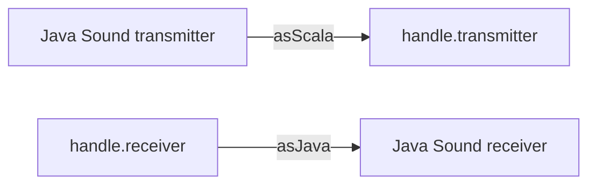

# `sc-midi-javamidi` module architecture

## Responsibility

`sc-midi-javamidi` implements the device traits of [`sc-midi`](../../sc-midi/docs/ARCHITECTURE.md) over Java Sound
(`javax.sound.midi`). Only the composition roots, `app` and `cli`, depend on it: they construct a `JavaMidiManager` and
pass it on as a `MidiManager`, so the rest of the application sees only `sc-midi`'s traits and its `MidiMsg` model.

On macOS, devices come from CoreMIDI4J, which replaces Java Sound's default MIDI device provider; no other module
depends on CoreMIDI4J. The JDK provides Java Sound to every module, so keeping it here is a review matter, not a build
rule.

## Key types

- **`JavaMidiManager`** — the Java Sound `MidiManager`. Java Sound exposes a device working in both directions as two
  devices sharing a `MidiDeviceId`, so the manager accepts only the `Input` and `Output` directions, keeping a registry
  of live handles for each, which it reconciles with the devices found on every refresh. It publishes its `MidiEvent`s
  through the `MidiEventPublisher` it is given.
- **`JavaMidiDeviceHandle`** — the Java Sound `MidiDeviceHandle` for one direction of a device, and the one place
  where messages cross between `MidiMsg` and Java Sound.
- **`JavaMidiDeviceReferenceCounter`** — opens and closes the devices of all the handles of a manager, since Java
  Sound's `MidiDevice.close()` closes a device however many times it was opened.
- **`JavaMidiConverters`** — `asScala` and `asJava` between `MidiMsg` and Java Sound's `MidiMessage`. Only `Midi1Msg`
  has `asJava`, Java Sound speaking MIDI 1.0 only.
- **`JavaMidiEnvironment`** — the devices present, and the changes to them, as the manager sees them.
  `CoreMidi4JEnvironment` is the production one; the tests run the manager over a fake, without MIDI hardware.

## Message path

A handle drops a `Midi2Msg` sent to it, since a Java Sound device speaks MIDI 1.0 only.

## Threading

`JavaMidiManager` serialises its operations under its locks, whose order its ScalaDoc gives, and publishes the events
they collect only after releasing them, synchronously on the calling thread. For a platform change, that is
CoreMIDI4J's notification thread.

## Subject to change

- Two identical devices plugged in at once share a `MidiDeviceId`, so only the one resolved last gets a handle (#306).
- A vanished device is noticed only once CoreMIDI4J reports it, and a handle whose device failed to open stays unusable
  until the tracks are rebuilt (#302).
