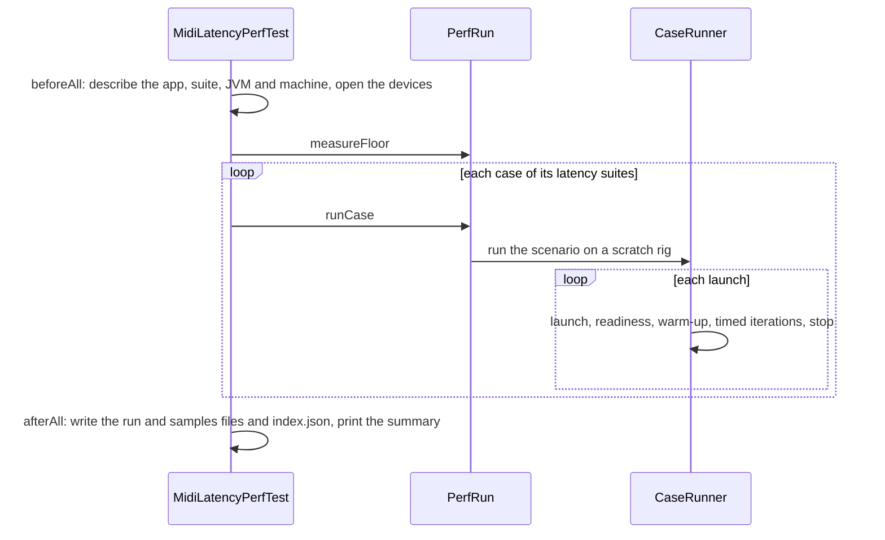

# `perf-midi-latency` module architecture

## Responsibility

`perf-midi-latency` measures the app's MIDI latency end to end. It treats the app as a black box, which lets it
measure the JAR of any commit: it launches `java -jar <jar> <composition> <app config>` in a process of its own, sends
MIDI to the app's input device and timestamps what arrives from its output device with `System.nanoTime`.

The latency cases are Scala code in the module's tests, in `cases`, where a ScalaTest suite runs them. The main code is
the infrastructure: it runs the cases, computes the statistics of each metric and writes a run file to the module's
`results/`, which the report in `report/` reads. It knows nothing about tuners: a case's tracks template picks the tuner
and the tuning changer, and its expected messages encode their output.

Besides the code, the module holds:

- `results/` — a run file per run, `<machine id>/<UTC start time>-<app version>-<short commit>.json`, and `index.json`,
  which lists the runs; they are committed to track the latency across versions. The last run of each machine also
  keeps its raw samples beside its run file, in a `.samples.json` file that git ignores.
- `report/` — a single page, `index.html`, that explores the results, and `test.html`, which tests its statistics in
  the browser. It needs no build step, only a static file server: `report-server/` holds the one that
  `bin/mtlist-perf-midi-latency serve` runs.

The cases run only when a JAR is given (`-Djar=<path>`) and are canceled otherwise, so that the normal test suite and
coverage never launch the app nor need MIDI devices. How to run them:
[`docs/development/performance-tests.md`](../../../docs/development/performance-tests.md).

## Key types

The model of a case, which [`case-model.md`](case-model.md) explains:

- **`PerfCase`** — a case: the resources of its rig, a tracks template and a composition, and its **`Scenario`**: when
  the launched app is ready (**`Readiness`**), the **`Step`**s of an iteration, which the suite repeats, and the
  **`Metric`**s. A step sends **`InputSeries`** of messages, then waits for **`OutputSeries`** of **`Expected`**
  messages, exact ones or patterns. A metric measures from a marked input series to a marked output series.
- **`PerfDsl`** — the language the cases are written in.

Running:

- **`PerfRun`** — a run: the floor, then each case on a **`ScratchRig`**, whose tracks template gets the configured
  devices.
- **`CaseRunner`** — measures a scenario over several launches of the app, and fails it at the first iteration whose
  output isn't the expected one; **`StepMatcher`** matches the messages received during a step to its output series.
- **`MidiPath`** — the two ends of the measured path; **`DeviceMidiPath`** opens them on MIDI devices through
  `sc-midi`. **`ReceiveBuffer`** timestamps what arrives.
- **`AppLauncher`** / **`JarAppLauncher`** and **`ProcessApp`** — launch and stop the app, which is killed too if the
  suite's JVM exits first; **`RunningApp`** is a launch.
- **`Pacer`** — paces the measured step of the iterations on a scheduler; **`Traffic`** counts the messages of an
  iteration, which set the warm-up's pace.

Describing a run:

- **`JarBuildInfo`** and **`AppBuild`** — the app's version, Scala version and commit, read from the JAR's `BuildInfo`
  in a class loader of its own; an older JAR's commit comes from `-Dcommit`.
- **`GitRepo`**, **`JvmInfo`**, **`MachineProbe`** — the suite's own commit, the JDK, and the machine. Only macOS has a
  probe, **`MacMachineProbe`**, which identifies the machine by the hash of its hardware UUID.

Results:

- **`MetricResult`** — a metric's statistics over all launches and over each, from **`SampleStatistics`**
  (nearest-rank percentiles) and **`LogHistogram`** (1%-wide bins), and its raw samples.
- **`RunResult`** and **`JsonRunResultFormat`** — a run file and its JSON format, which leaves out the raw samples;
  **`JsonRunSamplesFormat`** writes them. **`ResultsStore`** writes both and updates `index.json`; **`SummaryTable`** is what
  a run prints.
- **`PerfConfig`** and **`RunParameters`** — the configuration, `midi-latency-config.json` with the git-ignored
  `midi-latency-config.local.json` over it, and the parameters of one run, from ScalaTest's config map.

In the tests, **`MidiLatencyPerfTest`** runs the latency suites, a **`LatencySuite`** each, in one run, whose
composition root is **`LatencySession`**: a suite per tuner, such as **`MtsTunerLatencyTest`**, holds its cases.

## Flows

A run, from ScalaTest's point of view:

The floor is the setup's own latency: the suite sends on the app's input device and receives the same message back from
it, which a loopback device like an IAC bus does, with no app running, once. It tells whether the setup behaves as in
other runs, not how much of a case's latency is the setup's, since a case's path crosses both devices and the app. It
always runs the configured warm-up, whatever the run's own, which warms the suite's code up before the first case.

A launch waits until the app is ready, e.g. by sending a probe until its expected output comes back, and drains what the
app sent while starting; a second probe then finds the app settled, e.g. once its first tuning reached its tracks. Then
come the warm-up and the timed iterations, which run the scenario's steps in order; the measured step starts on a pace,
which in the warm-up keeps each device under the configured maximum rate of messages, since macOS's IAC Driver mutes a
bus that carries too many (see the guide). A metric's sample is its output series' receive time minus its input
series' send time. A missing, extra or different message fails the case with the expected and received messages; the
run goes on with the next case and records the failure.

## Threading

The MIDI receive callback runs on CoreMIDI4J's thread: `ReceiveBuffer` takes the time and queues the message, nothing
else. The test thread sends, polls the queue, matches and records the samples into arrays allocated per case, without
logging. `Pacer` releases its ticks from a scheduler thread of its own. The module's tests run in a forked JVM, away
from the sbt server's load.

## Subject to change

- Each case has one set of resources, which suits `a8ba00df` and later; when a format changes, such as the tracks file
  renamed by #365, the cases will pick their resources by the app's version.
- Only macOS has a machine probe.
