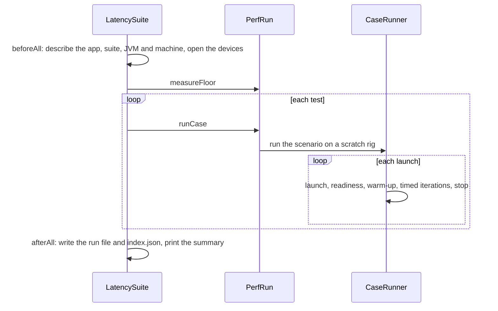

# `perf` module architecture

## Responsibility

`perf` measures the app's MIDI latency end to end. It treats the app as a black box, which lets it measure the JAR of
any commit: it launches `java -jar <jar> <composition> <app config>` in a process of its own, sends MIDI to the app's
input device and timestamps what arrives from its output device with `System.nanoTime`.

The latency cases are Scala code in the module's tests, in `cases`, where a ScalaTest suite runs them. The main code is
the infrastructure: it runs the cases, computes the statistics of each metric and writes a run file to the group's
`results/`, which the report in `report/` reads (see the [group's README](../../README.md)). It knows nothing about
tuners: a case's tracks template picks the tuner and the tuning changer, and its expected messages encode their output.

The cases run only when a JAR is given (`-Djar=<path>`) and are canceled otherwise, so that the normal test suite and
coverage never launch the app nor need MIDI devices. How to run them:
[`docs/development/performance-tests.md`](../../../docs/development/performance-tests.md).

## Key types

The model of a case:

- **`PerfCase`** — a case: the resources of its rig, a tracks template and a composition, and its **`Scenario`**: when
  the launched app is ready (**`Readiness`**), the **`Step`**s of an iteration and the **`Metric`**s. A step sends
  **`InputSeries`** of messages and waits for **`OutputSeries`** of **`Expected`** messages, exact ones or patterns. A
  metric names a marked input series and a marked output series.
- **`PerfDsl`** — the language the cases are written in.

Running:

- **`PerfRun`** — a run: the floor, then each case on a **`ScratchRig`**, whose tracks template gets the configured
  devices.
- **`CaseRunner`** — measures a scenario over several launches of the app, and fails it at the first iteration whose
  output isn't the expected one; **`StepMatcher`** matches the messages received during a step to its output series.
- **`MidiPath`** — the two ends of the measured path; **`DeviceMidiPath`** opens them on MIDI devices through
  `sc-midi`. **`ReceiveBuffer`** timestamps what arrives.
- **`AppLauncher`** / **`JarAppLauncher`** and **`ProcessApp`** — launch and stop the app, which is killed too if the
  suite's JVM exits first; **`RunningApp`** is a launch.
- **`Pacer`** — paces the measured step of the iterations on a scheduler.

Describing a run:

- **`JarBuildInfo`** and **`AppBuild`** — the app's version, Scala version and commit, read from the JAR's `BuildInfo`
  in a class loader of its own; an older JAR's commit comes from `-Dcommit`.
- **`GitRepo`**, **`JvmInfo`**, **`MachineProbe`** — the suite's own commit, the JDK, and the machine. Only macOS has a
  probe, **`MacMachineProbe`**, which identifies the machine by the hash of its hardware UUID.

Results:

- **`MetricResult`** — a metric's statistics over all launches and over each, from **`SampleStatistics`**
  (nearest-rank percentiles) and **`LogHistogram`** (1%-wide bins).
- **`RunResult`** and **`RunResultJson`** — a run file and its JSON format; **`ResultsStore`** writes it and updates
  `index.json`; **`SummaryTable`** is what a run prints.
- **`PerfConfig`** and **`RunParameters`** — the configuration, `perf.json` with the git-ignored `perf.local.json` over
  it, and the parameters of one run, from ScalaTest's config map.

In the tests, **`LatencySuite`** is the composition root of a run, and **`MidiLatencyPerfTest`** holds the cases.

## Flows

A run, from ScalaTest's point of view:

The floor is the setup's own latency: the suite sends on the app's input device and receives the same message back from
it, which a loopback device like an IAC bus does, with no app running. The loopback cases do the same with the messages
of the tuners' flows, such as an MTS SysEx or a Pitch Bend and a Note On, so that each case through the app has a
baseline; they run once, as there is no app to launch again.

A launch waits until the app is ready, e.g. by sending a probe until its expected output comes back, and drains what the
app sent while starting; a second probe then finds the app settled, e.g. once its first tuning reached its tracks. Each
iteration runs the scenario's steps in order: a step sends its input series back to back, taking the time before each
series' first message, then waits until its output series are complete, taking the time each one's last message arrived.
In each iteration, the measured step, the first that sends a metric's input series, starts on a pace: that of the
warm-up keeps the traffic of each IAC bus under the rate at which macOS mutes it (see the guide), and that of the timed
iterations spaces the samples. A metric's sample is its output series' receive time minus its input series' send time. A
missing, extra or different message fails the case with the expected and received messages; the run goes on with the
next case and records the failure.

## Threading

The MIDI receive callback runs on CoreMIDI4J's thread: `ReceiveBuffer` takes the time and queues the message, nothing
else. The test thread sends, polls the queue, matches and records the samples into arrays allocated per case, without
logging. `Pacer` releases its ticks from a scheduler thread of its own. The module's tests run in a forked JVM, away from
the sbt server's load.

## Subject to change

- Each case has one set of resources, which suits `a8ba00df` and later; when a format changes, such as the tracks file
  renamed by #365, the cases will pick their resources by the app's version.
- Only macOS has a machine probe.
