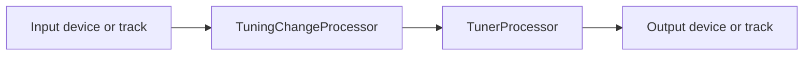
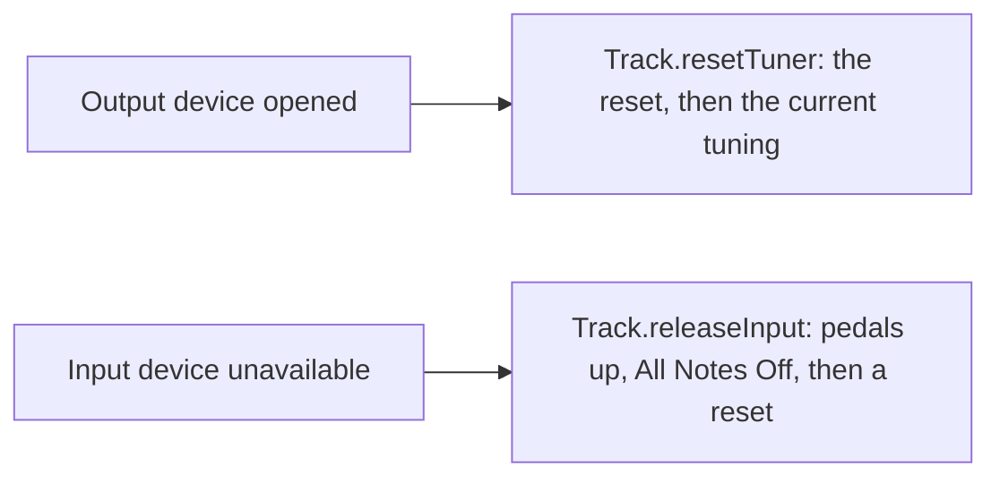

# `rig` module architecture

## Responsibility

`rig` runs the *rig*: the setup of tracks a performer plays. A *track* is a per-instrument pipeline that routes MIDI
from an input to an output while its tuning changers detect tuning-change triggers and the tuning engine of
[`tuner`](../../../tuner/tuner/docs/ARCHITECTURE.md) applies the current tuning. The module holds the runtime state of
the rig, behind a thread-safe service.

It doesn't read or write the tracks files that store rigs: the `RigRepo` trait lives here, and
[`rig-format`](../../rig-format/docs/ARCHITECTURE.md) implements it.

## Key types

`TrackInputSpec` and `TrackOutputSpec` are plugins, which `rig-format` (de)serializes by their `familyName` and
`typeName`.

**Tracks.** A `Track` is one instrument pipeline built from a `TrackSpec`, whose `TrackInputSpec` and
`TrackOutputSpec` each name a device or another track. A `RigSpec` is the ordered list of a rig's `TrackSpec`s.
`RigManager` builds and replaces the tracks, wires the links between them, and reacts to tuning and device events.

**Processors.** They are the stages of a track. `TuningChangeProcessor` asks the track's
[tuning changers](../../../tuner/tuning-changer/docs/ARCHITECTURE.md) in order, the first effective decision winning,
and calls `TuningService.changeTuning`. `TunerProcessor` wraps a `Tuner`: it sends the tuner's reset to every receiver
attached to its transmitter and, as a courtesy, restores 12-EDO on every receiver detached from it.

**Session and service.** `RigSession` loads the `RigSpec` through a `RigRepo` and edits it. It runs on the business
thread and publishes `RigEvent`s, behind the thread-safe `RigService`. `RigModule` wires them around the
`MidiManager` that `app` gives it and the `TuningService` of `tuner`.

## Track pipeline

Either processor is optional. The output device's receiver is attached when the track is built, so the tuner's reset
reaches it at once; `RigManager` attaches the downstream tracks afterwards. The channel of an input or output spec is
meant to filter the input or remap the output, but no track applies it yet (#97).

## Tuning-change flow

```mermaid
flowchart LR
  trigger["Trigger, e.g. a pedal"] --> tcp[TuningChangeProcessor] --> service["TuningService.changeTuning"]
  service -->|business thread| session[TuningSession] -->|TuningIndexUpdatedEvent| manager[RigManager]
  manager --> tune["Track.tune, for every track"] --> tuner["Tuner.tune"] --> out["Output device"]
```

`TuningService`, `TuningSession` and `Tuner` are in `tuner`. Loading a composition sets the session's tunings, and
their `TuningsUpdatedEvent` makes `RigManager` retune every track the same way.

## Device changes

- Only the tracks wired straight to the device react.
- A device available when its track is built needs no event: attaching it already sends the reset.
- `RigManager` forgets the old tracks before building new ones, so that an event never reaches a closed track.

## Threading

`RigSession` and `RigManager` are `@NotThreadSafe` and run on the business thread (see
[`businessync`](../../../base/businessync/docs/ARCHITECTURE.md)); other threads go through `RigService`. The
processors, and the tuners and tuning changers they hold, are `@NotThreadSafe` too: MIDI messages run through them on
the input device's callback thread, and `tune` and `reset` come from the business thread; #121 will give each track a
thread of its own.

Today, wrongly, `RigManager` handles a `MidiEvent`, and so resets the tracks a device change concerns, on the thread
publishing the event; #90 will move it to the business thread.

## Subject to change

- `Track` doesn't run on a thread of its own yet (#121).
- Events are subscribed to with Guava's `@Subscribe`, and device events are handled on the publishing thread (#90).
- A link declared from both of its ends is wired twice (#296).
- A track fed by another track loses the messages that arrive before the link is wired (#298).
- The courtesy 12-EDO messages make 12-EDO the tuner's current tuning, and attaching and detaching will drive the
  device requests (#305; see
  [`midi-device-lifecycle.md`](../../../docs/architecture/midi-device-lifecycle.md#subject-to-change-305)).
- A track fed by another track isn't released or reset when the feeding track's input device goes away (#316).
