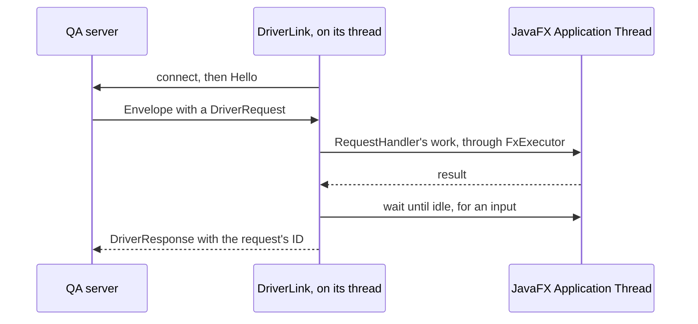

# `qa-driver` module architecture

## Responsibility

`qa-driver` is a Java agent that the [QA server](../../qa-mcp/docs/ARCHITECTURE.md) loads into the app's JVM with
`-javaagent`, on the QA command line only. It answers the server's requests: it lists the app's windows, dumps their
scene graphs, takes snapshots, injects clicks, keys and text, and reads or writes the clipboard. It knows nothing of the
app's code, only JavaFX's, so it tests the app as a black box.

Its JAR holds only its own classes: it compiles against JavaFX and play-json as `Provided`, and at run time uses those
of the app's JAR, and its Scala library. It runs on either JavaFX platform: the headless one, which
`-Dglass.platform=Headless` selects and which shows no window, or the desktop one.

## Key types

The link to the server:

- **`QaDriverAgent`** — the `premain`, which starts the `DriverLink` on a daemon thread and returns, so that the app
  starts. On an app without JavaFX, it says so in the app's log and aborts the JVM, so that the server reports at
  once that the app exited.
- **`DriverLink`** — waits until the app shows a window, connects to the Unix domain socket that the server listens on,
  in the run directory, and answers the requests one at a time until the socket closes.
- **`Protocol`**, in the `protocol` package that the server shares — one JSON object per line: the driver's `Hello`,
  with its PID and `GuiPlatform`, then an `Envelope`, a `DriverRequest` with an ID, and the `DriverResponse` that
  carries it.
- **`RequestHandler`** — carries out a request on the JavaFX Application Thread, through `FxExecutor`, which runs code
  there with a timeout.

Reading the GUI:

- **`SceneReader`** — the windows, a menu, a tooltip or a dialog being a window of its own, and the dump of their
  visible nodes.
- **`Selectors`** — resolves a selector to the single visible node whose `accessibleText` equals it, else its `id`,
  else its visible text, and says which matched. It rests on the view convention that every control without visible
  text sets `accessibleText`.
- **`Snapshots`** — a PNG of a node, or of a window with the popups it owns pasted over it.

Driving it:

- **`Input`** — injects clicks, keys (`KeyChord`, e.g. `Shortcut+N`) and text. `RobotInput`, on the headless
  platform, uses JavaFX's `Robot`, which injects through Glass's input path like a user. Two workarounds of the
  headless `Robot` keep it as a user's mouse:
  - Its release reports the button as still down, which leaves the clicked node pressed, so `RobotInput` clears the
    pressed state after a click, through reflection.
  - It sends the release to the window under the pointer: a context menu that the press opened takes it, and a list's
    row, which selects on the release, isn't selected. So when the node's window saw the press but not the release,
    `RobotInput` fires the release and the click in that window itself.

  On the desktop platform the `Robot` is OS-level, so `EventInput` fires JavaFX events instead, at the node that
  `Picker` picks under the point, in the window shown last that holds it; macOS sees nothing and needs no grant.

## Flows

A request:

An input, and a snapshot before it is taken, wait until the Application Thread has drained, twice so that a pulse
passes: the next request sees the input's effect, and a snapshot doesn't catch an animation midway.

## Threading

The link's daemon thread reads and writes the socket; everything that touches JavaFX runs on the Application Thread.
`Input` queues its events rather than run them, so that a handler that blocks in a modal dialog's `showAndWait` doesn't
block the driver. `RobotInput` queues each key press and release on its own, since its `Robot` keeps a key down until
its release: the dialog's nested event loop then runs the releases, as a user would let go of the keys.

The tests run against a stand-in scene, on the headless platform, in a forked JVM, since JavaFX starts only once per JVM
and sbt's own JVM is the long-lived BSP server.

## Subject to change

- The driver reads JavaFX only, and the app's GUI is Swing until #393 ports it to JavaFX: until then it can drive only
  a JavaFX stand-in.
