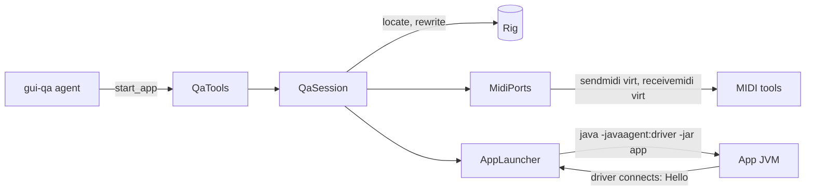

# `qa-mcp` module architecture

## Responsibility

`qa-mcp` is the QA MCP server, which the `gui-qa` agent of Claude Code starts over stdio through `bin/mtlist-qa-mcp`.
It owns one QA run: a run directory, which every path a tool takes must lie in; the app, which it starts from its fat
JAR with the [QA driver](../../qa-driver/docs/ARCHITECTURE.md) as its Java agent; and the app's virtual MIDI ports,
which SendMIDI and ReceiveMIDI open. Its tools pass the agent's GUI requests to the driver, send MIDI to the app, and
unplug or replug its devices. The agent reads the app's log and the MIDI that the app sent as files of the run
directory, with its own tools.

It is a boundary: the app can reach only the run's virtual ports, the tools only the app that the server started, and
the server stops only the processes it started, through their handles, or, for a killed server's, by their recorded
PIDs checked by start instant, never by name. The JARs are fixed when the server starts: no tool chooses a JAR, a JVM
option or a command line. Its tools are built with [`mcp`](../../../ai/mcp/docs/ARCHITECTURE.md)'s helpers.

## Key types

The server:

- **`QaMcpMain`** — the entry point: creates the run, stops the processes of servers that were killed, and runs the
  server until its standard input ends, then stops what it started, killing an app that ignores `SIGTERM`; a shutdown
  hook only sends `SIGTERM`.
- **`QaMcpServer`**, **`QaTools`** — the SDK's server and its tools; each tool calls the `QaService` and logs the call
  in the run's `tools.log`.
- **`StdoutGuard`** — keeps stray output off the standard output, which carries the protocol; the server logs to
  standard error.

The run:

- **`QaRun`** — the run directory, `$TMPDIR/microtonalist-qa/<run>/`, whose short unique ID, e.g. `qa-3f9c`, also
  names its MIDI ports.
- **`QaService`**, **`QaSession`** — the contract that the tools call, and its implementation, which starts and stops
  the app and its ports. Thread-safe.
- **`RigLocator`**, **`RigRewriter`** — find the composition's rig in the run directory, and rewrite it as a JSON tree
  so that each QA device, `qa:<device>`, becomes the run's virtual port. They refuse a rig that names any other device,
  so that the app can't tune a real instrument.

The processes:

- **`AppLauncher`**, **`RunningApp`**, **`DriverClient`** — write the app's `qa.conf`, start the app with the driver,
  and talk to the driver over a Unix domain socket in the run directory, one request at a time.
- **`MidiPorts`** — a `sendmidi virt` per input device, which gets the lines that `SendMidiLines` allows, and a
  `receivemidi virt` per output device, which records in `midi-out-<device>.txt`.
- **`ProcessLauncher`** — starts the external processes; the tests fake it. **`ProcessRecords`** records each one's PID
  and start instant, so that a later server stops the processes of a killed one, killing those that ignore `SIGTERM`,
  and never a process that reuses the PID.
- **`OsScreenshots`** — on the desktop platform, a PNG of each window of the app, from macOS's `screencapture`.

## Flows

Starting the app:

`start_app` locates and rewrites the rig, opens the ports of the QA devices that aren't left unplugged, writes
`qa.conf`, which keeps the app from reading `~/.microtonalist/`, and starts the app, its output going to `app.log`. It
answers once the driver has connected and the app has shown a window, or, if the app exits first, with an error that
points at `app.log`. Then each GUI tool is a `DriverRequest` sent through the `DriverClient`.

The unit tests fake the processes, and an integration test drives the server over stdio through pipes: no test needs
SendMIDI, ReceiveMIDI or a display.
