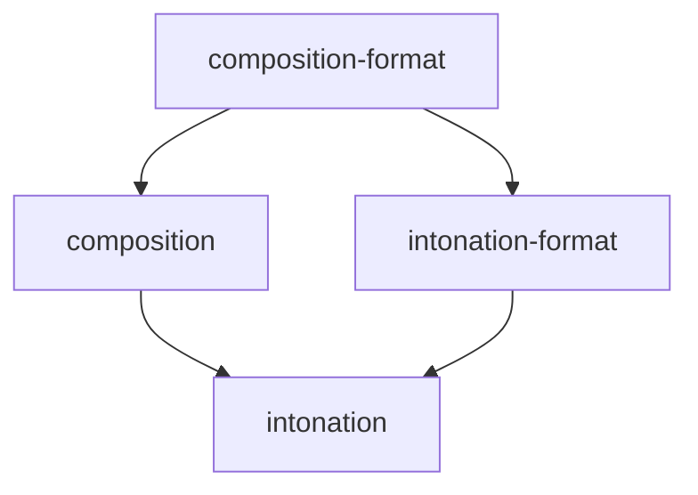

# `theory` module group

Music theory: interval math and the composition model that turns scales into tunings, both pure domain logic, and their
formats.

| Module | Description | Root package |
| ------ | ----------- | ------------ |
| [`intonation`](intonation/docs/ARCHITECTURE.md) | Intervals, scales and intonation standards: the math of microtonal pitch | `org.calinburloiu.music.intonation` |
| [`intonation-format`](intonation-format/docs/ARCHITECTURE.md) | The formats of scales, Microtonalist's JSON (`.jscl`) and Scala's `.scl`, and the repositories that read them | `org.calinburloiu.music.intonation.format` |
| [`composition`](composition/docs/ARCHITECTURE.md) | A composition, resolved into a `TuningList` by the `TuningMapper` and `TuningReducer` plugins | `org.calinburloiu.music.microtonalist.composition` |
| [`composition-format`](composition-format/docs/ARCHITECTURE.md) | The JSON format of compositions (`.mtlist`) and of their plugins, and the repositories that read them | `org.calinburloiu.music.microtonalist.composition.format` |

The dependencies between the modules, leaving out those that others imply:

