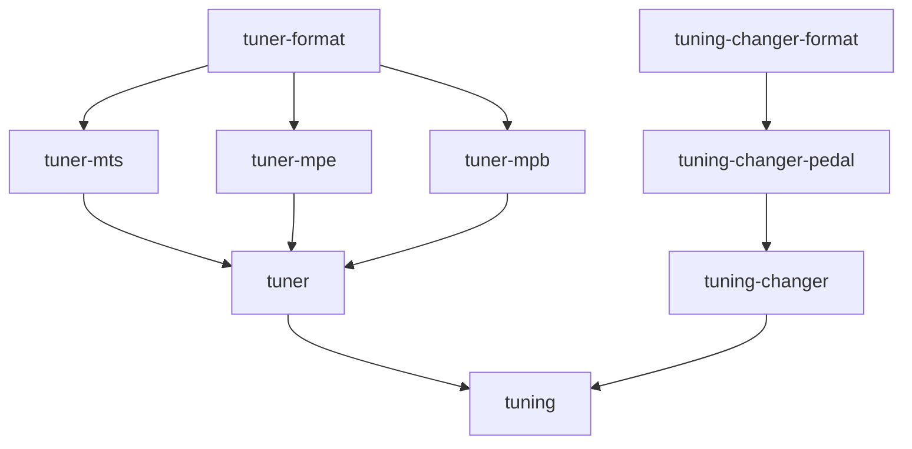

# `tuner` module group

Real-time tuning: turns a tuning into the MIDI messages an instrument needs to play it.

| Module | Description | Root package |
| ------ | ----------- | ------------ |
| [`tuner`](tuner/docs/ARCHITECTURE.md) | The tuning engine: the contract of the `Tuner` plugins, and the tuning session behind a thread-safe service | `org.calinburloiu.music.microtonalist.tuner` |
| [`tuner-mts`](tuner-mts/docs/ARCHITECTURE.md) | The MIDI Tuning Standard (MTS) tuners, which retune the instrument's pitch table with an MTS Octave SysEx message | `org.calinburloiu.music.microtonalist.tuner.mts` |
| [`tuner-mpe`](tuner-mpe/docs/ARCHITECTURE.md) | The MPE tuner, which tunes polyphonically by bending the pitch of a Member Channel per note | `org.calinburloiu.music.microtonalist.tuner.mpe` |
| [`tuner-mpb`](tuner-mpb/docs/ARCHITECTURE.md) | The Monophonic Pitch Bend tuner, which tunes one note at a time with Pitch Bend | `org.calinburloiu.music.microtonalist.tuner.mpb` |
| [`tuner-format`](tuner-format/docs/ARCHITECTURE.md) | The JSON format of the `Tuner` plugin family and of each tuner | `org.calinburloiu.music.microtonalist.tuner.format` |
| [`tuning-changer`](tuning-changer/docs/ARCHITECTURE.md) | The contract of the `TuningChanger` plugins, which find in a track's MIDI messages when to change the tuning | `org.calinburloiu.music.microtonalist.tuner.changer` |
| [`tuning-changer-pedal`](tuning-changer-pedal/docs/ARCHITECTURE.md) | The pedal tuning changer, which changes the tuning when a pedal is pressed | `org.calinburloiu.music.microtonalist.tuner.changer.pedal` |
| [`tuning-changer-format`](tuning-changer-format/docs/ARCHITECTURE.md) | The JSON format of the `TuningChanger` plugin family and of each tuning changer | `org.calinburloiu.music.microtonalist.tuner.changer.format` |
| [`tuning`](tuning/docs/ARCHITECTURE.md) | The `Tuning` and `TuningChange` values that the tuning engine shares with its clients | `org.calinburloiu.music.microtonalist.tuner` |

`tuning` and `tuner` share their root package: `tuning` holds `Tuning`, the `TuningChange` ADT and
`DefaultCentsTolerance`, and `tuner` the rest.

`tuner-format` and `tuning-changer-format` also hold the format of each plugin of their family, in a `format`
subpackage of the plugin's package, e.g. `org.calinburloiu.music.microtonalist.tuner.mpe.format`.

The dependencies between the modules, leaving out those that others imply:

