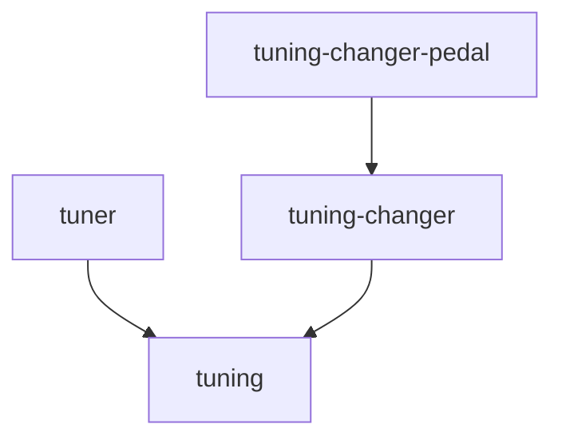

# `tuner` module group

Real-time tuning: turns a tuning into the MIDI messages an instrument needs to play it.

| Module | Description | Root package |
| ------ | ----------- | ------------ |
| [`tuner`](tuner/docs/ARCHITECTURE.md) | The tuning engine: the `Tuner` plugins, and the tuning session behind a thread-safe service | `org.calinburloiu.music.microtonalist.tuner` |
| [`tuning`](tuning/docs/ARCHITECTURE.md) | The `Tuning` and `TuningChange` values that the tuning engine shares with its clients | `org.calinburloiu.music.microtonalist.tuner` |
| [`tuning-changer`](tuning-changer/docs/ARCHITECTURE.md) | The contract of the `TuningChanger` plugins, which find in a track's MIDI messages when to change the tuning | `org.calinburloiu.music.microtonalist.tuner.changer` |
| [`tuning-changer-pedal`](tuning-changer-pedal/docs/ARCHITECTURE.md) | The pedal tuning changer, which changes the tuning when a pedal is pressed | `org.calinburloiu.music.microtonalist.tuner.changer.pedal` |

`tuning` and `tuner` share their root package: `tuning` holds `Tuning`, the `TuningChange` ADT and
`DefaultCentsTolerance`, and `tuner` the rest.

The dependencies between the modules, leaving out those that others imply:

